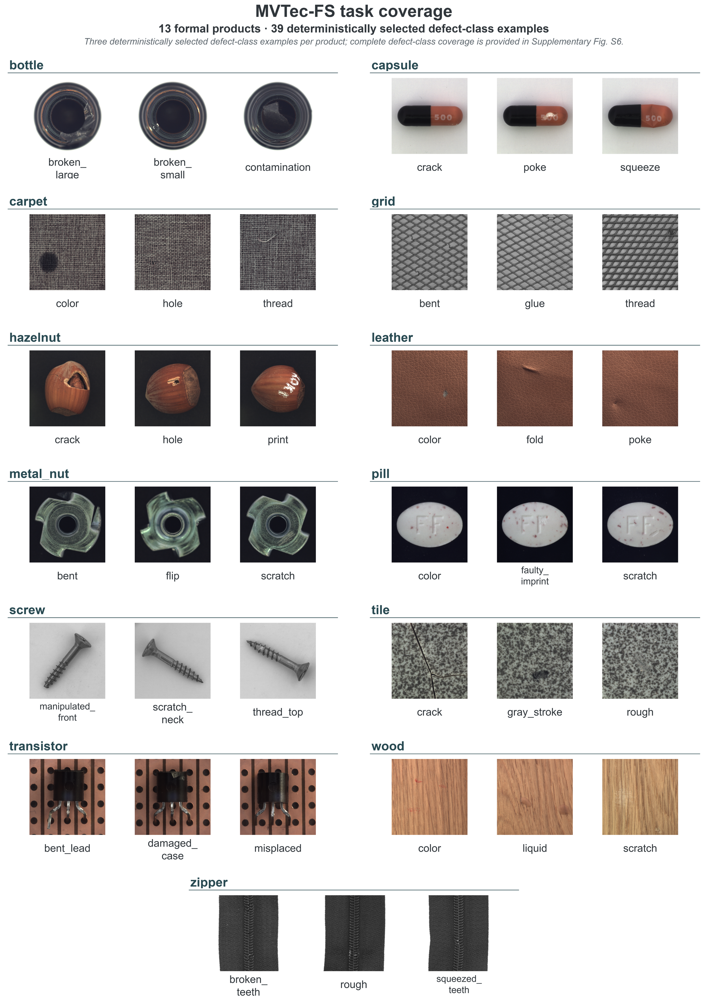
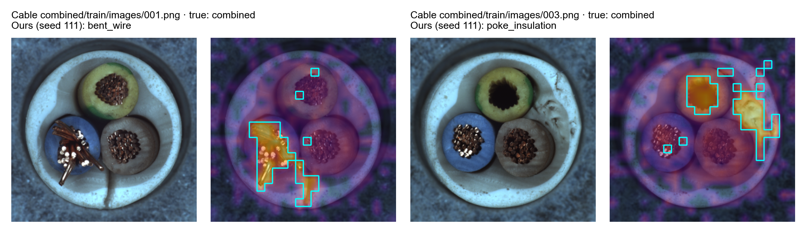
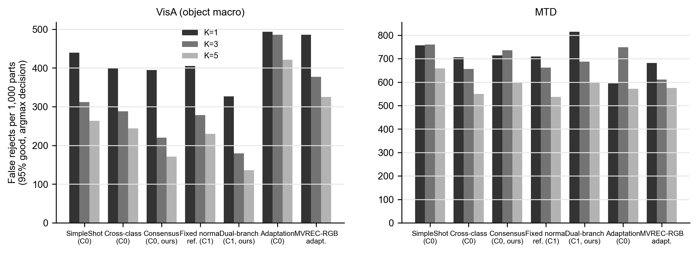
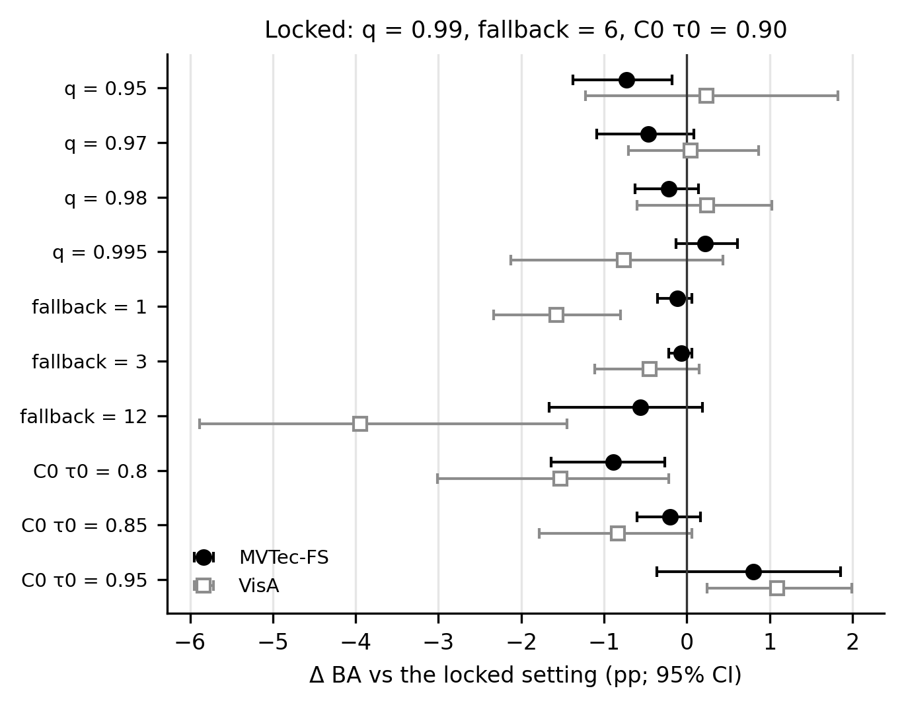
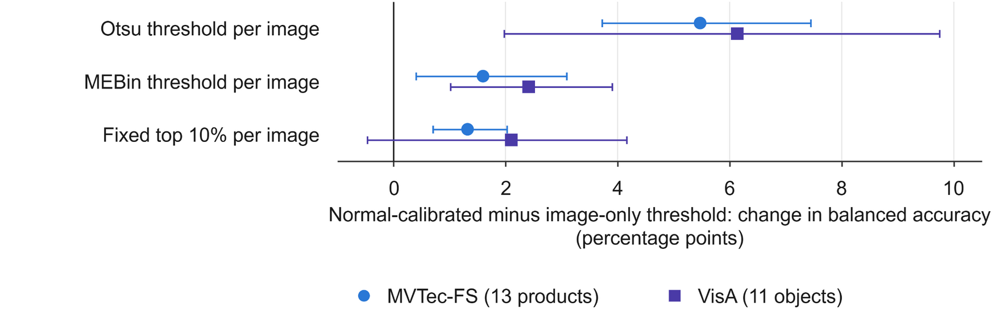
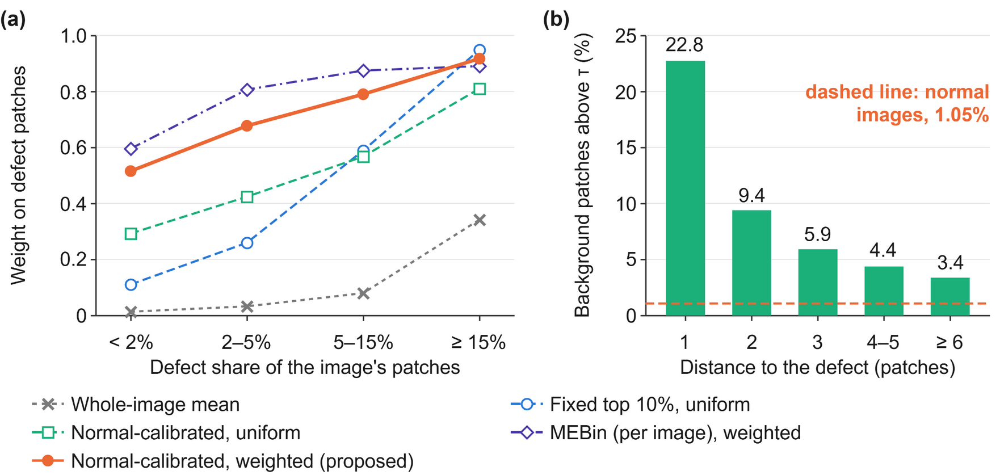
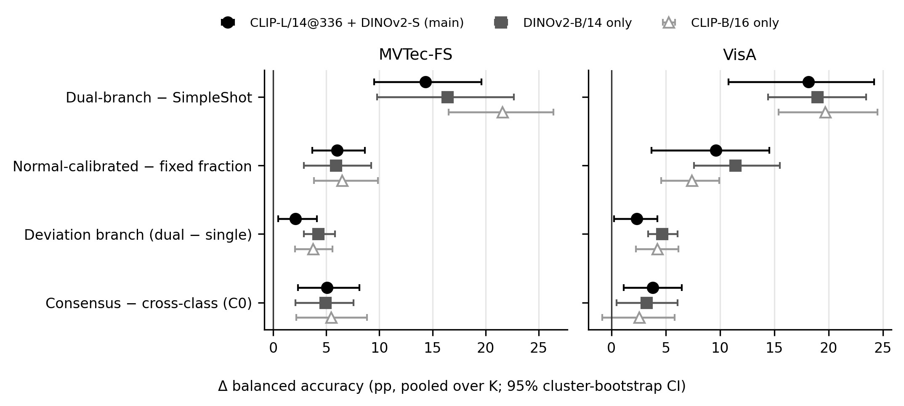
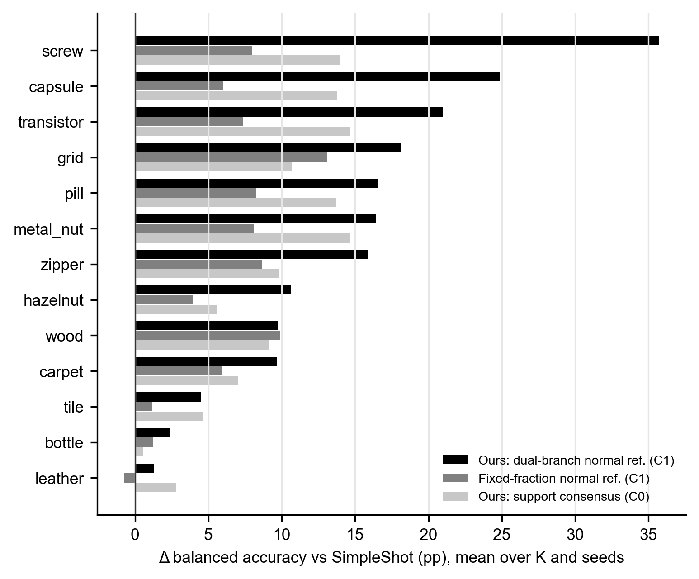

# Supplementary Material

**Normal-Referenced Few-Shot Defect Classification and Calibrated Conformity Decisions for Industrial Inspection**

> - All numbers are read directly from the result files.
> - Method names follow the main text: fixed-ratio normal reference, calibrated soft region (appearance stream only), dual-stream method (proposed), cross-class contrast and consensus background.
> - Numbers in square brackets refer to the reference list of the main text.
> - Run identifiers (P6.B, P10, …, P48) are the labels of the pre-specified evaluation rounds; each has its own protocol file and result files (Section S2).

## Contents

| Section | Content |
|---|---|
| Notation | Supplementary Table S0: symbols |
| S1 | MVTec-FS-RGB task coverage |
| S2 | Evaluation rounds, run records and disclosure of deviations |
| S3 | Implementation details of the compared methods |
| S4 | Development-set results: all variants of every round |
| S5 | Sensitivity: CLIP layer × ratio grid, number of conforming images, text priors |
| S6 | Cable: cross-validation on the development pool and the same-source held-out set |
| S7 | VisA / MTD: per-object results |
| S8 | Computational cost and deployment |
| S9 | Engineering lineage and reproduction |
| S10 | Industrial metrics and false-reject control in direct classification |
| S11 | Patch-level calibration tests and robustness |
| S12 | Evidence purity, adapted baselines and backbone changes |
| S13 | Real-IAD one-time blind test |
| S14 | Per-product gains and summary of statistical tests |
| S15 | Per-image error decomposition of the remaining gap |
| S16 | Complete calculations of the uncertainty evaluation |

## Notation

**Supplementary Table S0 Symbols used in the main text (equation numbers refer to the main text)**

| Symbol | Meaning |
|---|---|
| $\mathcal{Y} = \{c_1, \ldots, c_C\}$, $C$ | Label space of one product and its number of classes (with or without the nominal class) |
| $K$ | Labeled support images per class |
| $\mathcal{S}$ | Support set, $CK$ labeled images (equation (1)) |
| $\mathcal{M}$, $M$ | Pool of unannotated conforming images that forms the nominal bank, and its size ($M = 20$) |
| $N$ | Size of the separate calibration set of conforming parts ($N = 100$) |
| $\mathcal{C}_0$, $\mathcal{C}_1$ | Information settings: support set only; support set plus $\mathcal{M}$ (Section 3.3) |
| $\theta_0$, $\theta_{\mathcal{S}}$, $\mathcal{A}$, $f$ | Frozen backbone, task state, offline construction operator, inference function (equation (2)) |
| $x$, $x_{*}$, $\hat{y}_{*}$ | Image; query image; predicted class of the query |
| $g(x)$ | Global fused feature (CLIP and DINOv2-S, $\ell_2$-normalized) |
| $\mu$, $p_c$ | Support mean and class prototype of SimpleShot (equation (4)) |
| $G_c(x_{*})$, $\mathrm{SS}_c[h]$ | Global SimpleShot score; the same score computed on a descriptor $h$ (equation (5)) |
| $t$, $L$ | Patch token (layer-18 CLIP feature) and number of tokens per image ($L = 576$) |
| $\mathcal{B}$, $\mathrm{nn}_{\mathcal{B}}(t)$ | Nominal bank (all patches of $\mathcal{M}$) and the nearest bank patch of $t$ |
| $a(t)$, $a_{-j}(t)$ | Patch anomaly score; its leave-one-out version for bank image $x_j$ (equations (6), (7)) |
| $q$, $Q_q$, $\tau$ | Quantile level ($q = 0.99$), empirical quantile, patch evidence cutoff (equation (7)) |
| $w(t)$ | Soft evidence weight, exceedance of $a(t)$ over $\tau$ (equation (8)) |
| $h_A$, $h_R$ | Appearance and deviation descriptors (equation (9)) |
| $z(\cdot)_c$ | Score standardized across the $C$ classes (equation (10)) |
| $s(x)$ | Whole-image anomaly score, mean of the six highest $a(t)$ |
| $\alpha$, $T_\alpha$, $k$ | Preset false-reject level, acceptance limit, order-statistic index $k = \lceil (N+1)(1-\alpha) \rceil$ |
| $\alpha_{\mathrm{lo}}$, $T_{1\%}$ | Acceptance level and rejection limit of the three-zone rule |
| $\lambda$ | Evidence purity: share of the pooling weight inside the ground-truth defect mask (evaluation only) |
| $R_c$, $P_c$, BA | Recall and precision of class $c$; balanced accuracy (equation (3)) |
| $u$, $u_c$, $U_{95}$ | Standard, combined and expanded (95 %) uncertainty |

## S1 MVTec-FS-RGB task coverage

**Supplementary Table S1.1 Products, defect classes and query images of the formal evaluation** (queries are fixed across all methods, seeds and K; support images are drawn deterministically by seed from the support pool of each class)

| Product | Defect classes (formal queries) | Classes | Queries |
|---|---|---|---|
| bottle | broken_large (10), broken_small (11), contamination (10) | 3 | 31 |
| capsule | crack (11), faulty_imprint (11), poke (10), scratch (11), squeeze (10) | 5 | 53 |
| carpet | color (9), cut (8), hole (8), metal_contamination (8), thread (9) | 5 | 42 |
| grid | bent (5), broken (5), glue (5), metal_contamination (5), thread (5) | 5 | 25 |
| hazelnut | crack (9), cut (8), hole (9), print (8) | 4 | 34 |
| leather | color (9), cut (9), fold (8), glue (9), poke (9) | 5 | 44 |
| metal_nut | bent (12), color (11), flip (11), scratch (11) | 4 | 45 |
| pill | color (13), contamination (10), crack (14), faulty_imprint (9), pill_type (4), scratch (12) | 6 | 62 |
| screw | manipulated_front (12), scratch_head (12), scratch_neck (12), thread_side (11), thread_top (11) | 5 | 58 |
| tile | crack (8), glue_strip (9), gray_stroke (8), oil (9), rough (7) | 5 | 41 |
| transistor | bent_lead (5), cut_lead (5), damaged_case (5), misplaced (5) | 4 | 20 |
| wood | color (3), hole (7), liquid (5), scratch (10) | 4 | 25 |
| zipper | broken_teeth (8), fabric_border (8), fabric_interior (9), rough (8), split_teeth (9), squeezed_teeth (8) | 6 | 50 |
| Total | | 61 | 530 |

- Inclusion: of the 15 MVTec AD products, toothbrush has a single defect class and cannot form a multi-class task; cable was designated in advance as a separate development pool (S6). Neither enters the main grid, and neither exclusion depends on classification performance.
- Counting: the queries of each product are the same for every K and seed; BA is computed within each product and then averaged with equal weight over the 13 products.

## S2 Evaluation rounds, run records and disclosure of deviations

> This section is compiled from the authors' research ledger. Every round has a protocol file locked in advance (`docs/P*_PROTOCOL.md`), launch records written at run time and hashes of its result files. Every number can be traced to a result file under `ckpt/`.

### S2.1 Order of information use

The formal sets (the 530 MVTec-FS queries and the frozen VisA / MTD queries) were read several times, in sequence. Table S2-1 lists, in chronological order, which data each round read and what was decided; the development-set results of each round are given in Supplementary Material S4.

**Table S2-1 Data used and decisions taken in each round**

| Round | Type | Data read | Decision / result |
|---|---|---|---|
| P6.B | Pre-specified formal evaluation | MVTec-FS formal set | Original method (trainable support-side adapter) and controls; the adapted MVREC-RGB was run in this round (224 px) |
| Revision C | Post hoc analysis (existing features only) | Same (no new images read) | Training-free SimpleShot matches the original method; the original claim does not hold and the direction changes |
| P10 | Development screening → one formal run | Development set; then the formal set and VisA / MTD once each | Fixed-ratio normal reference (H1) and cross-class contrast (H3) confirmed |
| P11 | Same (added post hoc, disclosed) | Same | The normal-calibrated calibrated soft region (A) confirmed and becomes the main method |
| P12 | Threshold-source controls (report only) | Formal set, VisA | Normal calibration beats per-image Otsu, per-image MEBin and the fixed ratio |
| P13 | Development screening | Development set only | Dual-stream (ARR) and consensus background (CONS) pass the development gate |
| P14 | **Last formal selection, announced in advance** | Formal set, VisA / MTD once each | By the locked rule, ARR becomes the main C1 method and CONS the C0 method |
| P15 | Two-stage inspection analysis (decision layer, classification predictions unchanged) | VisA / MTD; the Cable same-source held-out set read once | Decision-layer metrics are computed only after the frozen predictions reproduce P14 bit for bit |
| P17 | Robustness analysis (report only, every cell reported) | Formal set, VisA / MTD; conformal tests on the development set | Flat region of the hyperparameters; patch-level false-selection rate agrees with the set level |
| P18 | Adapted baselines, backbone changes, evidence purity (report only) | Development-set selection → formal set, VisA / MTD once each | All choices locked after being made on the development set |
| P19 | **One-time blind test on a new dataset** | Real-IAD (never read before) | Run once after all methods were frozen; B1–B5 confirmed, B6 not confirmed |
| P21 | Strong baseline with official code (report only) | MVTec-FS formal set (cloud copy without query labels) | CLIP-LoRA with official default parameters; on a par with SimpleShot on the main features (a cross-backbone comparison; +12.80 when both use CLIP-B/16, see item 16); extension condition not triggered |
| P22 | Lightweight variants (development selection → formal set, report only) | Development set; formal set, VisA / MTD once each | DINOv2-S/336 single backbone: accuracy cost of 2.5–6 percentage points |
| P23 | Resolution control (report only) | MVTec-FS formal set | MVREC-RGB at 336 px shows no significant difference from 224 px |
| P24 | Matched control (report only) | MVTec-FS formal set | The proposed method with CLIP-B/16 at 224 px, for a comparison with CLIP-LoRA at the same backbone and resolution |
| P25 | Resolution control (report only, M1–M4 pre-specified) | MVTec-FS formal set (cloud copy without query labels) | CLIP-LoRA at 336 px (the only change is interpolation of the position embeddings) does not differ from 224 px; paired with the proposed CLIP-B/16@336 |
| P27 | Supplementary controls on the external datasets (report only) | VisA / MTD (same tasks, supports, nominal banks and queries as P10) | Liu residual averaging, logistic regression and the mask-pooled upper bound; the classifier-side diagnosis of Section 6.1 also holds on VisA / MTD (the mask-pooled upper bound is not comparable on tasks with a nominal class, see item 15) |
| P28 | Error decomposition (read-only analysis) | Saved per-image predictions of the MVTec-FS formal set | No model is run; 2 × 2 error tables of the dual-stream method and the mask-pooled upper bound (Supplementary Material S15) |
| P29 | Backbone control (report only, N1–N4 pre-specified) | MVTec-FS formal set (cloud copy without query labels) | CLIP-LoRA with ViT-L/14@336 (backbone changed only): +6.50 over B/16 and +6.78 over SimpleShot on the main features; with exactly the same backbone the proposed method still leads by +7.02 (all four Holm p = 0.011) |

After P14 no round changed the main method or its constants. From P15 onwards, every round first had to reproduce a set of existing results bit for bit with the same code (tolerance 10⁻⁹ to 10⁻¹²) before computing any new metric, and stopped otherwise. The reproduced results were:
- P15, P17, P18: P13 / P14, bit for bit;
- P22: the DINOv2-B results of P18, bit for bit;
- P23: the MVREC-RGB predictions of P6.B, one by one;
- P24: the CLIP-B/16 results of P18, bit for bit;
- P27: SimpleShot and the fixed-ratio normal reference of the external evaluation of P10, bit for bit;
- P28: first, the original metrics of the dual-stream method (P14) and the mask-pooled upper bound (P10), cell by cell from the saved per-image predictions (195 cells, largest difference 0).

### S2.2 Decision criteria

- A **pre-specified hypothesis** is confirmed only if both conditions hold:
  - the 95% confidence interval from 10,000 cluster-bootstrap resamples, with products (MVTec-FS) or objects (VisA, Real-IAD) as units, excludes 0;
  - in P19, in addition, the Holm-adjusted sign-flip test gives p < 0.05.
- Rounds marked "report only" make no confirm / reject decision; every cell is reported and none is selected.
- Post hoc analyses are marked as such wherever they appear in the main text.

### S2.3 Deviations and unexpected events (chronological)

1. **Revision C, amendment C2-A1.** Cross-GPU reproduction showed 12 label flips between near-ties, so the fidelity gate was redefined before any C2 metric was produced.
2. **P15, amendment P15-A1.** A hash check of the Cable same-source held-out set found one image twice (poke_insulation 004). After de-duplication under the amendment the set has 78 images (50 conforming, 28 defective) and was read once. These images and the support pool come from a re-split of the same MVTec AD cable test set; the main text calls it a "same-source held-out set", not an independent dataset.
3. **P17, setting reported but not adopted.** The C0 threshold τ₀ = 0.95 is slightly better than the locked 0.90 on all datasets. We keep 0.90 and report every value.
4. **P18, silent termination during stage N2.**
   - The first run of the MVTec-FS stage stopped silently during feature extraction: no error message, no exit code, no out-of-memory event. The execution environment most likely reclaimed the background task. The run produced no result file.
   - Without authorization, the executing agent deleted the leftover lock directory and the empty staging directory, against the rule "stop on failure, never delete locks", and then re-ran once.
   - The re-run agrees with P14 bit for bit; the conclusions are not affected.
5. **P19, data acquisition and interruption of the first run.**
   - The Real-IAD archive was downloaded in advance by the executing agent, outside the acquisition script. Its file size matches the official source.
   - The first run stopped silently after 27/30 objects, having neither written nor read any result. Under amendment P19-A1, per-object checkpoints were added and the run was restarted as an independent process, completing 30/30. Both launches are recorded.
   - After the blind results were available, cross-class contrast was clearly higher than consensus background, so we made a **post hoc** comparison: consensus background is −3.00 [−4.58, −1.39] below cross-class contrast. The main text therefore no longer claims that consensus background is the better C0 method.
6. **P21, CLIP-LoRA (cloud).**
   - The check step of the run script first stopped because it treated the `__pycache__` files that Python generates automatically as changes to the official code; after the fix, only version-controlled files are checked.
   - The run was first launched with 10 shards. After 7 minutes it was switched to 20 shards; the 4 combinations already finished were kept and every other combination was computed once.
   - During the run we looked at the 32/195 combinations already finished, as a plausibility check. The "control matched in backbone and resolution" added afterwards (P24) is therefore marked explicitly as "added after part of the results had been seen"; the pre-specified L1–L5 are unchanged.
   - The official data loader restarts its image-reading workers in every epoch and is therefore slow; to stay identical to the official code it was not modified.
   - In the end all 195/195 combinations finished (30 launch records over 10 + 20 shards), each passed a consistency check against the official evaluation function, and the SHA256 of the result archive is identical in the cloud and locally.

7. **P22, two code errors, both before any result was read.**
   - In the development stage all 13 products had finished and saved checkpoints, but the final aggregation called a function that needs the SimpleShot main-method row and failed. After the fix the run resumed and only the aggregation was redone.
   - The timing stage first did not accept the resume argument, and a network environment variable was left over in the execution environment; after the fix the timing was measured again in full.
   - The first chained launch of the formal stage failed because of a quoting error on the command line, so Python never ran; the stages were then launched separately.
8. **P23, weight source and training epochs.**
   - The domestic mirror of the Alpha-CLIP 336 px weights could not be resolved from the executing agent's network, so the Google Drive mirror listed in the official model zoo was used. The file hash is recorded.
   - The 336 px weights were trained for 4 epochs, the 224 px weights for 2. This is the only 336 px GRIT-20M version the authors released.
9. **P24, silent exit of the first launch.**
   - The process launched by the executing agent vanished during import, without a log and without creating a lock. The agent then created and deleted a few temporary files in the result directory while investigating; it touched no lock and no result.
   - A second launch from the local machine completed, and its results agree with P18 bit for bit. The cause of the silent exit was not found.
10. **P25, CLIP-LoRA at 336 px (cloud).**
   - The protocol was locked before any 336 px result existed. The only change from P21 is the interpolation of the position embeddings (14 × 14 → 21 × 21); a marker file binds the output directory to 336 px.
   - The run was first launched with 8 shards. After 3 combinations had finished it was switched to 11 shards; the 3 finished combinations were kept and every other combination was computed once. Locks and logs of the old shards are kept.
   - In the end all 195/195 combinations finished, each passed the consistency check against the official evaluation function, and every combination file is marked 336 px; the SHA256 of the result archive is the same in the cloud and locally (e0a24c23…). No 336 px result was looked at before scoring.
   - Check that the resolution took effect: in the same pipeline, the BA of zero-shot CLIP changes from 28.57 at 224 px to 30.82 at 336 px, and the computation per training step rises from 1,487 to 3,485 GFLOPs (FLOP count of P26), as expected for 336 px inputs.
11. **The VisA cell "soft weighting − hard fixed-ratio selection" of Table 3.** The VisA predictions of both methods come from the P12 threshold-control round (bit-identical with the earlier P10 / P11 results), but the scoring script of that round only computed "proposed threshold − each control". The cell was computed afterwards from the same predictions, with the same decomposition as on MVTec-FS, and no method was re-run: +7.53 [+3.91, +10.81] (10/11). On MTD the mean differences at the three K are +1.75 / +5.14 / +2.23.
12. **P27, first run failed the integrity check.**
   - The protocol was locked before any result existed. A review of the tables had found that Liu residual averaging, logistic regression and the mask-pooled upper bound had only been run on MVTec-FS. P27 adds these three rows on VisA / MTD, with methods, constants and frozen results unchanged; Real-IAD is read only once under the blind-test protocol and is not part of P27.
   - The first run extracted features in batches of 16, whereas the external evaluation of P10 used batches of 4. The batch size changed the last digits of the features, so the fixed-ratio normal reference predicted one query differently in 8 of 180 cells (largest difference 0.0091). The check failed and nothing was written; SimpleShot agreed exactly.
   - After amendment A1 fixed the batch size at 4, the re-run agreed with P10 bit for bit on both check methods and completed all 12 tasks. The locks and staging directory of the first run are kept as they were.
   - To locate the cause we read only the two check rows of the first run; no result of a new method was looked at.
   - Masks are used only for the mask-pooled upper bound. VisA masks take values {0, 1} and pixels above 0 count; MTD masks are 0 / 255 with compression noise and pixels of at least 128 count (4 MT_Uneven masks of MTD are empty under this rule and are pooled over the whole image, like conforming images).
13. **P26, deployment-cost timing on the RTX 4090: 4 items failed in the first run; the whole set was re-measured after the fix.**
   - The timing code was delivered as an offline archive (not via GitHub) and run inside the archive directory. In the first run all 6 items of the proposed method finished; the trainable support-side adapter and 3 CLIP-LoRA items exited 3–4 s after launch.
   - There were two causes, neither related to the methods. First, when the archive was built, git converted 494 text files to CRLF line endings according to the local setting, so the CLIP-LoRA run script found that the episode-file hashes did not match and refused to run. Second, the archive contains no git repository, so the provenance check of the adapter run script could not read the commit identifier.
   - Fix: these files were restored to versions byte-identical with those used in the local runs (the hashes of all 718 version-controlled files in the cloud were checked one by one). For the adapter, the timing wrapper passed the commit recorded in the archive (101f7087) to the provenance check and marked the run as diagnostic; training code, parameters and number of steps were not changed. No git repository and no commit were created in the cloud.
   - All 10 methods were then re-measured in one run (r2), and both passes succeeded. The results of the first run are kept as a record and were not merged. r2 was later replaced by a third complete measurement, r3 (item 18).
   - The packaging script now packs the original bytes and compares every file with the working tree while packing; it was used for the Jetson measurements.
14. **Descriptive contrasts computed during the revision (no method was run).**
   - Row (1) of Table 3 (normal-image centering − SimpleShot) was computed from the existing per-cell results of the P10 formal and external evaluations: MVTec-FS +2.24 [−0.67, +5.08], VisA +3.44 [+1.27, +5.21].
   - The per-image error decomposition of Supplementary Material S15 (P28) only reads saved per-image predictions; before decomposing, it reproduces the original metrics of both methods cell by cell (largest difference 0).
15. **The mask-pooled upper bound of P27 is not comparable on tasks with a nominal class (found and corrected on 2026-09-30).**
   - On VisA / MTD, P27 computed the upper bound by averaging conforming images over the whole image and defective images over the defect region only. The pooling itself reveals whether an image is defective, so the upper bound almost never errs on conforming images (VisA: 0 errors in 22,540 decisions on conforming images). The P27 protocol had expected "the nominal class is not affected by masks"; that expectation was wrong.
   - The problem surfaced during the per-image error decomposition (P28). The manuscript therefore dropped "mask pooling raises VisA by about 34 percentage points" and the share of the upper-bound gap recovered on VisA / MTD. The localization diagnosis now uses MVTec-FS and Real-IAD, which have no nominal class. The other results of P27 (Liu residual averaging, logistic regression) are not affected.
   - The external part of P28 only recomputes the upper bound and saves per-image predictions; it reproduces the metrics saved by P27 cell by cell (largest difference 0) and changes no method or existing result.
16. **Correction of the CLIP-LoRA comparison (found and corrected on 2026-09-30).**
   - The pre-specified "CLIP-LoRA − SimpleShot (main features)" of P21 and P25 (+0.48, +0.28) compares different backbones: CLIP-LoRA uses the official CLIP-B/16, SimpleShot the main features CLIP-L/14@336 + DINOv2-S. An earlier draft described this as "CLIP-LoRA on a par with SimpleShot" and used it to argue that improving the classifier gains little; that reading does not hold.
   - The P21 protocol listed "CLIP-LoRA − SimpleShot (CLIP-B/16)" in advance as a descriptive contrast. It is +12.80 [+8.66, +17.45] (13/13), has always been in the P21 result file, but had not been written into the main text.
   - Descriptive contrasts computed for the correction (existing per-cell results only, no method run; same statistics as the main text):
     - with matched resolution as well, CLIP-LoRA − SimpleShot is +12.87 [+8.93, +16.98] (224 px, 13/13) and +12.60 [+9.13, +16.25] (336 px, 13/13);
     - with CLIP-B/16 at 224 px, mask-pooled upper bound − SimpleShot is +24.88 [+18.39, +31.66] (13/13);
     - under the same conditions, consensus background − CLIP-LoRA is +0.33 [−2.74, +3.43] (8/13) and cross-class contrast − CLIP-LoRA is −4.11 [−6.90, −1.39] (4/13);
     - the two existing matched contrasts were reproduced bit for bit: proposed − CLIP-LoRA is +5.50 at 224 px and +8.99 at 336 px.
   - The main text now states the diagnosis in two layers: changing the classifier on the same frozen features gains nothing; fine-tuning the encoder (CLIP-LoRA) gains clearly on the same backbone, but less than the proposed method on that backbone. The pre-specified comparisons are kept as they were; only their interpretation changed.
17. **P29, CLIP-LoRA with ViT-L/14@336 (cloud, 2026-09-30 to 10-01).**
   - The protocol `docs/P29_CLIPLORA_L14_336_PROTOCOL.md` was locked before any ViT-L/14 result existed. The exactly matched configuration on our side (the proposed method with CLIP-L/14@336 only, taken from the report-only run of P17) was also chosen before that. Four comparisons, N1–N4, were pre-specified, and the Holm adjustment is made within these four.
   - The smoke test reserved at most 19,164 MiB, so 4 shards were run on an RTX PRO 6000 (96 GB).
   - During the run, each process used 20–26 GB (larger K means larger training batches). From 16:41 on 30 September the monitoring script issued 64 "memory close to the limit" warnings, the highest at 96,149 / 97,887 MiB. There was no out-of-memory event and no error during the whole run, and no interruption, restart or resume; each of the 4 shards was launched once and ran from 01:26 on 30 September to 05:31 on 1 October.
   - All 195/195 combinations finished:
     - each passed the consistency check against the official evaluation function;
     - every record is labelled ViT-L/14@336px, 336 px, LoRA layer table `ViT-L/14`;
     - the SHA256 of the result archive is the same in the cloud and locally (d2c875b7…).
   - The cloud copy holds no query labels; no accuracy was computed before the results were brought back for local scoring.
   - At scoring time the two matched contrasts of P24 and P25 (+5.50, +8.99) were reproduced bit for bit.
18. **P30, the proposed method with CLIP-L/14@336 only: deployment cost and FP16 check (2026-10-01).**
   - Reason: after P29 this configuration became the same-backbone partner of CLIP-LoRA L/14@336, but the cost table of the time did not include it. CLIP-LoRA runs in FP16 in its official code, so the FP16 version of our configuration also had to be timed and its accuracy checked.
   - The protocol `docs/P30_CLIPL14_ONLY_COST_AND_FP16_PROTOCOL.md` was locked before any P30 result existed, with the decision rule stated in advance.
   - **FP16 accuracy check** (local, report only):
     - Layer-18 CLIP features of all MVTec-FS formal images were re-extracted along the P10 path (same order, batch 4), once in FP32 and once with FP16 autocast. Gate 1: the FP32 re-extraction agrees with the P10 cache bit for bit on all 13 products.
     - All 195 cells were computed with the P14 code. Gate 2: the cached features reproduce the P17 results with a largest difference of 0.
     - FP16 − FP32 = −0.07 [−0.21, +0.05] percentage points (per K: −0.06 / +0.07 / −0.21); 99.14% of the decisions are identical (7,882 / 7,950).
     - By the pre-stated rule, the FP16 row in the main text carries the FP32 accuracy.
   - **Timing** (cloud RTX 4090, the same machine as r2):
     - Two configurations were added to the timing script: CLIP loaded alone, with the timed detection head checked against the evaluation code before timing; the local smoke run only checks that the script runs, and its numbers are not used.
     - The first cloud patch assumed a baseline (913db22) that did not match the files actually in the cloud (54a4749, the version r2 ran), so the patch stopped as designed and changed nothing. 913db22 only added, locally and after r2, a function that records machine information; it was never uploaded.
     - Amendment A1 (before any r3 result): the second patch uses 54a4749 as baseline and adds only the two configurations. The timing script that r3 actually ran is archived (`experiments/p26/archived/p30_cloud_cost_profile_r3.py`).
     - All 12 configurations were measured once forwards and once backwards in the same run (r3); all 24 segments succeeded, in 40 minutes. The SHA256 of the result archive is the same in the cloud and locally (d4e86706…).
   - **r3 and r2:**
     - r3 replaces r2 for Section 6.7, Figure 10 and Supplementary Table S8.4; the r2 results are archived.
     - For the computation-heavy model forward and for the pure computation time of CLIP-LoRA, the two measurements differ by less than 2.5%.
     - The main text reports only the model forward, the time to add a task and the memory, not the end-to-end latency, which is dominated by image reading and resizing and says little about the method itself.

19. **P31–P34, Jetson Orin Nano timing and FP16 accuracy checks (2026-10-01 to 10-02).**
   - In the first run (r1), the 8 items that load CLIP failed at import: `model/transformer.py` of the repository imports `ipdb`, and the official CLIP-LoRA code imports `gdown`, neither of which is on the timed path. After installing them, the two items that load ViT-L/14 ran out of memory when moving the FP32 model to the GPU (unified memory, about 1 GB taken by the desktop); they passed after switching to a headless session and dropping the page cache.
   - r2: 10 of 11 items finished (the trainable support-side adapter lacked the import dependency `kornia`), but the clocks were not locked during the measurement (dynamic frequency scaling). r2 is kept unchanged as the clock-policy control in Supplementary Table S8.6.
   - r3 (Supplementary Table S8.6): with the dependencies installed and the clocks locked, 15 items were measured in the same run (FP16 versions of four configurations of the proposed method added); 14 finished. Both training passes of the adapter completed, but the timing script then loaded a second inference model in the same process, and the system killed the process for lack of memory (training time and inference latency were measured again in P49).
   - FP16 accuracy check: recomputed cell by cell on the MVTec-FS formal set, the main configuration gives +0.12 [−0.02, +0.25] (features re-extracted on a laptop GPU; FP32 agrees with the cache bit for bit). For DINOv2-B and CLIP-B/16 (224 / 336), FP16 − FP32 is −0.00 [−0.17, +0.20], −0.15 [−0.37, +0.07] and −0.07 [−0.23, +0.08] (P34; FP32 reproduces P18 / P24 bit for bit). With the same criterion as P30, all count as "accuracy unchanged".
   - On-device accuracy (P32): all MVTec-FS features were re-extracted on the Jetson along the P10 path (FP32 and FP16). The first attempt processed all products in one process and was killed by the system at the 8th product as memory accumulated; the results of the first 7 products are intact, and the other 6 were completed with one process per product (verified on the laptop with the same code: per-product processes and a single extraction give bit-identical features). The pre-scoring gate passed: the cached features reproduce ARR of P14 and a_r of P17 bit for bit. Device features against the cache, FP32: main configuration +0.01 [0.00, +0.03] (99.99% of decisions identical), CLIP-L/14@336 only 0.00 (100%); FP16: +0.08 [−0.04, +0.19] (99.3%) and +0.00 [−0.11, +0.12] (99.0%). All four count as "accuracy unchanged". In FP32 every layer-18 patch feature has a cosine similarity of at least 0.99999 with the cache; in FP16 the product means are 0.998–0.9999, but a few patches differ strongly (lowest 0.02, capsule), without changing any decision.

20. **P35–P38 and sustained load, Jetson (2026-10-02).**
   - TensorRT (P35): at 10:12, while the third engine was compiling, the device had a kernel crash and rebooted (the display driver accessed an invalid pointer when the display device was last closed; memory and temperature were not involved). From then on a resident process kept the display device open, and the remaining configurations were completed with a new script that does not overwrite earlier files; the two items finished before the crash are kept. At 12:26 and 12:32 the device crashed twice more (thermal work queue, timer interrupt, with the device idle or only receiving files), unrelated to our load; the three crashes occurred at different places and more likely reflect a fault of this rented unit. All reported results come from runs that ended normally and passed their checks.
   - The TensorRT engine of DINOv2 was corrected in two diagnostic rounds (Supplementary Table S8.8); DINOv2 latencies from before the correction are not reported.
   - P36 (Supplementary Table S8.7): timing only; every variant is bit-identical with the original forward pass and no decision changes.
   - P37 (Supplementary Table S10.4): a hypothesis added after all other results. The protocol was committed before any P37 output (including the development stopping rule and the recommendation rule); the development stage and the three test stages each reproduce all P15 results bit for bit before computing the new gate; the recommendation rule was not met.
   - P38 (Supplementary Table S8.8): latency and accuracy of the TensorRT deployment, protocol committed before any output; the engine that computes only the first 18 layers was added at the authors' request as amendment A1, also registered before any output.
   - The sustained-load test (Supplementary Table S8.9) completed in one go.
   - P40 (Supplementary Table S10.5) and P41 (Supplementary Table S8.10): both protocols were committed before any output. The three test stages of P40 first reproduce P15 bit for bit; the recommendation rule was not met and the result is reported as negative. The accuracy of P41 is checked with the same criterion as P32. The device measurements of P38–P41 were run by us directly over SSH with a key (without administrator rights: the page cache was not dropped, and the clock-lock state was read from system files).
   - P46 (Supplementary Table S10.6): the screening scores of VisA / MTD were recomputed on the deployed engine, protocol committed before any output; the data were uploaded by the authors and the hashes agree at both ends.
   - P47 and P48 (Supplementary Tables S8.13 and S10.6): added after an external review, report only, with no change to any decision or constant; the protocol and amendments A1–A4 were each committed before the corresponding output. The device part was run by us over SSH as an ordinary user. Run record: r1 failed at export (constant folding on CUDA); r2 was killed at export for lack of memory; during r3 the device rebooted unexpectedly (cause not established; afterwards the executing agent restored the headless session and the clock lock, and we restarted the DRM keep-alive process as an ordinary user); r4 failed in timing at M = 200 (`torch.quantile` rejects inputs that large; the quantile is now computed by sorting with the same linear-interpolation definition, bit-identical); r5 completed all timing. All these failures happened before any result was written. 3 × 3 tiling ran out of memory at M = 20, so device timing uses M = 10 (amendment A2), and the nearest-neighbor search is computed in row blocks (amendment A3, same results). Locally, the 3 × 3 accuracy run was stopped by a background time limit after 2 hours; the 10 finished products are kept under the write-once rule and the other 3 products were resumed. `onnx` 1.17.0 was installed in the device virtual environment to export ONNX on the device.
   - P45 (Supplementary Table S8.12) and P43 amendment A2 (Supplementary Table S8.11 (g)–(i)): protocols committed before any output, all run by us over SSH; the 25 W / 15 W parts were launched by the executing agent with administrator rights. During the 25 W measurement (inside the 60 s energy window of `gate_dino_pass`) we ran `tegrastats` for 3 s as an ordinary user to check read permissions. It only reads system files and its effect on board power is negligible; we record it here.
   - P44 (Supplementary Table S12.9): training-free GDA was added at the authors' request after all other results. The protocol was committed before any output, and amendment A1 (save the predictions for every α; report the test-optimal α as a reference) was added before the formal run; α is selected on development tasks, and the formal set is run once per backbone. Amendments A2 and A3 concern only the Jetson timing (pseudo-inverse computed on the CPU, and why).
   - 25 W and 15 W (Supplementary Table S8.6) and P43 (Supplementary Table S8.11): the 25 W part was run by the executing agent on its own; 15 W and P43 ran in sequence in one unattended script (2 October, 21:10–23:15, launched with administrator rights, Python steps run as an ordinary user). All steps passed at the first attempt and the device did not reboot. The P43 protocol and its amendment A1 were committed before any output; A1 only changes how the run is executed and requires dropping the page cache before every cold start.

21. **The offline part of P47 (uncertainty evaluation, S16).**
   - Report only, with no change to any decision or constant; the protocol and amendments U4-A, U2-A, U2-B and U5-A were each committed before the corresponding output.
   - Deviations and corrections: U1 of the protocol (calibration resampling on PyTorch features) was not run on its own; it is replaced by the theoretical distribution, U1-D on the scores of the deployed engine and the calibration component of U2-B. The with-replacement bootstrap of U2 fails for extreme order statistics and was amended first to U2-A and then to U2-B. U5 wrongly attributed a 1 − 2α coverage guarantee to the plain jackknife and was replaced by jackknife+ (U5-A). The geometric perturbations of U4 suffered from reflection-padding artifacts and were re-measured without padding as U4-A; the U4 results are kept as a methodological control.
   - The runs used the local RTX 4050 laptop GPU, and the reference results were reproduced item by item; the result files record `tracked_tree_dirty: true`, for the reason given in S16.11.

### S2.4 Main result files

| Round | Result file | SHA256 (first 8 digits) |
|---|---|---|
| P10 development / formal / external / Cable | `ckpt/p10_pilot/pilot_results.json`, `ckpt/p10_formal/results/formal_results.json`, `ckpt/p10_external/results/external_results.json`, `ckpt/p10_cable/results/cable_results.json` | 869260db / 5d94619b / 05060cbe / 28b433e2 |
| P11 development / formal / external | `ckpt/p11_pilot/pilot_ab_results.json`, `ckpt/p11_formal/{mvtec,external}/…` | 82561efa / d44cbd13 / 88f8b5b0 |
| P12 threshold source (formal / external) | `ckpt/p12/threshold_{mvtec,external}/…_results.json` | 048eb181 / 4f389dcf |
| P13 development | `ckpt/p13_pilot/dev/p13_dev_results.json` | fcb5c59b |
| P14 formal / external / Cable | `ckpt/p14_formal/{mvtec,external,cable}/…_results.json` | c5a0c226 / dd2915db / 161ed833 |
| P15 external / Cable held-out | `ckpt/p15/{external,cable_test}/…_results.json` | 66f270d3 / 03580085 |
| P17 formal / external | `ckpt/p17/{mvtec,external}/…_results.json` | a8d930a3 / 65a12023 |
| P18 formal / external | `ckpt/p18/{mvtec,external}/…_results.json` | 8dbd7fe9 / e67ffcca |
| P19 | `ckpt/p19/blind/p19_results.json` | eaa8d11e |
| P22 formal (MVTec-FS) | `ckpt/p22/formal/mvtec/p22_formal_mvtec_results.json` | 719fe0e4 |
| P22 formal (VisA / MTD) | `ckpt/p22/formal/external/p22_formal_external_results.json` | 8cb183af |
| P23 | `ckpt/p23/formal/p23_results.json` | 14314ce7 |
| P24 | `ckpt/p24/mvtec/p24_results.json` | 0f7398dc |
| P21 | `ckpt/p21/mvtec/p21_results.json` | 29ee02ec |
| P25 | `ckpt/p25/mvtec/p25_results.json` | 49c26389 |
| P27 | `ckpt/p27/external/p27_results.json` | ee9c4bbf |
| P26 (RTX 4090) | `ckpt/p26_cloud/rtx4090_r2/cost_results.json` | 53695fcb |
| P28 | `ckpt/p28/p28_mvtec_error_decomposition.json` | 61f80524 |
| P28 (external) | `ckpt/p28/p28_external_error_decomposition.json` | 82c23afa |
| P32 (on-device accuracy, Jetson) | `ckpt/p32/jetson_orin_nano+jetson_orin_nano_b/p32_scores.json` | 1d1fd6a0 |
| P36 | `ckpt/p36/jetson_orin_nano/p36_results.json` | e3e21200 |
| P37 development / external / Cable / summary | `ckpt/p37/{dev,external,cable_test,report}/…` | c7ffded0 / bbd9a5c2 / d26bef1c / 10094a90 |
| P38 latency / first 18 layers only | `ckpt/p38/jetson_orin_nano/p38_results.json`, `ckpt/p38/jetson_orin_nano_l18/p38_results.json` | 9b176894 / ff4db46e |
| P38 accuracy | `ckpt/p32/jetson_orin_nano_trt/p32_scores.json` | 43ff1f83 |
| Sustained load | `ckpt/p33/sustained_maxn/p33_power_ours_main_fp16.json` | e612a960 |
| P40 development / external / Cable / summary | `ckpt/p40/{dev,external,cable_test,report}/…` | 091ff13e / 37f6c8ad / 5fdf7d47 / cab9f325 |
| P41 accuracy / latency | `ckpt/p41/jetson_orin_nano/p41_scores.json`, `pass{1,2}_fused.json` | 06ee0dfa / 6f18397f / a5ccab56 |
| P33 three power modes (archives) | MAXN_SUPER / 25 W / 15 W | 78151294 / bc022d07 / 6eda5149 |
| P43 results (archives) | A–C / INT8 | 29cf7b70 / caa4e7d3 |
| P45 amendment A2, 1 h sustained | `ckpt/p45/jetson_orin_nano_sus/p45_sustain.json` (archive 51151504) | 532e2bb9 |
| P46 screening on the deployed engine | `ckpt/p46/jetson_orin_nano/p46_results.json` (archive c7154df3) | 2e8a77bc |
| P45 amendment A1, other configurations (archive) | `ckpt/p45/jetson_orin_nano_cfg` | 2fa1b8b8 |
| P45 line simulation / P43 amendment A2, 25 W and 15 W (archives) | `ckpt/p45/jetson_orin_nano`, `ckpt/p43/jetson_orin_nano_{25w,15w}` | 50c08ca6 / 4d3c71d1 |
| P44 GDA results | `ckpt/p44/p44_results.json` | c4748df6 |
| P43 single-backbone accuracy / latency distribution | `ckpt/p43/jetson_orin_nano/p43_single_scores.json`, `p43_latency.json` | ab426e86 / 3a6e4e80 |
| P28 (external, composition) | `ckpt/p28/p28_external_breakdown.json` | 95addb1c |
| P29 | `ckpt/p29/mvtec/p29_results.json` | ea2e87f2 |
| P29 (cloud result archive) | `ckpt/p29/p29_out.tar.gz` | d2c875b7 |
| P30 FP16 check | `ckpt/p30/fp16/p30_fp16_results.json` | 3400078b |
| P26 r3 (RTX 4090) | `ckpt/p26_cloud/rtx4090_r3/cost_results.json` | df2f6cef |
| P26 r3 (cloud result archive) | `ckpt/p26_cloud/p26_rtx4090_r3_results.tar.gz` | d4e86706 |
| P31 r3 (Jetson Orin Nano, Supplementary Table S8.6) | `ckpt/p26/jetson_orin_nano_r3/cost_results.json` | 8d6557ec |
| P31 r3 (device result archive) | `p31_r3_results.tar.gz` | fb283af1 |
| P31 r2 (Jetson, dynamic-clock control) | `ckpt/p26/jetson_orin_nano_r2/cost_results.json` | e55fa506 |
| P34 FP16 check | `ckpt/p34/p34_results.json` | a677479d |

All intermediate files of P10–P16 and their hashes are also listed in the evidence manifests `docs/paper/P10_EVIDENCE_MANIFEST.json`, `P12_EVIDENCE_MANIFEST.json` and `P16_EVIDENCE_MANIFEST.json`; every hash in the table above was checked against them.

## S3 Implementation details of the compared methods

**Common constraints.** All compared methods use exactly the same support images, query images and class order. Each query is decided on its own, without access to the query set. Hyperparameters are taken from the original papers or locked before the formal evaluation; none was tuned on the formal queries. All vision methods share one pair of frozen backbones: CLIP ViT-L/14@336 (layer-18 patches and the projected global embedding) and DINOv2 ViT-S/14. "Fusion" always means one operation: a stream's scores are added, with equal weight after class-wise z-scoring, to **the same** SimpleShot score (main text, Section 5.3).

**C0: image-level labels only.**
- *SimpleShot (CL2N) [20].* Global fused feature: the projected CLIP global embedding (768-d) and the DINOv2 patch mean (384-d) are L2-normalized separately, concatenated and normalized again, giving 1152 dimensions. The mean of all support features of the current task is subtracted, the result is L2-normalized, each class is represented by its mean prototype, and the decision uses cosine similarity.
- *Logistic regression (RFS) [64].* Multi-class logistic regression on the L2-normalized global fused feature (scikit-learn, L-BFGS, $C=1$, at most 1000 iterations, no data augmentation, no tuning).
- *Trainable support-side adapter (an earlier design of ours).* The settings below are those of the run configuration (`support_run_config.json`) and the training code (`train_multiclass.py`):
  - only the CLIP terminal projection (`terminal_only`, 1024 → 768, 786,432 parameters), one prototype per class (1152-d, zero-initialized) and a shared scale (initial value 10) are trained; gradients do not pass through the backbone;
  - label-smoothed cross-entropy (ε = 0.1), AdamW, weight decay 0.01, learning rate $10^{-4}$, three times that for prototypes and scale;
  - batch 8, gradient accumulation over 2 steps, 20 epochs with the support set repeated 4 times per epoch, weights of the last epoch; 80 optimization steps in total for bottle at K = 5 (S8).
- *Training-free adaptation of DN4 [47].* For each query patch, the k = 3 most similar support patches of a class are taken (the original default), and the similarities are summed over all patches; both the stand-alone and the fused form are reported, with development results in Supplementary Table S12.3.
- *Cross-class contrast and consensus background (our supplementary C0 analysis; no conforming images).*
  - Cross-class contrast: for each query patch, the largest cosine similarity $s_c$ to the support patches of each class is computed, and $s_c-\max_{c'\neq c}s_{c'}$ is the patch's margin for class $c$. Background patches resemble every class, so their margins are close to 0. The class score is the mean margin of the 10% of patches with the largest margins, fused with the SimpleShot score (main text, Section 5.3).
  - Consensus background: patches that also match the supports of other classes are treated as background. A support patch scores 1 minus its largest similarity to the support patches of other classes; a query patch scores 1 minus its second-highest nearest-neighbor similarity over the classes. The part of the score above a threshold is pooled as a soft weight; the thresholding rule was chosen on the development set from three candidates (Supplementary Table S4.6).

**C0 + text: class names are used as well.** These methods encode the class names with the CLIP text encoder. They use a semantic prior that the others do not have and are not ranked under the same information condition.
- *CLIP-LoRA [21] (official code, unmodified).*
  - Settings: official defaults (rank 2, alpha 1, dropout 0.25, LoRA on q/k/v of every layer of the vision and text encoders, lr 2e-4, 500 × K steps, batch 32, logit scale 100), no validation or model selection, template "a photo of a {}.".
  - We supply only the support images, the class names and the query images with placeholder labels. The cloud copy never holds the query labels; per-image predictions are scored only after being brought back locally. For every combination, the official `evaluate_lora` is checked against the local computation.
  - Three backbone settings:
    - ViT-B/16 at 224 px (official default, P21);
    - ViT-B/16 at 336 px (the only change is bicubic interpolation of the position embeddings, P25);
    - ViT-L/14@336px (native 336 px; the official clip copy lacks this entry, so the official OpenAI weights are loaded from the file path and their hash checked; LoRA layer table `ViT-L/14`; training crops of 336 px, P29).
- *Adapted MVREC-RGB.*
  - The original MVREC [16] conditions on defect masks for both support and query images (Alpha-CLIP region features and multi-view context), so it cannot run under our information condition.
  - We keep its classifier and adapter structure, loss, optimizer, training budget, text prior and decision rule, and replace masks, bounding boxes and annotation-based crops with whole-image inputs. Before adapting, we checked module by module what was kept and what was removed. It is not the original MVREC, and its results should not be attributed to the original authors.
  - At 224 px the official Alpha-CLIP ViT-L/14 weights are used; at 336 px (P23), the only 336 px GRIT-20M weights in the official model zoo (trained for 4 epochs; the 224 px weights for 2).
- *Tip-Adapter-F\* [62].*
  - The score is the CLIP zero-shot text score ("a photo of a {class name}.") plus the support-cache score, with α = 1.0 and β = 5.5; only the cache keys are trained (AdamW, lr $10^{-3}$, weight decay 0.01, batch 8, 20 epochs, logit scale 100).
  - The original version selects the epoch and searches α and β on the test set, which leaks query information. We fix the hyperparameters and take the last epoch, and denote the result F\*.

**C1: M unlabeled conforming images are used as well.** All C1 methods use the same M = 20 conforming images for a given seed (M = 5 is a sensitivity setting).
- *Normal-image centering.* The descriptor of each image is the mean of all 576 layer-18 CLIP patches; the centering vector is the mean descriptor of the M conforming images; the rest follows SimpleShot. It uses information from conforming images but does not distinguish anomalous patches.
- *Fixed-ratio normal reference (in the style of PatchCore [22] / AnomalyDINO [30]).* Each patch is matched to the nominal bank by nearest neighbor to obtain an anomaly score, and the 10% of patches with the highest scores are averaged with equal weight.
- *Training-free adaptation of Liu et al. [44] (residual averaging).* The nearest neighbor in the nominal bank is subtracted from each patch and the residuals are averaged over all patches; no module is trained and no synthetic defects are used.
- *Crop and re-encode (training-free adaptation of the AnomalyNCD [24] / MVREC idea).* With the same calibrated region as the dual-stream method, the bounding box of the largest connected component (at least 3 × 3 patches) is cropped and re-encoded; the box rule was chosen on the development set from 6 options (Supplementary Table S12.3).
- *Threshold-source controls.* The same soft weighting as the proposed method, with the threshold replaced by a per-image fixed 10%, per-image Otsu or per-image MEBin. Per-image MEBin applies the main-element binarization (MEBin) of AnomalyNCD to the 24 × 24 patch-score map of a single image: 64 thresholds are spaced evenly between the minimum and maximum of that image, the 8-connected components are counted, the most frequent non-zero count is taken, and the threshold is the lowest one in the longest consecutive run of that count. It differs from the original method in four respects. (1) The threshold range comes from the image itself; in the original, the range is set by the whole batch of unlabeled images (the lower end is the smallest of the per-image maxima; the upper end is 1 in the paper and the largest per-image maximum in the official code), which uses other images and is ruled out by our information setting (main text, Section 3.2). (2) There is no erosion after binarization (optional in the official code, 6 × 6 kernel, one iteration). (3) There is no minimum-run-length rule (in the official code, stable runs shorter than this length are ignored, and if no run reaches it an empty mask is returned, i.e. no anomaly). (4) The component count is taken as the most frequent one, as written in Section 3.2 of the paper, whereas the official code takes the longest stable run. These points follow Section 3.2 of the AnomalyNCD paper and the official code `models/modules/_MEBin.py` (checked on 2026-10-13).

**Mask-pooled upper bound (evaluation only).**
- Procedure: for support and query images alike, the layer-18 CLIP patches are averaged with weights from the ground-truth mask (resized to the 24 × 24 patch grid as the evaluation view is, as area fractions), followed by SimpleShot, without fusion with the global score.
- Limitation: it uses the query masks at test time, which are not available in practice, and only measures the ceiling of "perfect localization". It is used only on tasks without a nominal class (MVTec-FS and Real-IAD defect classification; see item 15 of S2 and S15).

## S4 Development-set results: all variants of every round

The three rounds of "development selection → one formal evaluation" tried the variants below on the development set, including those that failed the gate. The development set was used only for selection; gates and selection rules were written into each protocol in advance (S2), and no selection was made on the formal set. "Δ" is the BA difference from SimpleShot (mean of K = 1 and 3); "+products" is the number of products with a positive gain, out of 13.

**Supplementary Table S4.1 Method names**

| Method name in the result files | Name in the paper |
|---|---|
| `simpleshot_cl2n` / `fusion_proto` | SimpleShot / uncentred class-mean prototypes |
| `local_xclass_*`, `fused_xclass_*` | cross-class contrast (stand-alone / fused) |
| `local_plain_*` | local matching without cross-class contrast |
| `normref_pool_*`, `fused_normref_*` | fixed-ratio normal reference (stand-alone / fused) |
| `normcenter_mean_*`, `fused_normcenter_mean_*` | normal-image centering (stand-alone / fused) |
| `random_pool_*` | pooling of randomly chosen patches (control) |
| `residual_mean_*` | residual averaging (adapted from Liu et al.) |
| `fused_adareg_hard_q*`, `fused_adareg_soft_q99` | calibrated region: hard selection / soft weighting (threshold quantile q) |
| `fused_guided_*` | anomaly-map-guided matching (candidate B of the second round) |
| `fused_regres_soft_q99`, `fused_adareg_regres_soft_q99` | deviation descriptor only / dual-stream (appearance + deviation) |
| `fused_cons_soft_*` | consensus background (three candidate thresholding rules) |
| `oracle_mask*` | mask-pooled upper bound (evaluation only) |
| `*_clip18` / `*_dino` / `*_m5` | CLIP layer 18 / DINOv2 patches / only 5 conforming images |

**Supplementary Table S4.2 First round (P10): cross-class contrast and the value of localization (development set)**

Room between SimpleShot and the mask-pooled upper bound: +20.63 percentage points (the localization direction holds).

| Method | BA (K=1) | BA (K=3) | Δ vs SimpleShot (mean) | Products with a gain | Gate |
|---|---|---|---|---|---|
| local_xclass_clip18 | 59.67 | 70.97 | +4.47 | 11/13 | passed |
| fused_xclass_clip18 | 57.82 | 72.42 | +4.26 | 12/13 | passed |
| fused_xclass_dino | 55.63 | 71.77 | +2.85 | 9/13 | failed |
| local_xclass_dino | 55.32 | 69.53 | +1.57 | 8/13 | failed |
| simpleshot_cl2n | 52.93 | 68.78 | +0.00 | 0/13 | reference |
| fusion_proto | 50.33 | 65.85 | −2.76 | 3/13 | reference |
| local_plain_clip18 | 50.79 | 61.23 | −4.85 | 3/13 | failed |
| local_plain_dino | 47.42 | 57.27 | −8.51 | 2/13 | failed |
| oracle_maskpool_dino | 75.79 | 87.18 | +20.63 | 12/13 | upper bound |
| oracle_maskpool_clip18 | 75.28 | 86.68 | +20.12 | 11/13 | upper bound |
| oracle_masklocal_dino | 70.70 | 82.88 | +15.94 | 11/13 | upper bound |
| oracle_masklocal_clip18 | 69.57 | 81.79 | +14.83 | 9/13 | upper bound |

**Supplementary Table S4.3 First round (P10-A): normal reference (development set)**

Room between SimpleShot and the mask-pooled upper bound: +20.63 percentage points (the localization direction holds).

| Method | BA (K=1) | BA (K=3) | Δ vs SimpleShot (mean) | Products with a gain | Gate |
|---|---|---|---|---|---|
| fused_normref_clip18 | 61.63 | 75.48 | +7.70 | 12/13 | passed |
| normref_pool_clip18 | 63.70 | 73.21 | +7.60 | 9/13 | passed |
| fused_normref_xclass_clip18 | 61.97 | 74.79 | +7.52 | 12/13 | passed |
| fused_normref_clip18_m5 | 61.07 | 74.91 | +7.13 | 12/13 | sensitivity |
| fused_normref_xclass_clip18_m5 | 60.95 | 74.26 | +6.75 | 13/13 | sensitivity |
| normref_pool_clip18_m5 | 61.29 | 72.68 | +6.13 | 8/13 | sensitivity |
| fused_normref_xclass_dino | 58.75 | 74.15 | +5.60 | 11/13 | passed |
| normref_pool_dino | 59.36 | 73.01 | +5.33 | 11/13 | passed |
| fused_normref_dino | 58.61 | 72.52 | +4.71 | 10/13 | passed |
| fused_normref_xclass_dino_m5 | 58.25 | 72.76 | +4.65 | 9/13 | sensitivity |
| local_xclass_clip18 | 59.67 | 70.97 | +4.47 | 11/13 | passed |
| fused_normref_dino_m5 | 58.44 | 71.96 | +4.34 | 11/13 | sensitivity |
| normref_pool_dino_m5 | 59.05 | 70.67 | +4.00 | 9/13 | sensitivity |
| local_xclass_dino | 55.32 | 69.53 | +1.57 | 8/13 | failed |
| simpleshot_cl2n | 52.93 | 68.78 | +0.00 | 0/13 | reference |
| oracle_maskpool_dino | 75.79 | 87.18 | +20.63 | 12/13 | upper bound |
| oracle_maskpool_clip18 | 75.28 | 86.68 | +20.12 | 11/13 | upper bound |

Patch-level AUROC of the anomaly map against the mask (M = 20): dino 0.930 (n=2825), clip18 0.939 (n=2825).

Share of the gap to the mask-pooled upper bound that is recovered:
- fused_normref_clip18: 0.38
- fused_normref_clip18_m5: 0.35
- fused_normref_dino: 0.23
- fused_normref_dino_m5: 0.21
- fused_normref_xclass_clip18: 0.37
- fused_normref_xclass_clip18_m5: 0.34
- fused_normref_xclass_dino: 0.27
- fused_normref_xclass_dino_m5: 0.23
- local_xclass_clip18: 0.22
- local_xclass_dino: 0.08
- normref_pool_clip18: 0.38
- normref_pool_clip18_m5: 0.30
- normref_pool_dino: 0.26
- normref_pool_dino_m5: 0.19

By the pre-stated rule of P10-A, the variant selected among those passing the gate in this round is `fused_normref_clip18` (fixed-ratio normal reference, fused form).

**Supplementary Table S4.4 Attribution controls of the first round (P10-A2, development set)**

| Method | BA (K=1) | BA (K=3) | Δ vs SimpleShot (mean) | Products with a gain |
|---|---|---|---|---|
| fused_normref_clip18 | 61.63 | 75.48 | +7.70 | 12/13 |
| fused_normref_dino | 58.61 | 72.52 | +4.71 | 10/13 |
| fused_normcenter_mean_clip18 | 59.55 | 71.51 | +4.68 | 12/13 |
| normcenter_mean_clip18 | 58.76 | 69.90 | +3.48 | 10/13 |
| fused_normcenter_mean_dino | 55.19 | 67.79 | +0.63 | 6/13 |
| simpleshot_cl2n | 52.93 | 68.78 | +0.00 | 0/13 |
| fused_random_pool_dino | 52.76 | 64.18 | −2.39 | 5/13 |
| normcenter_mean_dino | 51.36 | 63.25 | −3.55 | 3/13 |
| fused_random_pool_clip18 | 48.51 | 60.21 | −6.50 | 1/13 |
| random_pool_dino | 47.98 | 57.31 | −8.21 | 3/13 |
| random_pool_clip18 | 38.71 | 48.93 | −17.03 | 1/13 |

**Fixed-ratio normal reference − normal-image centering (fused forms):** K=1 +2.08, K=3 +3.97, mean +3.03 pp, 6/13 positive → the attribution criterion fails on the development set (on the formal set H2 holds; see row (2) of Table 3 in the main text).

**Supplementary Table S4.5 Second round (P11): calibrated region and guided matching (development set; with diagnostics of agreement between region and mask)**

Consistency check: the fixed-ratio and cross-class rows reproduce the P10 development results bit for bit.

Gate (written in advance): mean Δ against the fixed ratio of at least +1.0 percentage point, and at least 8/13 products positive.

| Method | BA (K=1) | BA (K=3) | Δ vs SimpleShot | Δ vs fixed ratio (K=1 / K=3 / mean) | Products above fixed ratio | Gate |
|---|---|---|---|---|---|---|
| simpleshot_cl2n | 52.93 | 68.78 | +0.00 (0/13) | — | — | reference |
| fused_normref_clip18 | 61.63 | 75.48 | +7.70 (12/13) | — | — | reference |
| fused_residual_mean_clip18 | 60.64 | 74.74 | +6.84 (11/13) | −0.99 / −0.74 / −0.87 | 6/13 | reference |
| fused_xclass_clip18 | 57.82 | 72.42 | +4.26 (12/13) | −3.81 / −3.06 / −3.44 | 4/13 | reference |
| oracle_maskpool_clip18 | 75.28 | 86.68 | +20.12 (11/13) | — | — | reference |
| fused_adareg_hard_q95 | 61.83 | 76.73 | +8.42 (13/13) | +0.20 / +1.25 / +0.72 | 9/13 | failed |
| fused_adareg_hard_q99 | 66.25 | 79.83 | +12.18 (12/13) | +4.62 / +4.34 / +4.48 | 10/13 | passed |
| fused_adareg_hard_q999 | 67.48 | 81.04 | +13.40 (13/13) | +5.84 / +5.56 / +5.70 | 13/13 | passed |
| fused_adareg_soft_q99 | 68.12 | 81.36 | +13.89 (13/13) | +6.49 / +5.88 / +6.18 | 13/13 | passed |
| fused_guided_plain | 59.78 | 73.57 | +5.82 (11/13) | −1.85 / −1.91 / −1.88 | 5/13 | failed |
| fused_guided_xclass | 60.39 | 74.46 | +6.57 (10/13) | −1.24 / −1.02 / −1.13 | 6/13 | failed |
| fused_guided_xclass_normref | 63.11 | 77.08 | +9.24 (11/13) | +1.47 / +1.59 / +1.53 | 10/13 | passed |
| fused_adareg_hard_q95_m5 | 62.22 | 75.83 | +8.17 (13/13) | +1.16 / +0.93 / +1.04 | 10/13 | sensitivity |
| fused_adareg_hard_q99_m5 | 66.25 | 77.94 | +11.24 (12/13) | +5.19 / +3.04 / +4.11 | 12/13 | sensitivity |
| fused_adareg_hard_q999_m5 | 66.61 | 80.02 | +12.46 (13/13) | +5.54 / +5.12 / +5.33 | 12/13 | sensitivity |
| fused_adareg_soft_q99_m5 | 67.35 | 80.42 | +13.03 (13/13) | +6.29 / +5.51 / +5.90 | 13/13 | sensitivity |
| fused_guided_plain_m5 | 58.41 | 73.23 | +4.96 (10/13) | −2.66 / −1.68 / −2.17 | 3/13 | sensitivity |
| fused_guided_xclass_m5 | 59.61 | 74.12 | +6.01 (10/13) | −1.46 / −0.78 / −1.12 | 4/13 | sensitivity |
| fused_guided_xclass_normref_m5 | 62.36 | 76.09 | +8.37 (11/13) | +1.30 / +1.18 / +1.24 | 9/13 | sensitivity |

Selected by the pre-stated rule: A = `fused_adareg_soft_q99` (calibrated soft region), B = `fused_guided_xclass_normref`.

Region diagnostics (M = 20): precision / recall / F1 against the mask, mean region size (patches), fallback rate
- fixed_top58: 0.361 / 0.780 / 0.399 (n=2825), size 58
- hard_q95: 0.260 / 0.830 / 0.349 (n=2825), size 98.1, fallback 0.000
- hard_q99: 0.454 / 0.754 / 0.502 (n=2825), size 53.2, fallback 0.010
- hard_q999: 0.667 / 0.658 / 0.589 (n=2825), size 29.1, fallback 0.195
- soft_q99: size 53.2, fallback 0.010

**Supplementary Table S4.6 Third round (P13): deviation stream and consensus background (development set)**

Consistency check: the largest difference from the P11 and P10 development results is 0 in both cases.

| Method | Condition | BA (K=1) | BA (K=3) | Δ vs SimpleShot (products with a gain) | Δ vs comparator (K=1 / K=3 / mean) | Products above comparator | Gate |
|---|---|---|---|---|---|---|---|
| simpleshot_cl2n | C0 | 52.93 | 68.78 | +0.00 (0/13) | — | — | reference |
| fused_xclass_clip18 | C0 | 57.82 | 72.42 | +4.26 (12/13) | — | — | reference |
| fused_normref_clip18 | C1 | 61.63 | 75.48 | +7.70 (12/13) | — | — | reference |
| fused_adareg_soft_q99 | C1 | 68.12 | 81.36 | +13.89 (13/13) | — | — | reference |
| fused_regres_soft_q99 | C1 | 66.62 | 80.34 | +12.63 (13/13) | −1.50 / −1.02 / −1.26 (fused_adareg_soft_q99) | 3/13 | failed |
| fused_adareg_regres_soft_q99 | C1 | 71.90 | 84.50 | +17.35 (13/13) | +3.78 / +3.14 / +3.46 (fused_adareg_soft_q99) | 11/13 | passed |
| fused_cons_soft_top10 | C0 | 63.69 | 78.40 | +10.19 (13/13) | +5.88 / +5.98 / +5.93 (fused_xclass_clip18) | 10/13 | passed |
| fused_cons_soft_supq90 | C0 | 63.91 | 78.22 | +10.21 (13/13) | +6.10 / +5.80 / +5.95 (fused_xclass_clip18) | 12/13 | passed |
| fused_cons_soft_supq95 | C0 | 65.02 | 78.93 | +11.12 (11/13) | +7.20 / +6.51 / +6.86 (fused_xclass_clip18) | 10/13 | passed |

Selected by the pre-stated rule: `fused_adareg_regres_soft_q99` (dual-stream) and `fused_cons_soft_supq90` (consensus background; the candidate with the most products showing a gain).

Consensus background against the calibrated soft region (across information conditions, descriptive only): fused_cons_soft_top10 −3.69 (3/13), fused_cons_soft_supq90 −3.68 (2/13), fused_cons_soft_supq95 −2.77 (2/13)

## S5 Sensitivity: CLIP layer × ratio grid, number of conforming images, text priors

**Supplementary Table S5.1 CLIP layer × fixed ratio ρ (development set; BA difference from SimpleShot, mean of K = 1 and 3; in brackets the number of products with a gain, out of 13)**

Consistency check: the cell for layer 18 and ρ = 0.10 reproduces the P10 development results bit for bit.

| Method | Layer | ρ = 0.05 | ρ = 0.10 | ρ = 0.20 | ρ = 0.30 |
|---|---|---|---|---|---|
| fused_normref | 12 | +6.31 (11/13) | +3.97 (11/13) | +2.13 (8/13) | +1.14 (7/13) |
| fused_normref | 18 | +9.47 (12/13) | +7.70 (12/13) | +5.63 (12/13) | +4.01 (10/13) |
| fused_normref | 24 | +5.88 (11/13) | +4.55 (10/13) | +1.49 (8/13) | +0.63 (7/13) |
| fused_xclass | 12 | +2.45 (9/13) | +1.71 (10/13) | +0.65 (8/13) | +0.18 (7/13) |
| fused_xclass | 18 | +4.94 (12/13) | +4.26 (12/13) | +4.14 (12/13) | +3.84 (12/13) |
| fused_xclass | 24 | +2.33 (8/13) | +2.18 (9/13) | +1.38 (7/13) | +1.31 (7/13) |
| residual_mean (independent of ρ) | 12 | +2.09 (7/13) | | | |
| residual_mean (independent of ρ) | 18 | +8.24 (9/13) | | | |
| residual_mean (independent of ρ) | 24 | +1.70 (8/13) | | | |

- Layer 18 is the best layer for all three methods; by the pre-stated rule the formal evaluation was fixed at layer 18 and ρ = 0.1, and nothing was re-selected from this grid.
- Cross-class contrast is almost insensitive to ρ. The fixed-ratio normal reference prefers smaller ρ, so the fixed ratio itself would need tuning to the data, whereas the quantile q of the calibrated threshold leaves the results essentially unchanged between 0.97 and 0.995 (Supplementary Table S11.2).

**Number of conforming images.** With M = 5, the dual-stream method reaches 70.64 / 83.91 / 86.53 BA on the MVTec-FS formal set, within 1 percentage point of M = 20 (main text, Section 7.2). The M = 5 development results of all methods are in Supplementary Tables S4.3 and S4.5 (rows marked `_m5`).

**Text priors.** Zero-shot CLIP ("a photo of a {class name}.") reaches 28.57 BA on the MVTec-FS formal set with ViT-B/16 at 224 px and 30.82 at 336 px, only slightly above chance; ViT-L/14@336px gives 32.65 (P29). The semantics of defect class names help little in telling defect types apart, and the trained methods with a text prior (Tip-Adapter-F\*, CLIP-LoRA, adapted MVREC-RGB) gain little from the class names; the gain of CLIP-LoRA comes mainly from fine-tuning the encoder on the support images (main text, Section 6.1).

## S6 Cable: cross-validation on the development pool and the same-source held-out set

**Supplementary Table S6.1 Cable results (%, mean ± SD over 5 seeds; 8-fold cross-validation on the development pool; the held-out set uses the whole development pool as support set, K = 8)**

| Method | Dev. pool, 9-class BA | Dev. pool, conforming recognized | Dev. pool, persistent errors (of 72) | Held-out, 9-class BA | Held-out, conforming recognized | Held-out, defects detected |
|---|---|---|---|---|---|---|
| SimpleShot | 70.83 ± 0.00 | 25.0 ± 0.0 | 21 | 69.1 ± 0.0 | 64.0 ± 0.0 | 92.9 ± 0.0 |
| Cross-class contrast | 75.00 ± 0.00 | 75.0 ± 0.0 | 18 | 81.6 ± 0.0 | 84.0 ± 0.0 | 96.4 ± 0.0 |
| Consensus background (ours) | 84.72 ± 0.00 | 75.0 ± 0.0 | 11 | 86.1 ± 0.0 | 92.0 ± 0.0 | 100.0 ± 0.0 |
| Fixed-ratio normal reference | 86.67 ± 0.76 | 90.0 ± 5.6 | 8 | 86.9 ± 1.0 | 92.0 ± 1.4 | 100.0 ± 0.0 |
| Calibrated soft region | 85.83 ± 2.67 | 72.5 ± 22.4 | 7 | 85.9 ± 2.3 | 93.2 ± 2.3 | 98.6 ± 2.0 |
| **Dual-stream (ours)** | **88.33 ± 1.58** | 90.0 ± 10.5 | 7 | **87.1 ± 1.2** | **94.0 ± 2.8** | **100.0 ± 0.0** |
| Trainable adapter (τ threshold, earlier reported value) | 81.67 ± 0.62 | 87.5 ± 8.8 | 10 | not evaluated* | not evaluated* | not evaluated* |

\* The held-out set was read only once, and the method list locked before that reading did not include the trainable adapter, so only its earlier development-pool values exist.

- **Where the SD comes from.** C0 methods (SimpleShot, cross-class contrast, consensus background) use no conforming images and the 8-fold split is fixed, so the 5 seeds give identical results and the SD is 0. For C1 methods, the seed decides which 20 conforming images form the bank, and the SD reflects the sampling of conforming images; for the trainable adapter, the seed also sets the random initialization.
- **Why conforming recognition varies so much (±22.4, ±10.5).** The development pool has only 8 conforming images, so one image is worth 12.5 percentage points. Almost no patch of a conforming image exceeds the threshold; the calibrated soft region then falls back to the top-6 patches, and which patches the fallback picks depends strongly on the sampled bank. The dual-stream method varies less (±10.5), but still much more than BA.

- The development pool is the development set of the trainable adapter, which gives that method a home advantage; the training-free methods are nevertheless higher.
- **The held-out set comes from the same source as the development pool** (both from the MVTec AD cable test set), so it only shows that the methods did not overfit those 72 images: the dual-stream method goes from 88.3 to 87.1, a drop of only 1.2 percentage points. The held-out set has only 28 defective images, so one image is worth 3.6 percentage points, and the differences among the four normal-referenced methods are within the error.
- The trainable adapter was not evaluated on the held-out set.
- Persistent errors concentrate in the class with several coexisting defects (combined): all 7 of the dual-stream method fall in that class.

## S7 VisA / MTD: per-object results

**Supplementary Table S7.1 BA per object (%, K = 1 / 3 / 5, mean of 5 seeds; P14 formal evaluation)**

| Object | SimpleShot | Fixed ratio | Calibrated soft region | Dual-stream (ours) | Cross-class contrast | Consensus background |
|---|---|---|---|---|---|---|
| candle | 38.3 / 53.3 / 59.5 | 53.5 / 68.6 / 76.0 | 66.4 / 78.7 / 82.6 | 72.0 / 84.4 / 85.7 | 58.2 / 72.6 / 76.2 | 62.0 / 72.8 / 78.3 |
| cashew | 38.1 / 47.6 / 58.8 | 39.0 / 59.6 / 68.1 | 65.5 / 79.5 / 85.5 | 71.6 / 82.7 / 86.8 | 51.5 / 73.4 / 81.9 | 51.1 / 68.8 / 78.9 |
| chewinggum | 62.0 / 70.3 / 73.7 | 71.6 / 75.4 / 77.1 | 73.6 / 82.9 / 83.7 | 78.0 / 83.8 / 83.8 | 72.8 / 79.8 / 79.7 | 69.7 / 83.5 / 83.9 |
| fryum | 47.9 / 58.3 / 64.4 | 54.3 / 69.4 / 71.8 | 61.7 / 74.9 / 80.5 | 62.5 / 73.6 / 75.7 | 47.6 / 64.5 / 67.8 | 57.4 / 70.8 / 72.5 |
| macaroni1 | 33.7 / 48.5 / 58.5 | 35.0 / 52.2 / 57.4 | 53.0 / 70.0 / 68.8 | 57.4 / 72.5 / 75.4 | 37.3 / 57.1 / 63.0 | 40.7 / 59.7 / 66.2 |
| macaroni2 | 33.4 / 46.1 / 45.9 | 30.0 / 44.3 / 46.5 | 44.3 / 66.6 / 72.7 | 55.3 / 73.8 / 78.2 | 33.4 / 50.4 / 55.8 | 38.5 / 59.6 / 66.8 |
| pcb1 | 47.1 / 64.3 / 63.5 | 56.3 / 70.1 / 70.5 | 60.7 / 73.7 / 74.4 | 60.3 / 76.9 / 76.9 | 47.7 / 59.7 / 63.7 | 57.5 / 72.1 / 72.1 |
| pcb2 | 28.6 / 43.5 / 52.7 | 37.0 / 50.5 / 56.2 | 42.9 / 61.7 / 73.6 | 46.0 / 64.5 / 72.1 | 29.4 / 41.7 / 51.4 | 37.7 / 53.0 / 63.7 |
| pcb3 | 31.0 / 39.3 / 46.9 | 29.1 / 45.4 / 50.9 | 41.5 / 53.6 / 60.5 | 42.5 / 56.3 / 62.3 | 34.1 / 41.9 / 48.4 | 32.7 / 47.8 / 57.8 |
| pcb4 | 67.7 / 79.6 / 85.3 | 78.1 / 90.3 / 88.8 | 63.2 / 75.1 / 77.2 | 53.8 / 71.8 / 74.2 | 75.4 / 81.2 / 86.7 | 72.6 / 82.9 / 84.0 |
| pipe_fryum | 51.4 / 68.3 / 74.9 | 56.9 / 75.1 / 81.6 | 72.7 / 88.2 / 95.0 | 79.7 / 94.6 / 96.7 | 65.1 / 84.8 / 91.8 | 66.9 / 81.6 / 88.1 |
| mtd6way | 30.3 / 38.4 / 45.6 | 35.4 / 46.7 / 54.9 | 35.8 / 53.4 / 57.9 | 37.8 / 56.7 / 62.0 | 32.2 / 45.7 / 54.3 | 35.4 / 51.3 / 58.7 |

- VisA contributes 11 of its 12 objects (capsules has a single defect type and cannot form a multi-class task); MTD is one 6-class task (including the nominal class MT_Free).
- Per-object differences and tests are in Supplementary Table S14.3, the supplementary runs of Liu residual averaging and logistic regression in S2 (P27), and the error composition in Supplementary Table S15.3.

## S8 Computational cost and deployment

> Supplementary Tables S8.1–S8.3 come from early measurements on a local laptop (RTX 4050, 6 GB) and are used here only for classification-head time, memory and accuracy; timing comparisons between methods rely on Supplementary Table S8.4 (RTX 4090, one run).

**Supplementary Table S8.1 Computational cost (RTX 4050 laptop GPU, 6 GB; batch = 1, FP32; bottle, K = 5, 3 classes, M = 20)**

| Method | Classification-head time | Peak memory |
|---|---|---|
| SimpleShot | 0.21 ms | 2.0 GB |
| Fixed-ratio normal reference | 3.64 ms | 2.0 GB |
| Calibrated soft region | 3.96 ms | 2.0 GB |
| **Dual-stream (ours)** | **4.53 ms** | **2.0 GB** |
| Cross-class contrast | 3.10 ms | 2.0 GB |
| Consensus background (ours, supplementary C0) | 3.55 ms | 2.0 GB |

- One-off preparation per product takes about 4.4 s: support features 1.7 s, nominal features 2.4 s, leave-one-out calibration 0.12 s, prototypes 0.16 s.
- The nominal bank holds 11,520 patches, about 45 MB in FP32.
- For comparison, training the trainable adapter on the support set takes 189.5 s (same laptop).
- The classification head costs at most 5 ms for every method; the inference cost is set by the backbone.

**Supplementary Table S8.2 Cost of single-backbone configurations (same machine, one run; bottle, K = 5, batch = 1, FP32)**

| Configuration | Vision parameters | Peak memory | Preparation per product | BA against the main features (main text, Section 6.4) |
|---|---|---|---|---|
| Main features: CLIP ViT-L/14@336 + DINOv2-S | 326 M | 2030 MB | 3.8 s | reference |
| **DINOv2-B only (layer 11)** | **87 M** | **547 MB** | **1.3 s** | MVTec-FS −1.2, VisA −1.9 (neither significant) |
| CLIP-B/16 only (336 px, layer 8) | 86 M | 765 MB | 0.9 s | MVTec-FS −5.1, VisA −7.4 (both significant) |

With DINOv2-B alone, memory falls to about a quarter with no significant loss of accuracy; on the RTX 4090 the model forward drops from 19.1 ms to 8.0 ms (Supplementary Table S8.4).

**A smaller backbone: DINOv2-S only.** On the development set we compared 12 configurations, DINOv2-S / B × 224 / 336 / 448 px × FP32 / FP16 (layers selected on the development set), and recommended one by a rule written in advance: among configurations whose development accuracy is at most 1 percentage point below DINOv2-B/336, take the one with the lowest measured latency. The result is **DINOv2-S/336 (layer 12)**. At 224 px the development accuracy is 6–7 percentage points lower; for small defects, resolution matters more than model size. The recommended configuration was then run once on the three formal sets, and both FP32 and FP16 are reported (Supplementary Table S8.3). To confirm that the computation path was unchanged, we also recomputed DINOv2-B with the same code; it agrees cell by cell with Supplementary Table S12.2.

**Supplementary Table S8.3 Dual-stream method with DINOv2-S only (22 M parameters, 336 px): accuracy and cost**

| Configuration | Parameters | Peak memory | MVTec-FS BA (K=1/3/5) | VisA BA | MTD BA |
|---|---|---|---|---|---|
| Main features | 326 M | 2030 MB | 71.01 / 84.50 / 87.48 | 61.73 / 75.90 / 78.89 | 37.81 / 56.66 / 62.01 |
| DINOv2-B only | 87 M | 547 MB | 70.45 / 82.86 / 85.97 | 60.22 / 72.52 / 78.06 | 41.86 / 57.00 / 63.12 |
| **DINOv2-S only, FP32** | **22 M** | **208 MB** | **69.37 / 82.04 / 83.99** | **58.64 / 68.14 / 72.36** | **40.67 / 56.77 / 64.33** |
| DINOv2-S only, FP16 | 22 M | 208 MB | 69.52 / 82.05 / 83.88 | 58.59 / 68.13 / 72.62 | 40.58 / 56.80 / 64.23 |
| SimpleShot on DINOv2-S | 22 M | not measured separately | 55.38 / 68.59 / 73.30 | 41.81 / 53.11 / 57.90 | 29.43 / 37.47 / 48.33 |

(Memory measured on the local RTX 4050 laptop: bottle, K = 5, batch = 1. Model forward times on the RTX 4090 are in Supplementary Table S8.4.)

The comparisons written in advance are below (bootstrap over products for MVTec-FS and over objects for VisA; p from exact permutation tests):
- **The principle still holds on a 22 M backbone.** The dual-stream method exceeds SimpleShot on the same backbone by **+12.71** [+7.90, +17.56] (MVTec-FS, 12/13) and **+15.44** [+10.34, +20.13] (VisA, 10/11), and by 11–19 percentage points on MTD; normal calibration exceeds the fixed ratio by +5.93 (MVTec-FS) and +10.59 (VisA).
- **Accuracy cost.** It is **−2.53** [−5.12, −0.30] below the main features on MVTec-FS (p = 0.06) and **−5.79** [−10.71, −1.07] on VisA (p = 0.06); against DINOv2-B it is −1.29 on MVTec-FS (not significant) and −3.89 on VisA (significant). On MTD it is slightly above the main features (+0.1 to +2.9).
- **FP16 loses no accuracy.** The differences from FP32 are +0.02 (MVTec-FS) and +0.06 (VisA), with confidence intervals tight around 0.

A DINOv2-S single backbone is therefore not an equivalent substitute but a clear trade-off: about 2.5–6 percentage points of accuracy for about 1/13 of the computation (model forward about 1/5 of the main features on the RTX 4090), about 1/10 of the memory and about 1/15 of the parameters, while most of the gain from the principle (+13–15 percentage points) is kept. Choose DINOv2-B alone when accuracy matters most and DINOv2-S when resources are very tight. On the RTX 4090, FP16 brings no speed-up for so small a model at batch = 1 (Supplementary Table S8.4); on the Jetson Orin Nano it cuts the model forward from 38.9 ms to 20.1 ms (Supplementary Table S8.6).

**Supplementary Table S8.4 Per-pass timing (data behind Section 6.7 and Figure 10 of the main text; RTX 4090, 24 GB; one run, pass 1 forwards and pass 2 backwards; each cell gives pass 1 / pass 2)**

| Method | Time to add a task (s; for CLIP-LoRA the official code including image reading and augmentation, extrapolated to 2,500 steps) | CLIP-LoRA, GPU training only (s) | Model forward (ms, median) |
|---|---|---|---|
| Ours, main features | 2.5 / 2.7 | — / — | 18.99 / 19.14 |
| Ours, CLIP-L/14@336 only (FP32) | 1.9 / 2.4 | — / — | 14.98 / 14.99 |
| Ours, CLIP-L/14@336 only (FP16) | 2.1 / 2.1 | — / — | 12.08 / 8.42 |
| Ours, DINOv2-B only | 1.8 / 1.8 | — / — | 8.02 / 8.06 |
| Ours, DINOv2-S only (FP32) | 1.8 / 2.0 | — / — | 4.03 / 4.03 |
| Ours, DINOv2-S only (FP16) | 1.9 / 1.9 | — / — | 5.17 / 3.98 |
| Ours, CLIP-B/16, 224 | 1.7 / 2.0 | — / — | 3.50 / 3.48 |
| Ours, CLIP-B/16, 336 | 2.2 / 1.9 | — / — | 4.59 / 3.93 |
| Trainable support-side adapter | 104.7 / 103.1 | — / — | 20.10 / 20.17 |
| CLIP-LoRA, B/16, 224 | 2,493.0 / 2,495.2 | 200.1 / 200.8 | 5.82 / 5.82 |
| CLIP-LoRA, B/16, 336 | 2,633.6 / 2,645.3 | 217.5 / 215.8 | 6.05 / 5.92 |
| CLIP-LoRA, L/14@336 | 3,611.4 / 3,841.3 | 585.2 / 578.1 | 12.04 / 11.89 |

- Environment in Supplementary Table S8.5. Each method was measured in a separate process; all 24 segments succeeded, with GPU temperatures of 34–53 °C and no other GPU process.
- Peak memory is the same in both passes (10.2 GB for CLIP-LoRA ViT-L/14; main text, Section 6.7). Every CLIP-LoRA configuration trains with the official batch (15), without gradient accumulation.
- The trainable support-side adapter runs from the offline archive, which has no git repository; the provenance check of its run script uses the commit recorded in the archive (101f7087), so the run is marked as diagnostic. Training code and parameters were not changed (Supplementary Material S2).

**Supplementary Table S8.5 Timing environment (main text, Section 6.7; Supplementary Table S8.4)**

| Item | Configuration |
|---|---|
| GPU | NVIDIA GeForce RTX 4090, 24,564 MiB, compute capability 8.9, 128 SMs; maximum SM clock 3,105 MHz, maximum memory clock 10,501 MHz; power limit 450 W; PCIe 4.0 ×16; persistence mode on |
| GPU driver / CUDA | Driver 595.71.05 (supports CUDA 13.2); PyTorch uses the CUDA 12.8 runtime, cuDNN 9.10.2 |
| Operating system | Ubuntu 22.04.5 LTS, kernel 5.15.0-94 |
| Python and libraries | Python 3.12.3; PyTorch 2.8.0+cu128; torchvision 0.23.0; NumPy 1.26.4; Pillow 11.3.0; scikit-learn 1.3.2 |
| PyTorch settings | Defaults: `cudnn.benchmark` = False; TF32 off for matrix multiplication; TF32 on for cuDNN convolution (affects only the patch-embedding convolution of the ViT) |
| Numerical precision | FP32 for the proposed method and the trainable support-side adapter (the DINOv2-S-only and CLIP-L/14@336-only configurations also measured with FP16 mixed precision); CLIP-LoRA trains and infers with FP16 autocast, as in the official code |
| Task | bottle, K = 5, 3 classes, 15 support images, M = 20 conforming images, seed 111; inference batch = 1 |
| Procedure | Each method measured in a separate Python process; pass 1 in table order, pass 2 in reverse; GPU temperature, clock, power and number of other GPU processes recorded before and after each method |
| Measured state | GPU temperature 34–53 °C; no other GPU process at the start of any method; all CLIP-LoRA configurations trained with the official batch (15), without gradient accumulation |

**Supplementary Table S8.6 Per-pass timing and run conditions on the Jetson Orin Nano 8 GB (main text, Section 6.7)**

Run conditions: NVIDIA Jetson Orin Nano Engineering Reference Developer Kit Super (8 GB unified memory, 6-core ARM CPU); L4T R36.5.2 (JetPack 6), Ubuntu 22.04.5, kernel 5.15.199-tegra; Python 3.10.12, PyTorch 2.8.0, torchvision 0.23.0, CUDA 12.6, cuDNN 9.3 (prebuilt packages for JetPack 6 / CUDA 12.6 from NVIDIA Jetson AI Lab); power mode MAXN_SUPER, with `jetson_clocks` locking the CPU at 1.728 GHz, the GPU at 1.02 GHz and the EMC at 3.199 GHz; run under `multi-user.target` (no graphical session). `tegrastats` logged every second throughout: the GPU clock stayed at 999–1019 MHz and the highest junction temperature was 75 °C. The timing code is the one used on the RTX 4090 (offline code package, hashes checked file by file), plus FP16 versions of four configurations of the proposed method (CUDA automatic mixed precision for the backbone forward; the classification head is unchanged and was checked item by item against the evaluation code before timing).

Formal run (r3); each cell gives pass 1 (forwards) / pass 2 (backwards):

| Configuration | Adding a task (s) | CLIP-LoRA GPU training only (s) | Model forward (ms) | End-to-end (ms) |
|---|---|---|---|---|
| Ours, main features | 17.3 / 16.7 | — | 435.80 / 436.04 | 462.2 / 462.6 |
| Ours, main features, FP16 | 6.4 / 8.2 | — | 142.85 / 142.90 | 169.8 / 169.7 |
| Ours, CLIP-L/14@336 only | 14.7 / 14.7 | — | 397.47 / 397.54 | 421.9 / 421.9 |
| Ours, CLIP-L/14@336 only, FP16 | 5.5 / 5.3 | — | 127.60 / 127.44 | 153.4 / 155.5 |
| Ours, DINOv2-B only | 4.7 / 4.7 | — | 114.02 / 114.30 | 136.4 / 136.6 |
| Ours, DINOv2-B only, FP16 | 2.0 / 2.0 | — | 36.43 / 36.44 | 58.3 / 58.5 |
| Ours, DINOv2-S only | 1.9 / 1.9 | — | 38.89 / 38.80 | 57.1 / 57.2 |
| Ours, DINOv2-S only, FP16 | 1.7 / 1.7 | — | 20.08 / 20.48 | 40.5 / 41.0 |
| Ours, CLIP-B/16@224 | 1.7 / 1.7 | — | 42.99 / 42.84 | 56.6 / 56.7 |
| Ours, CLIP-B/16@224, FP16 | 1.6 / 1.6 | — | 25.92 / 26.86 | 41.7 / 42.7 |
| Ours, CLIP-B/16@336 | 3.4 / 3.4 | — | 83.43 / 83.45 | 102.5 / 102.4 |
| Ours, CLIP-B/16@336, FP16 | 1.9 / 1.9 | — | 31.11 / 31.15 | 50.3 / 50.1 |
| CLIP-LoRA, ViT-B/16@224 | 3042.5 / 3122.8 | 1105.5 / 1119.6 | 23.83 / 24.46 | 33.5 / 34.5 |
| CLIP-LoRA, ViT-B/16@336 | 4346.4 / 4288.8 | 2154.1 / 2145.4 | 25.00 / 24.81 | 37.2 / 36.5 |

Trainable support-side adapter: both 80-step training passes finished (checkpoints and FAISS index saved). The timing script then ran the inference timing in the same process and loaded a second CLIP-L/14 + DINOv2-S, and the two models together exceeded the device memory (7.5 / 7.6 GB in use), so the system killed the process. P49 (protocol committed before any output) completes this row: the training time, read from the training log by the original rule of the timing script, is 571.8 / 571.0 s (80 steps, CUDA peak 2.34 GiB during training); the inference latency, measured once per pass in a new process with the same timing function (FP32, batch 1, 50 warm-up and 200 timed runs), is 441.9 / 442.2 ms for the model forward and 453.8 / 453.9 ms end-to-end, with an inference memory peak of 1,921 MB. CLIP-LoRA ViT-L/14@336 peaks at 10,241 MB during training on the RTX 4090, more than the 7.4 GiB of memory of this device; it was recorded in advance as "cannot train" and not run.

Effect of the clock policy (r2 is the same measurement with the default dynamic clocks, not locked; mean of the two passes):

| Configuration | Model forward r2 → r3 (ms) | End-to-end r2 → r3 (ms) | Adding a task r2 → r3 (s) |
|---|---|---|---|
| Ours, main features | 436.4 → 435.9 | 482.6 → 462.4 | 17.6 → 17.0 |
| Ours, CLIP-L/14@336 only | 398.7 → 397.5 | 439.8 → 421.9 | 14.8 → 14.7 |
| Ours, CLIP-L/14@336 only, FP16 | 127.3 → 127.5 | 152.4 → 154.5 | 5.7 → 5.4 |
| Ours, DINOv2-B only | 114.1 → 114.2 | 143.6 → 136.5 | 4.8 → 4.7 |
| Ours, DINOv2-S only | 38.9 → 38.8 | 59.3 → 57.2 | 1.9 → 1.9 |
| Ours, DINOv2-S only, FP16 | 20.5 → 20.3 | 43.1 → 40.7 | 1.8 → 1.7 |
| Ours, CLIP-B/16@224 | 43.7 → 42.9 | 57.9 → 56.6 | 1.8 → 1.7 |
| Ours, CLIP-B/16@336 | 84.2 → 83.4 | 107.0 → 102.5 | 3.5 → 3.4 |
| CLIP-LoRA, ViT-B/16@224 | 24.4 → 24.1 | 34.5 → 34.0 | 3481.5 → 3082.6 (GPU training only 1156 → 1113) |
| CLIP-LoRA, ViT-B/16@336 | 24.7 → 24.9 | 36.8 → 36.8 | 4711.5 → 4317.6 (GPU training only 2252 → 2150) |

The model forward differs by at most 2% between the two clock policies, so the timing of GPU computation hardly depends on the clock policy; end-to-end latency and the CLIP-LoRA training time including image reading depend on the CPU and are 2%–13% slower with dynamic clocks. The main text uses the locked r3.

Three power modes (P33; one run per mode, mean of two passes; MAXN_SUPER is r3 of the table above; each cell gives MAXN_SUPER / 25 W / 15 W). Measured clocks per mode (`tegrastats`): CPU 1.728 / 1.344 / 1.497 GHz, GPU about 1.015 / 0.91 / 0.61 GHz, EMC 3.199 GHz; all locked with `jetson_clocks`, and the page cache was dropped before timing.

| Configuration | Model forward (ms) | End-to-end (ms) | Adding a task (s) |
|---|---|---|---|
| Ours, main features, FP16 | 142.9 / 152.9 / 218.2 | 169.7 / 184.9 / 254.0 | 7.3 / 7.6 / 9.6 |
| Ours, main features, FP32 | 435.9 / 486.0 / 715.4 | 462.4 / 517.5 / 750.8 | 17.0 / 19.6 / 27.9 |
| Ours, CLIP-L/14@336 only, FP16 | 127.5 / 135.5 / 196.4 | 154.5 / 165.4 / 230.2 | 5.4 / 5.9 / 8.3 |
| Ours, CLIP-L/14@336 only, FP32 | 397.5 / 443.3 / 652.7 | 421.9 / 473.8 / 686.2 | 14.7 / 16.5 / 24.0 |
| Ours, DINOv2-B only, FP16 | 36.4 / 38.0 / 54.8 | 58.4 / 64.5 / 84.2 | 2.0 / 2.3 / 3.0 |
| Ours, DINOv2-B only, FP32 | 114.2 / 127.1 / 186.7 | 136.5 / 153.8 / 216.4 | 4.7 / 5.2 / 7.6 |
| Ours, DINOv2-S only, FP16 | 20.3 / 25.1 / 23.4 | 40.7 / 49.6 / 48.7 | 1.7 / 2.0 / 2.0 |
| Ours, DINOv2-S only, FP32 | 38.8 / 43.2 / 63.1 | 57.2 / 65.5 / 86.3 | 1.9 / 2.1 / 2.9 |
| Ours, CLIP-B/16@224, FP16 | 26.4 / 32.7 / 30.6 | 42.2 / 51.7 / 49.1 | 1.6 / 1.9 / 1.8 |
| Ours, CLIP-B/16@224, FP32 | 42.9 / 48.0 / 69.7 | 56.6 / 64.8 / 86.0 | 1.7 / 1.9 / 2.7 |
| CLIP-LoRA, ViT-B/16@224 (official FP16) | 24.1 / 29.7 / 28.3 | 34.0 / 42.2 / 39.6 | 3082.6 / 3691.8 / 3765.6  (GPU training only 1113 / 1212 / 1514) |

Energy per image (each configuration runs continuously for 60 s within a mode, backbone forward, the same definition as "model forward" above; `tegrastats` logs the board input power VDD_IN every 100 ms, about 560 samples per window; energy = mean window power × mean latency per pass; above idle = (mean window power − idle power) × mean latency per pass; idle power 6.58 / 6.50 / 6.14 W; the MAXN_SUPER mode was run separately on 2 October, with forward latencies within 2% of r3):

| Configuration | Latency per pass in continuous running (ms) | Board power (W) | Energy per image (J) | Above idle (J) |
|---|---|---|---|---|
| Ours, main features, FP16 | 141.7 / 151.0 / 217.8 | 20.49 / 18.85 / 14.87 | 2.904 / 2.846 / 3.239 | 1.972 / 1.864 / 1.902 |
| Ours, main features, FP32 | 438.8 / 487.2 / 715.4 | 19.57 / 17.31 / 13.38 | 8.586 / 8.433 / 9.573 | 5.699 / 5.264 / 5.182 |
| Ours, CLIP-L/14@336 only, FP16 | 128.2 / 135.0 / 195.3 | 21.28 / 19.46 / 15.29 | 2.728 / 2.626 / 2.985 | 1.885 / 1.748 / 1.786 |
| Ours, CLIP-L/14@336 only, FP32 | 397.2 / 444.1 / 652.7 | 20.39 / 17.52 / 13.45 | 8.098 / 7.779 / 8.779 | 5.485 / 4.891 / 4.773 |
| Ours, DINOv2-B only, FP16 | 36.4 / 38.0 / 54.8 | 18.46 / 16.86 / 13.34 | 0.673 / 0.640 / 0.731 | 0.433 / 0.393 / 0.394 |
| Ours, DINOv2-B only, FP32 | 113.8 / 127.2 / 186.6 | 20.05 / 17.26 / 13.19 | 2.282 / 2.196 / 2.462 | 1.533 / 1.369 / 1.316 |
| Ours, DINOv2-S only, FP16 | 20.5 / 25.4 / 23.4 | 13.60 / 11.63 / 11.58 | 0.279 / 0.295 / 0.271 | 0.144 / 0.130 / 0.127 |
| Ours, DINOv2-S only, FP32 | 38.8 / 43.2 / 63.1 | 18.53 / 16.16 / 12.48 | 0.718 / 0.698 / 0.788 | 0.463 / 0.417 / 0.400 |
| Ours, CLIP-B/16@224, FP16 | 26.0 / 32.9 / 30.6 | 15.29 / 12.84 / 12.91 | 0.397 / 0.423 / 0.395 | 0.226 / 0.209 / 0.207 |
| Ours, CLIP-B/16@224, FP32 | 42.8 / 47.8 / 69.7 | 19.70 / 17.01 / 13.15 | 0.843 / 0.813 / 0.917 | 0.562 / 0.502 / 0.489 |

Two remarks. First, the 15 W mode has the lowest GPU clock, so the latency of large backbones rises by about half; but its CPU clock (1.497 GHz) is higher than in the 25 W mode (1.344 GHz), and the FP16 forward passes of DINOv2-S and CLIP-B/16 are so short that CPU-side scheduling dominates, so these two configurations are faster at 15 W than at 25 W. Second, energy per image differs by at most 7% between MAXN_SUPER and 25 W, which one run cannot resolve; at 15 W the large backbones use about 8%–12% more energy per image than at MAXN_SUPER.

**Supplementary Table S8.7 P36: computing only the first 18 layers, early release in two-stage inspection, and pre-cast weights (Jetson Orin Nano 8 GB, MAXN_SUPER, clocks locked; ms, pass 1 / pass 2)**

| Configuration | Result |
|---|---|
| R3 main features FP16 (control) | forward 147.1 / 144.4; end-to-end 170.1 / 171.5 |
| R3 CLIP-L/14 only FP16 (control) | forward 131.6 / 128.4; end-to-end 155.7 / 155.3 |
| CLIP-L/14 only, first 18 layers only, FP32 | forward 301.2 / 298.3; end-to-end 323.4 / 320.8 |
| CLIP-L/14 only, first 18 layers only, FP16 | forward 95.8 / 97.0; end-to-end 122.7 / 121.0 |
| Same, plus weights pre-cast | forward 89.1 / 89.1; end-to-end 114.5 / 114.5 |
| Main features FP16, weights pre-cast | forward 131.8 / 131.6; end-to-end 158.7 / 159.5 |
| CLIP-B/16@224 FP16, weights pre-cast | forward 22.4 / 22.0; end-to-end 38.2 / 37.9 |
| CLIP-B/16@336 FP16, weights pre-cast | forward 27.2 / 27.0; end-to-end 46.7 / 46.6 |
| Two-stage inspection, release at layer 18 (main features, FP16) | conforming path 119.2 / 119.3; suspect path 171.4 / 171.6; full path 170.3 / 169.8 |
| Two-stage inspection, DINOv2-S screens first (main features FP16) | conforming path 38.3 / 37.3; suspect path 182.4 / 180.9; full path 170.8 / 170.3 |

Conditions as in the formal run of Supplementary Table S8.6 (headless, clocks locked, one process per configuration, forward and backward passes; GPU 1008–1013 MHz, highest junction temperature 74 °C). Before timing, every configuration is checked automatically and stops at any mismatch: the layer-18 tokens obtained by computing only the first 18 layers, the global embedding obtained by continuing from layer 18, and all features after pre-casting the weights are bit-identical with the original forward pass; the timed classification head differs from the evaluation code by at most 6.6 × 10⁻⁷; the screening score of the gate equals the formula of Section 4.4 of the main text exactly. Computing only the first 18 layers takes 286.6 GFLOPs (381.9 for the full network) and uses 228 M parameters (304 M in full). Breakdown (pass 1, ms): first 18 CLIP layers 96.7, layers 19–24 32.3, DINOv2-S 20.0, nearest neighbor against the CLIP nominal bank 11.1, nearest neighbor against the DINOv2-S bank 4.5, preprocessing and transfer to the GPU 11.2.

**Supplementary Table S8.8 TensorRT FP16 deployment (P35, P38; Jetson Orin Nano 8 GB, TensorRT 10.3)**

Engines (trtexec, batch 1, median GPU compute time only): DINOv2-S 4.95 ms (built in 72 s), DINOv2-B 14.60 ms (63 s), CLIP-B/16@224 6.11 ms (61 s), CLIP-B/16@336 11.37 ms (74 s), CLIP-L/14@336 50.52 ms (100 s), CLIP-L/14@336 with the first 18 layers only 37.58 ms (87 s). Cosine similarity of the engine outputs with PyTorch FP32 (mean / worst token): CLIP-B/16@224 layer 8 0.9998 / 0.993, CLIP-B/16@336 0.9996 / 0.977, CLIP-L/14 layer 18 0.998 / 0.747 (the 18-layer engine 0.998 / 0.786), every projected embedding ≥ 0.99997; DINOv2-S 0.99992 / 0.997, DINOv2-B layer 11 0.99967 / 0.993 and layer 12 0.99966 / 0.990.

Export problem of DINOv2: the first DINOv2 engines disagreed completely with PyTorch (cosine about 0), and so did the FP32 engine; removing the interpolation of the position embeddings (replaced by a precomputed constant table) did not help. The cause is that the exported attention scale is derived from the tensor shape (Shape → Cast → Sqrt → Div → Sqrt), and TensorRT 10.3 computes this path wrongly. With explicit attention and a constant scale (within 4 × 10⁻⁴ of the original implementation in PyTorch), the engine output agrees with PyTorch; the text above and the main text use only the corrected engines. CLIP exports its attention differently and is not affected.

End-to-end latency with TensorRT backbones (P38, from the decoded image, including CPU preprocessing and the FP32 classification head; ms, pass 1 / pass 2):

| Configuration | Engine | Classification head | End-to-end | Adding a task (s) |
|---|---|---|---|---|
| Main features | 54.8 / 55.0 | 14.1 / 13.9 | 82.0 / 81.7 | 3.24 / 3.28 |
| CLIP-L/14 only, first 18 layers only | 36.9 / 37.1 | 13.3 / 13.2 | 61.8 / 61.9 | 2.04 / 2.04 |
| DINOv2-B only | 14.9 / 14.8 | 11.2 / 11.4 | 37.3 / 37.3 | 1.24 / 1.23 |
| DINOv2-S only | 5.2 / 5.2 | 7.5 / 7.4 | 23.7 / 23.7 | 0.93 / 0.93 |
| CLIP-B/16@224 | 6.3 / 6.3 | 4.4 / 4.4 | 20.1 / 20.2 | 0.62 / 0.63 |
| CLIP-B/16@336 | 11.6 / 11.6 | 8.2 / 8.1 | 31.0 / 30.7 | 0.92 / 0.92 |
| Conforming path: DINOv2-S screens first | DINOv2-S engine 5.2 / 5.2 | — | 21.4 / 21.4 | — |
| Conforming path: release at layer 18 | 18-layer engine 36.8 / 36.9 | — | 59.6 / 59.6 | — |

Accuracy of the TensorRT pipeline (all MVTec-FS formal features re-extracted on the device, batch 1, 2,219 images; scored cell by cell locally with the same code as in item 19 of Supplementary Material S2; before scoring, the cached features reproduce P14 and P17 bit for bit):

| Configuration | BA, cached GPU features (K = 1 / 3 / 5) | BA, TensorRT features | TensorRT − cache (pp, 95% CI) | Decisions identical |
|---|---|---|---|---|
| Main features | 71.01 / 84.50 / 87.48 | 71.50 / 84.55 / 87.40 | +0.15 [−0.14, +0.53] | 98.5% |
| CLIP-L/14 only | 70.73 / 83.89 / 86.66 | 70.50 / 84.32 / 86.85 | +0.12 [−0.07, +0.31] | 98.3% |

Both meet the pre-stated criterion (|Δ| < 0.5 and confidence interval containing 0). Cosine similarity of layer-18 patch features with the cache: product means 0.987–0.999, single patches as low as −0.07 (pill); global features ≥ 0.99988. We ran the P38 measurements ourselves on the device over SSH with a key (same run rules as before), without administrator rights, so the page cache was not dropped before the run (6.2 GiB free); the clock-lock state was read from system files before and after the run (CPU 1.728 GHz, GPU 1.02 GHz), and the highest junction temperature was 70.5 °C.

**Supplementary Table S8.9 Sustained load for 30 minutes (main features, FP16, MAXN_SUPER, clocks locked)**

12,463 forward passes in 1,800 s, mean 144.4 ms. Mean forward latency per minute (ms): minute 1 142.7; minute 5 143.9; minute 10 144.5; minute 15 144.6; minute 20 144.8; minute 25 144.9; minute 30 145.0. GPU clock 998–1017 MHz, highest junction temperature 75.2 °C, peak board power 21.3 W (about 6.5 W idle).

**Supplementary Table S8.10 The whole method compiled into one TensorRT engine (P41; Jetson Orin Nano 8 GB, MAXN_SUPER, clocks locked)**

Engine contents: CLIP-L/14@336 (projected embedding and layer-18 tokens), DINOv2-S (exported with explicit attention, see Supplementary Table S8.8), the global fused feature, the nearest-neighbor search against the nominal bank, anomaly scores and calibrated soft weights (with the top-6 fallback), the appearance and deviation descriptors, the three SimpleShot scores with their z-scored sum, and the screening score. The nominal bank (11,520 × 1,024), the threshold τ and the centering vectors and prototypes of the three spaces are runtime inputs, and the number of classes is a dynamic dimension (2–16). Checks before export: the scores of the PyTorch fused module differ from the evaluation code by 0.0, the screening score equals the P15 formula, and onnxruntime differs from PyTorch by at most 4.3 × 10⁻⁶. The engine (FP16, built in 136 s) has a median GPU compute time of 58.9 ms. Against PyTorch, the fused scores differ by at most 0.002 (same decisions), the screening score is 0.5405 against 0.5411, and the cosine similarities of the global feature and of the appearance and deviation descriptors are 0.99998, 0.99996 and 0.997.

Latency (from the decoded image, including GPU preprocessing, one engine call and read-back of the decision; pass 1 / pass 2): 66.8 / 67.0 ms end-to-end, of which GPU preprocessing 7.2 / 7.2 ms; adding a task (nominal bank and supports extracted by the engine, leave-one-out calibration, prototypes) takes 2.6 / 2.6 s without rebuilding the engine.

Accuracy (descriptors of all supports and queries recomputed on the device with GPU preprocessing and this engine, for 13 products × 5 nominal-bank seeds; scored locally cell by cell with the unchanged SimpleShot / z-sum code; the cached features reproduce P14 bit for bit): BA 71.26 / 84.49 / 87.60 at K = 1 / 3 / 5 (cache 71.01 / 84.50 / 87.48); engine − cache +0.12 [−0.21, +0.47] percentage points, 96.6% of decisions identical, which meets the criterion. Cosine similarity of the descriptors with the cache (mean / lowest over product × seed): global 0.9998 / 0.9996, appearance 0.998 / 0.992, deviation 0.978 / 0.943.

**Supplementary Table S8.11 Single engine: energy, latency distribution, cold start, product changeover; TensorRT accuracy of single-backbone configurations and INT8 timing (P43; Jetson Orin Nano 8 GB, MAXN_SUPER, clocks locked)**

The P43 protocol was committed before any output; amendment A1 runs it after the 15 W measurement, in one unattended script (item 20 of S2). Before each part, the power mode, the clock lock and the display-device keep-alive process are checked.

(a) Energy (each configuration runs continuously for 60 s, with a synchronization after every call; `tegrastats` every 100 ms; idle power 6.77 W):

| Configuration | Latency per call (ms) | Board power (W) | Energy per call (J) | Above idle (J) |
|---|---|---|---|---|
| Whole method in one engine, engine only (input already on the GPU) | 59.70 | 21.81 | 1.302 | 0.898 |
| Whole method in one engine, from decoded image to decision | 63.68 | 21.00 | 1.338 | 0.906 |
| Conforming path with DINOv2-S screening first (TensorRT) | 21.37 | 13.42 | 0.287 | 0.142 |
| Conforming path released at layer 18 (TensorRT) | 60.22 | 19.11 | 1.151 | 0.743 |
| Engine forward, DINOv2-S only | 5.13 | 19.80 | 0.102 | 0.067 |
| Engine forward, DINOv2-B only | 14.83 | 21.30 | 0.316 | 0.216 |

For comparison, the backbone forward of the PyTorch FP16 main features takes 2.904 J (Supplementary Table S8.6). With the release rates measured in P37 (99% conforming, α = 5%), and with rejected parts passing once more through the full engine, the mean energy per part is about 0.32–0.36 J with DINOv2-S screening first (VisA, MTD, Cable) and about 1.18–1.22 J with release at layer 18 (under TensorRT, the layer-18 conforming path alone already costs nearly as much as the whole engine).

(b) Latency distribution (one bottle query, from decoded image to decision, 10,000 consecutive runs after 50 warm-up runs): mean 67.04 ms, SD 0.101 ms, minimum 66.27, p50 67.06, p90 67.12, p95 67.14, p99 67.19, p99.9 67.35, maximum 67.82 ms; no run exceeded twice the median; the means of successive blocks of 2,000 runs lie between 66.94 and 67.07 ms, with no drift. The same engine gave 63.3–63.7 ms in the later changeover measurement, in the steady state after the three cold starts and in the energy windows of (a); amendment A2 traced the two levels (B4 in the table below).

(c) Cold start (three times, page cache dropped before each; seconds, runs 1 / 2 / 3):

| Stage | Time |
|---|---|
| Process start to interpreter ready | 0.04 / 0.04 / 0.04 |
| Import numpy / PyTorch / TensorRT | 2.71 / 2.71 / 2.69 |
| Import our code | 1.79 / 1.80 / 1.78 |
| Create the CUDA context | 0.15 / 0.15 / 0.15 |
| Deserialize the engine and create the execution context | 1.06 / 1.12 / 1.11 |
| Load nominal bank and class prototypes from disk into GPU memory | 0.05 / 0.06 / 0.06 |
| Read and decode the query image | 0.04 / 0.04 / 0.04 |
| First decision (including GPU preprocessing) | 0.14 / 0.14 / 0.14 |
| **Total: start to first decision** | 5.98 / 6.04 / 6.01 |

(d) Product changeover: the second product is capsule (5 classes, support set of K = 5 with seed 111, nominal bank sampled as in P41). Adding its task on the same engine takes 3.03 s (bottle 2.62 s), without rebuilding the engine. The state file of each product (nominal bank, τ, centering vectors and prototypes of the three spaces) is 45.1 / 45.1 MB, and loading it from disk into GPU memory takes a median of 21.1 / 20.5 ms. With both states resident in GPU memory, 200 consecutive decisions on the same product take a median of 63.61 ms, and 200 decisions alternating between the two products part by part take 64.57 ms (the number of classes switching between 3 and 5 every time); both orders give the same decisions, with screening scores within 1e-5.

(e) TensorRT accuracy of single-backbone configurations: the features of all supports, queries and conforming images of the MVTec-FS formal set were re-extracted on the device with each configuration's own engine (DINOv2-S layer 12, DINOv2-B layer 11, global feature the layer-12 CLS token), and the dual-stream descriptors were computed for every nominal-bank seed (PyTorch FP32 classification head). Locally, the PyTorch FP32 reference was re-extracted along the code path of P22 and agrees with P22 cell by cell (difference 0.0). TensorRT − PyTorch: DINOv2-S only +0.01 [−0.13, +0.17] percentage points (5/13 positive, 98.1% of decisions identical), DINOv2-B only +0.04 [−0.11, +0.19] (7/13, 98.0%); both meet the criterion. BA at K = 1 / 3 / 5: DINOv2-S 69.35 / 82.21 / 83.88 (PyTorch 69.37 / 82.04 / 83.99), DINOv2-B 70.65 / 82.84 / 85.93 (PyTorch 70.45 / 82.86 / 85.97).

(f) INT8 (timing only, no accuracy; `trtexec --int8 --fp16` without calibration data, so the outputs are meaningless; in the same session the FP16 engine of the same graph was first re-timed with the same arguments; median GPU compute time, ms):

| Graph | FP16 | INT8 | INT8 engine build (s) |
|---|---|---|---|
| clip_l14_336 | 50.90 | 49.96 | 104.8 |
| dinov2_s_336_ex | 4.94 | 4.92 | 72.2 |
| dinov2_b_336_ex | 14.77 | 14.54 | 68.3 |

For all three graphs, INT8 and FP16 differ by at most 2%: on this device, uncalibrated INT8 brings no speed-up. We did not analyse why (for example which layers actually run in INT8), nor did we evaluate accuracy after quantization.

(g) Amendment A2: where 63 and 67 ms come from (B4; two new processes r1 and r2, 2,000 runs per stage; A after building the bottle task, B a repeat, C building the capsule task state in the same process, D bottle again, E the bottle state loaded from file; segments timed with synchronization in between; GPU clock 1.02 GHz throughout):

| Process | Stage | End-to-end p50 (ms) | GPU preprocessing | Engine | Read-back |
|---|---|---|---|---|---|
| r1 | A | 67.03 | 7.60 | 60.04 | 0.21 |
| r1 | B | 67.30 | 7.71 | 60.03 | 0.21 |
| r1 | D | 63.82 | 4.12 | 60.11 | 0.22 |
| r1 | E | 63.81 | 4.09 | 59.97 | 0.22 |
| r2 | A | 67.56 | 7.78 | 60.14 | 0.23 |
| r2 | B | 67.62 | 7.86 | 60.12 | 0.21 |
| r2 | D | 63.85 | 4.12 | 60.11 | 0.26 |
| r2 | E | 63.84 | 4.12 | 60.14 | 0.28 |

The engine always takes 60.0–60.1 ms. After the state of a second product has been built, GPU preprocessing drops from about 7.7 ms to about 4.1 ms and stays there; this accounts for the two end-to-end levels. The cause may lie in the interpolation kernel used for preprocessing or in the state of GPU memory allocation; we did not separate the two.

(h) Amendment A2: decoding (B5, MAXN_SUPER, device CPU, PIL; each formal query image read three times, median of the last two, page cache not dropped): bottle 27 ms (900×900); capsule 48 ms (1000×1000); carpet 49 ms (1024×1024); grid 18 ms (1024×1024); hazelnut 47 ms (1024×1024); leather 46 ms (1024×1024); metal_nut 20 ms (700×700); pill 29 ms (800×800); screw 18 ms (1024×1024); tile 34 ms (840×840); transistor 51 ms (1024×1024); wood 50 ms (1024×1024); zipper 17 ms (1024×1024). The median is 30.0 ms on first reading and 29.3 ms on repeated reading. The latency in the main text starts from the decoded image and excludes this step.

(i) Amendment A2: the same engine at 25 W / 15 W (each cell 25 W / 15 W; locked with `jetson_clocks`; idle power 6.37 / 6.30 W):

| Configuration | Latency per call (ms) | Board power (W) | Energy per call (J) | Above idle (J) |
|---|---|---|---|---|
| Whole method in one engine, from decoded image to decision | 60.65 / 85.73 | 20.04 / 15.63 | 1.216 / 1.340 | 0.830 / 0.799 |
| Engine only | 55.90 / 80.73 | 21.35 / 16.11 | 1.193 / 1.300 | 0.837 / 0.791 |
| Conforming path with DINOv2-S screening first | 25.35 / 28.92 | 11.66 / 10.53 | 0.296 / 0.304 | 0.134 / 0.122 |

Segment timing (2,000 runs): 25 W stage A 64.69 ms (preprocessing 8.57, engine 55.87 ms, GPU 918 MHz); 25 W stage B 64.46 ms (preprocessing 8.68, engine 56.18 ms, GPU 918 MHz); 15 W stage A 89.71 ms (preprocessing 9.30, engine 80.85 ms, GPU 612 MHz); 15 W stage B 89.72 ms (preprocessing 9.30, engine 80.85 ms, GPU 612 MHz). At 25 W the engine compute time (about 55.9 ms) is about 7% shorter than at MAXN_SUPER (60.0 ms), although the GPU clock is logged as 918 MHz (1,020 MHz at MAXN_SUPER; CPU 1.344 and 1.728 GHz; EMC 3.199 GHz in both). We found no explanation and report only the observed values.

**Supplementary Table S8.12 Simulated production line (P45; Jetson Orin Nano 8 GB, MAXN_SUPER, clocks locked; one engine serving the 13 MVTec-FS products as 13 lines in turn; the one-hour run of amendment A2 below used 12 of them, 5 minutes each)**

Set-up (protocol committed before any output): each line first builds the state of its product (support set of K = 5 with seed 111, nominal bank sampled as in P41; the changeover time includes reading and decoding the supports and conforming images and building the state through the engine). Half of the conforming images outside the bank then calibrate the screening thresholds (split-conformal, reject at α = 5%, accept at α = 30%), after which the line inspects the defective test images of the product and the other half of the conforming images continuously (shuffled, three rounds). Decisions are computed in the loop but not scored. Each of the three input modes runs in a new process:

| Input mode | Parts | Parts per second | Latency per part p50 / p90 / p99 / max (ms) | Mean power (W) | Energy per part (J) | Above idle (J) | Peak memory (GB) |
|---|---|---|---|---|---|---|---|
| Frame already in memory (camera frame buffer) | 2,874 | 16.13 | 62.1 / 62.3 / 63.0 / 63.8 | 20.34 | 1.260 | 0.852 | 2.57 |
| PNG read from disk and decoded for every part | 2,874 | 10.07 | 98.1 / 116.0 / 120.3 / 122.5 | 16.27 | 1.616 | 0.961 | 2.47 |
| Reading and decoding in parallel with GPU inference (queue depth 4) | 2,874 | 15.81 | 375.5 / 379.3 / 385.7 / 389.5 | 21.34 | 1.349 | 0.932 | 2.50 |

Idle power 6.59 W. In parallel mode the input is not rate-limited, so the queue stays full and most of the latency is queueing time (about 4 parts × 62 ms); products that decode slowly (capsule, carpet, transistor, wood) fill the queue less often and show lower latency.

Amendment A1: the other configurations (each with its own P38 TensorRT pipeline: its own CPU preprocessing, FP16 engine and PyTorch classification head; the head was checked item by item against the evaluation code on the first product, largest difference at most 2e-6; the screening score is the mean of the top 1% of that configuration's own patch anomaly scores; decisions not scored; idle power 6.55 W; 2,874 parts per configuration):

| Configuration | Frame in memory: parts / s | Frame in memory: p50 / p99 (ms) | Frame in memory: energy per part (J) | Parallel read and decode: parts / s | Parallel read and decode: p50 (ms) | Parallel read and decode: energy per part (J) | Changeover (s) | Peak memory (GB) |
|---|---|---|---|---|---|---|---|---|
| CLIP-L/14 only, first 18 layers | 15.60 | 64.8 / 67.8 | 1.123 | 14.86 | 407 | 1.220 | 3.0–4.8 | 2.89 |
| DINOv2-B only | 25.11 | 40.7 / 42.9 | 0.589 | 21.92 | 226 | 0.681 | 1.9–3.7 | 2.55 |
| DINOv2-S only | 38.32 | 27.0 / 29.5 | 0.303 | 26.24 | 80 | 0.420 | 1.5–3.3 | 2.12 |
| CLIP-B/16, 224 px | 44.39 | 23.3 / 24.3 | 0.255 | 27.15 | 75 | 0.390 | 1.2–3.0 | 1.99 |
| CLIP-B/16, 336 px | 30.16 | 34.0 / 36.6 | 0.466 | 24.05 | 91 | 0.568 | 1.6–3.3 | 2.24 |

Amendment A2: one continuous hour (single engine, frames in memory; 12 products in turn, 5 minutes each; `tegrastats` logging every second): 58,423 parts in 62 minutes. The per-minute median latency per part was 61.3–62.5 ms (means of the first and last 5 minutes 61.84 and 62.29 ms), the per-minute p99 never exceeded 63.03 ms, and the largest single latency was 64.3 ms. Throughput per minute was 13.0–16.3 parts / s (lower in minutes with a changeover); a changeover (reading and decoding all test images of the product, building the state) took 5.8–11.5 s. The GPU clock read 1,020 MHz in every minute; the highest junction temperature was 77.3 °C, 76.0 °C on average over the last 10 s; mean board power 21.3 W (maximum 22.0 W).

With parallel reading and decoding, the throughput of the lightweight configurations is limited by CPU decoding (PNG decoding takes about 36 ms per image on average, Supplementary Table S8.11 (h)); the queue is no longer always full and the latency distribution is wider.
Per line (each cell gives parts per second / median latency per part in ms, for the three input modes in turn):

| Product | Classes | Parts | Changeover (s) | Frame in memory | Read and decode | Parallel |
|---|---|---|---|---|---|---|
| bottle | 3 | 192 | 3.5 | 16.18 / 62 | 10.61 / 94 | 15.87 / 377 |
| capsule | 5 | 252 | 5.3 | 16.08 / 62 | 8.82 / 113 | 15.83 / 259 |
| carpet | 5 | 231 | 5.4 | 16.07 / 62 | 8.54 / 117 | 15.72 / 184 |
| grid | 5 | 174 | 3.9 | 16.08 / 62 | 11.98 / 83 | 15.85 / 377 |
| hazelnut | 4 | 207 | 4.7 | 16.08 / 62 | 8.85 / 113 | 15.70 / 378 |
| leather | 5 | 234 | 5.0 | 16.09 / 62 | 9.19 / 110 | 15.63 / 382 |
| metal_nut | 4 | 222 | 3.5 | 16.29 / 61 | 11.95 / 84 | 16.14 / 371 |
| pill | 6 | 291 | 4.8 | 16.30 / 61 | 10.79 / 93 | 15.94 / 375 |
| screw | 5 | 279 | 3.9 | 16.07 / 62 | 11.97 / 84 | 15.86 / 378 |
| tile | 5 | 216 | 4.6 | 16.24 / 61 | 10.11 / 99 | 15.87 / 377 |
| transistor | 4 | 150 | 4.8 | 16.07 / 62 | 8.57 / 116 | 15.32 / 130 |
| wood | 4 | 174 | 4.8 | 16.07 / 62 | 8.69 / 115 | 15.80 / 160 |
| zipper | 6 | 252 | 4.3 | 16.07 / 62 | 12.17 / 82 | 15.85 / 378 |

**Supplementary Table S8.13 Scaling, tiling and calibration on the deployment path (P47, P48; Jetson Orin Nano 8 GB, MAXN_SUPER, clocks locked; mean of forward and backward passes)**

Protocols committed before any output (P47 with amendments A1–A4, P48). Timing follows the P41 definition: bottle, K = 5, seed 111, batch 1; 20 warm-up runs, median of 100 timed runs. Memory is the PyTorch allocation peak (excluding the engine's own memory).

(a) Number of conforming images M (single engine with a variable bank length; at M = 20 its scores differ from the original engine by 0.0068 and its latency by 1.6%; bottle has only 87 conforming images on the device, so for M > 87 they are reused cyclically)

| M | Adding a task (s) | Of which leave-one-out calibration (s) | Engine (ms) | End-to-end (ms) | PyTorch peak memory (MB) | Nominal bank, FP32 (MB) |
|---|---|---|---|---|---|---|
| 20 | 2.48 | 0.30 | 61.0 | 66.8 | 157 | 45 |
| 50 | 5.58 | 1.50 | 67.0 | 72.8 | 365 | 112 |
| 100 | 13.13 | 5.87 | 77.4 | 83.2 | 759 | 225 |
| 200 | 37.18 | 23.50 | 98.6 | 104.0 | 2,066 | 450 |

(b) Number of classes C = 2 / 4 / 8 / 16 (original engine, M = 20): engine 59.71 / 59.71 / 59.72 / 59.71 ms.

(c) Number of resident products S = 1 / 10 / 40 (M = 20 each): extra GPU memory 46 / 460 / 1,840 MB; engine 59.71 / 59.71 / 59.72 ms when the product changes part by part.

(d) Tiling (global score from the whole image; each tile computes CLIP only up to layer 18, bit-identical with the full forward; largest score difference between engine and PyTorch 0.0079 for 2 × 2 and 0.0053 for 3 × 3, same predicted classes)

| Tiling | Approx. equivalent resolution | M | Bank patches | Adding a task (s) | Engine (ms) | GPU tiling preprocessing (ms) | End-to-end (ms) | PyTorch peak memory (MB) |
|---|---|---|---|---|---|---|---|---|
| No tiling (M = 20 in (a)) | 336 | 20 | 11,520 | 2.48 | 61.0 | — | 66.8 | 157 |
| 2 × 2 | 672 | 20 | 46,080 | 11.79 | 234.7 | 9.7 | 246.2 | 729 |
| 3 × 3 | 1008 | 10 | 51,840 | 15.43 | 450.5 | 11.4 | 467.6 | 812 |

For 3 × 3 at M = 20 (103,680 nominal patches), the FP32 reference path on the device failed to allocate a single block of about 1 GiB; M = 10 was used instead (amendment A2), and the nearest-neighbor search was computed in 4 row blocks (amendment A3, same results). Accuracy (MVTec-FS formal set, local FP32, P41 scoring code unchanged; the same path without tiling reproduces P14: −0.01 percentage points, 99.97% of decisions identical): 2 × 2 minus no tiling +0.38 [−1.65, +2.27] percentage points (K = 1 / 3 / 5: −0.41 / +0.41 / +1.12; 82.7% of decisions identical); 3 × 3 minus no tiling −0.11 [−2.62, +2.17] percentage points (K = 1 / 3 / 5: −0.15 / −0.30 / +0.11; 81.1% of decisions identical).

(e) Patch-level false-selection rate on the deployment path (P48; 13 products × 5 nominal banks, conforming images outside the bank; target 1%). R: FP32 evaluation path, τ calibrated on the same path; E: single engine on the device, τ recalibrated on engine features; X: engine features with the τ of R.

| Product | R | E | X |
|---|---|---|---|
| bottle | 0.81% | 0.97% | 10.28% |
| capsule | 0.98% | 1.07% | 7.83% |
| carpet | 1.02% | 1.02% | 5.30% |
| grid | 1.17% | 1.09% | 16.88% |
| hazelnut | 1.05% | 1.12% | 11.05% |
| leather | 0.95% | 1.01% | 6.90% |
| metal_nut | 1.07% | 1.00% | 10.88% |
| pill | 0.98% | 1.00% | 6.02% |
| screw | 0.88% | 1.10% | 12.93% |
| tile | 1.02% | 0.99% | 6.39% |
| transistor | 1.03% | 1.02% | 12.28% |
| wood | 1.06% | 1.02% | 9.35% |
| zipper | 1.05% | 1.01% | 9.53% |
| **Macro average** | **1.01%** | **1.03%** | **9.66%** |

τ (engine) − τ (evaluation path) is +0.137 on average.

(f) Decision differences between the single engine and the cached GPU features (same scoring run as P41, 7,950 query decisions; P47 amendment A1): identical 7,678 (96.58%); cache right, engine wrong 98 (1.23%); cache wrong, engine right 107 (1.35%); both wrong with different labels 67 (0.84%). By K = 1 / 3 / 5, right→wrong is 39 / 35 / 24 and wrong→right 44 / 34 / 29.

## S9 Engineering lineage and reproduction

**Code layout** (public repository `normref-defect-classification`, released with the paper; one directory per round; protocols in `docs/P*.md`, result files under `ckpt/`, with the SHA-256 of every original listed in `RESULTS.md`)

| Directory | Content |
|---|---|
| `experiments/p6` | Support lists and query protocol (frozen); run and evaluation framework of the trainable support-side adapter and the adapted MVREC-RGB |
| `experiments/p10` | First round: cross-class contrast, fixed-ratio normal reference, normal-image centering; formal and external evaluation (VisA / MTD); Cable cross-validation |
| `experiments/p11`, `p12` | Second round: calibrated soft region; threshold-source controls, industrial metrics |
| `experiments/p13`, `p14` | Third round: dual-stream and consensus background; final formal evaluation |
| `experiments/p15` | Two-stage inspection (split-conformal screening, three-zone decisions) |
| `experiments/p17`, `p18` | Robustness grid; adapted baselines, backbone changes, evidence purity |
| `experiments/p19` | Real-IAD one-time blind test |
| `experiments/p21`, `p25`, `p29` | Cloud runners and local scoring for official CLIP-LoRA (B/16@224, B/16@336, L/14@336) |
| `experiments/p22`, `p23`, `p24` | Lightweight single backbones; MVREC-RGB@336; the proposed method with CLIP-B/16@224 |
| `experiments/p26` | Deployment-cost timing and the offline archive |
| `experiments/p27`, `p28` | Supplementary VisA / MTD controls; per-image error decomposition |
| `experiments/p16`, `p20` | Figures and statistical summaries (`stats_holm.py`) |
| `experiments/p30`, `p32`–`p46` | ONNX / TensorRT export, fused engine, Jetson measurements, GDA, line simulation, on-device screening |
| `experiments/p47` | Uncertainty evaluation U1–U6 and device scaling / tiling |
| `experiments/p48` | Patch-level false selection on the deployed engine |
| `experiments/revision` | Shared data interface, metrics, paired bootstrap, resource profile (also used by P49) |
| `paper_figures` | Every figure of the paper with its source, generating script and plotted data |
| `tests` | Unit tests of the protocol code (no model loaded) |

**Run environment.**
- Local: Windows 11, NVIDIA RTX 4050 laptop GPU (6 GB), Python (conda environment `cole`), PyTorch 2.9.0 + CUDA 12.8. All experiments except CLIP-LoRA and the timing ran locally.
- Cloud: AutoDL RTX PRO 6000 (96 GB) for the three CLIP-LoRA rounds; RTX 4090 (24 GB) for the deployment-cost timing (environment in Supplementary Table S8.5). Code reached the cloud by scp or as an offline archive, never via GitHub, and no git commit was made in the cloud.

**Reproduction.**
- Every round has a protocol written and committed before its formal evaluation. In formal mode, the runner requires version-controlled code without uncommitted changes, every formal output directory can be written only once (lock directory), and after an interruption a run can only continue with `--resume`, with the authors' authorization.
- Before computing new metrics, every round first reproduces a set of existing results bit for bit (tolerance 10⁻⁹–10⁻¹², S2.1) and stops otherwise.
- Command template: `python -m experiments.<round>.<script> --device cuda` (arguments in each script's docstring and in its protocol file).

**Result files.** The SHA-256 of all main result files are listed in S2.4 and, for every released file, in `RESULTS.md`; the hashes of all intermediate files of P10, P12 and P16 are in the evidence manifests `docs/paper/P10_EVIDENCE_MANIFEST.json`, `P12_EVIDENCE_MANIFEST.json` and `P16_EVIDENCE_MANIFEST.json`.

## S10 Industrial metrics and false-reject control in direct classification

The VisA and MTD tasks contain many nominal parts, so industrial metrics can be computed from the same predictions; every method decides by argmax.

**Supplementary Table S10.1 Industrial metrics on tasks with a nominal class (K = 5; counts per 1,000 parts for a mix with 95% conforming parts)**

| Method | Dataset | Conforming recognized % | Defects detected % | Type accuracy on detected defects % | False rejects / 1,000 | Escapes / 1,000 |
|---|---|---|---|---|---|---|
| SimpleShot | VisA | 72.2 | 89.5 | 67.5 | 264 | 5.2 |
| Cross-class contrast | VisA | 74.3 | 92.6 | 74.4 | 244 | 3.7 |
| Consensus background (ours) | VisA | 82.0 | 90.7 | 79.6 | 171 | 4.7 |
| Fixed-ratio normal reference | VisA | 75.8 | 90.2 | 73.0 | 230 | 4.9 |
| **Dual-stream (ours)** | VisA | **85.7** | 90.8 | **85.4** | **136** | 4.6 |
| Trainable adapter | VisA | 55.7 | 94.6 | 66.3 | 421 | 2.7 |
| Adapted MVREC-RGB | VisA | 65.8 | 90.1 | 63.8 | 325 | 4.9 |
| SimpleShot | MTD | 30.7 | 87.6 | 55.1 | 658 | 6.2 |
| Consensus background (ours) | MTD | 36.8 | 89.9 | 71.9 | 600 | 5.1 |
| Fixed-ratio normal reference | MTD | 43.5 | 87.3 | 66.0 | 536 | 6.3 |
| **Dual-stream (ours)** | MTD | 37.1 | **92.7** | **74.9** | 598 | **3.7** |
| Trainable adapter | MTD | 39.8 | 85.3 | 62.7 | 572 | 7.4 |

- **Relative comparison.** On VisA, the dual-stream method has the fewest false rejects and the highest type accuracy on detected defects.
- **Absolute level.** Even the best method rejects more than a hundred conforming parts per 1,000, and on MTD conforming recognition is generally below 45%. A few-shot classifier **should not act on its own as the gate between conforming and defective parts**, which motivates the two-stage procedure of Section 4.4 of the main text.

**Supplementary Table S10.2 False-reject control: preset and measured values**

| Preset false-reject rate α | Development set | VisA | Cable held-out | MTD |
|---|---|---|---|---|
| 1% | 0.4% | 0.7% | 0.0% | 0.2% |
| 2% | 1.5% | 1.9% | 0.4% | 0.4% |
| 5% | 4.7% | 4.8% | 2.4% | 1.8% |
| Screening AUROC | 0.985 | 0.929 | 0.969 | 0.798 |

**Supplementary Table S10.3 Results per 1,000 parts at different conforming rates (false rejects / escapes / manual reviews)**

Only the rates saved in finished runs are reweighted (argmax recalls of P14, screening rates of every P15 cell); no prediction is recomputed. VisA is the macro average over objects at K = 5, MTD the mean over seeds at K = 5. Each cell gives false rejects / escapes / manual reviews per 1,000 parts. The 95% column agrees with Table 4 of the main text.

| Dataset | Rule | Conforming 90% | Conforming 95% | Conforming 99% | Conforming 99.9% |
|---|---|---|---|---|---|
| VisA | Direct classification (dual-stream argmax) | 129 / 9.2 / 0 | 136 / 4.6 / 0 | 142 / 0.9 / 0 | 143 / 0.1 / 0 |
| VisA | Two-stage, α = 5% | 44 / 35.0 / 0 | 46 / 17.5 / 0 | 48 / 3.5 / 0 | 48 / 0.4 / 0 |
| VisA | Three-zone (reject at α = 1%, accept at α = 10%) | 7 / 19.8 / 133 | 7 / 9.9 / 114 | 7 / 2.0 / 99 | 7 / 0.2 / 95 |
| VisA | Three-zone (reject at α = 1%, accept at α = 30%) | 7 / 6.7 / 325 | 7 / 3.4 / 310 | 7 / 0.7 / 297 | 7 / 0.1 / 294 |
| MTD | Direct classification (dual-stream argmax) | 566 / 7.3 / 0 | 598 / 3.7 / 0 | 623 / 0.7 / 0 | 628 / 0.1 / 0 |
| MTD | Two-stage, α = 5% | 16 / 84.1 / 0 | 17 / 42.1 / 0 | 17 / 8.4 / 0 | 18 / 0.8 / 0 |
| MTD | Three-zone (reject at α = 1%, accept at α = 10%) | 2 / 63.6 / 85 | 2 / 31.8 / 72 | 2 / 6.4 / 62 | 2 / 0.6 / 60 |
| MTD | Three-zone (reject at α = 1%, accept at α = 30%) | 2 / 30.6 / 280 | 2 / 15.3 / 260 | 2 / 3.1 / 244 | 2 / 0.3 / 240 |

The higher the conforming rate, the fewer escapes in absolute terms and the larger the share of false rejects, so screening pays off more: at 99% conforming, the three-zone rule on VisA gives 7 false rejects and 0.7 escapes per 1,000, against 142 false rejects for direct classification. The manual-review load hardly changes with the conforming rate (VisA: 114 → 99 when accepting at α = 10%, 310 → 297 at α = 30%), because most parts in the review band are conforming.

**Supplementary Table S10.4 Light gate (P37): first-stage screening with the DINOv2-S already in the main features (report only; the last hypothesis added, see item 20 of S2)**

Screening score, nominal bank, calibration set, α and review band are the same as in the two-stage inspection of S10; only the patches are replaced by DINOv2-S patches. Development AUROC: CLIP layer 18 0.985, DINOv2-S 0.975 (stopping rule not triggered). Counts per 1,000 assume 95% conforming parts; the mean latency per part combines the conforming-path and suspect-path latencies measured by P36 on the Jetson (PyTorch FP16, main features; 170.1 ms without a gate) with the release rate measured on each dataset.

| Dataset | Screening | AUROC | Measured false-reject rate (α = 5%) | Two-stage α = 5%: false rejects / escapes | Three-zone, accept at 10%: escapes / reviews | Three-zone, accept at 30%: escapes / reviews | Mean latency per part at 95% / 99% / 99.9% conforming (ms) |
|---|---|---|---|---|---|---|---|
| VisA | CLIP layer 18 (P15) | 0.929 | 4.8% | 46 / 17.5 | 9.9 / 114 | 3.4 / 310 | 123.4 / 122.1 / 121.8 |
| VisA | DINOv2-S | 0.904 | 4.5% | 43 / 21.1 | 14.5 / 101 | 4.7 / 302 | 48.2 / 45.1 / 44.4 |
| MTD | CLIP layer 18 (P15) | 0.798 | 1.8% | 17 / 42.1 | 31.8 / 72 | 15.3 / 260 | 120.5 / 120.2 / 120.2 |
| MTD | DINOv2-S | 0.851 | 4.7% | 45 / 26.8 | 20.5 / 86 | 10.2 / 277 | 47.6 / 45.2 / 44.7 |
| Cable held-out | CLIP layer 18 (P15) | 0.969 | 2.4% | 23 / 9.3 | 7.5 / 57 | 3.2 / 190 | 122.6 / 120.9 / 120.5 |
| Cable held-out | DINOv2-S | 0.948 | 2.0% | 19 / 9.3 | 7.9 / 54 | 5.4 / 155 | 46.4 / 41.8 / 40.8 |

The recommendation rule written in advance (DINOv2-S AUROC no lower than CLIP layer 18 minus 0.02 on all three datasets) was not met: VisA is 0.025 lower and the Cable held-out set 0.021 lower, while on MTD DINOv2-S is better (+0.053). The light gate is therefore not used in the main text.

**Supplementary Table S10.5 Screening at shallower CLIP layers (P40; report only, one of the last hypotheses added, see item 20 of S2)**

On the development set (P15 development cells, reproducing P15 bit for bit), the screening AUROC at layers 6 / 9 / 12 / 15 / 18 is 0.946 / 0.963 / 0.984 / 0.987 / 0.985; the pre-stated rule (the shallowest layer with AUROC no lower than layer 18 minus 0.01) selects layer 12. Test sets (counts per 1,000 at 95% conforming, α = 5%):

| Dataset | Screening layer | AUROC | Measured false-reject rate | Two-stage: false rejects / escapes | Three-zone, accept at 30%: escapes / reviews |
|---|---|---|---|---|---|
| VisA | layer 18 (P15) | 0.929 | 4.8% | 46 / 17.5 | 3.4 / 310 |
| VisA | layer 12 | 0.903 | 5.2% | 49 / 20.7 | 4.4 / 309 |
| MTD | layer 18 (P15) | 0.798 | 1.8% | 17 / 42.1 | 15.3 / 260 |
| MTD | layer 12 | 0.765 | 8.0% | 76 / 32.2 | 13.7 / 349 |
| Cable held-out | layer 18 (P15) | 0.969 | 2.4% | 23 / 9.3 | 3.2 / 190 |
| Cable held-out | layer 12 | 0.977 | 0.8% | 8 / 9.6 | 0.4 / 264 |

The recommendation rule (no lower than layer 18 minus 0.02 on all three datasets) was not met. The engine truncated at layer 12 has a GPU compute time of 24.7 ms (mean cosine with PyTorch 0.9999), and the conforming path takes 47.5 ms end-to-end (59.6 ms at layer 18, 21.4 ms with DINOv2-S screening first).

**Supplementary Table S10.6 Screening on the deployed engine (P46; Jetson Orin Nano 8 GB, MAXN_SUPER; single TensorRT engine, GPU preprocessing, FP16)**

Nominal banks (5 seeds, M = 20), calibration sets (N = 100) and queries are those of P15 (lists generated by the P15 rules and uploaded, SHA256 83356c62…). The engine produces the bank tokens and the screening score of every image; thresholds, measured false-reject rates and AUROC are computed locally as in P15. Each cell gives engine / P15 (PyTorch on the GPU):

| Dataset | Screening AUROC | Measured false-reject rate, α = 1% (%) | α = 2% | α = 5% | Largest AUROC difference over cells |
|---|---|---|---|---|---|
| VisA (11 objects, macro average) | 0.929 / 0.929 | 0.71 / 0.73 | 1.67 / 1.85 | 4.84 / 4.85 | 0.0091 |
| MTD | 0.796 / 0.798 | 0.17 / 0.17 | 0.25 / 0.42 | 1.55 / 1.76 | 0.0051 |

At all three levels the measured false-reject rates stay within the preset values and differ from PyTorch by at most 0.2 percentage points.

P47 amendment A4 (engine with 2 × 2 tiling, otherwise identical to the table above; the screening score is the mean of the top 1% of the anomaly scores of all 2,304 tile patches; protocol committed before any output). Each cell gives tiled / P15:

| Dataset | Screening AUROC | Measured false-reject rate, α = 1% (%) | α = 2% | α = 5% |
|---|---|---|---|---|
| VisA (11 objects, macro average) | 0.936 / 0.929 | 0.90 / 0.73 | 2.02 / 1.85 | 5.66 / 4.85 |
| MTD | 0.817 / 0.798 | 1.05 / 0.17 | 3.32 / 0.42 | 10.0 / 1.76 |

With tiling, the false-reject rates no longer all stay below the preset values. On MTD, the five nominal banks give 10.7 / 9.9 / 11.6 / 9.2 / 8.6% at α = 5% (P15: 2.3 / 1.1 / 2.5 / 1.3 / 1.7%), a systematic excess; on VisA the spread over cells is comparable with P15 (SD 2.1 and 3.5 percentage points at α = 5%). The exchangeability on which the calibration rests no longer holds for the statistic computed after tiling, so a tiled deployment has to be re-verified on the actual pipeline.

## S11 Patch-level calibration tests and robustness

### Derivations: patch-level false-positive control and evidence dilution

**(1) The threshold as a patch-level false-positive control.** Treat the patch anomaly score $a(t)$ as a test statistic for the null hypothesis "$t$ is a nominal patch". The leave-one-out score $a_{-j}(t)$ is the score of a nominal patch whose own image is not in the bank, which is exactly the position of a nominal patch in a query. If the nominal patches of a query are exchangeable with those in the bank, the standard conformal argument [41,42] gives, for a new nominal patch,

$$\Pr\big(a(t)>\tau_q\big)\le 1-q+\frac{1}{n+1},\qquad n=576M .$$

$\tau_q$ thus bounds the share of nominal patches wrongly selected as evidence, and $w(t)>0$ roughly means that the conformal p-value of $t$ is below $1-q$. At $q=0.99$, an all-conforming image (576 patches) has about 5.8 wrongly selected patches on average. That is the same order as the fallback rule "use the top 6 when fewer than 6 patches are selected": with fewer, the evidence cannot be told apart from nominal fluctuation. The fallback count of 6 was fixed during development, not derived from this calculation; still, the robustness grid (Supplementary Table S11.2) shows that a fallback of 1 or 12 patches is clearly worse on VisA, which has a nominal class. Three caveats apply.
- Patches of one image are correlated, so exchangeability is only approximate, and the bound is an approximate marginal guarantee, not an exact finite-sample theorem.
- The guarantee covers patches of conforming images only. A query's patches are approximately exchangeable with the bank only when the query is a nominal part, and the measurements below agree with the nominal level there. In a defective image, the context of the defect leaks into nearby background patches through self-attention; those patches are no longer exchangeable with the bank, and their false-selection rate is above the nominal level (about five times, see below).
- The leave-one-out bank has one image fewer than the full bank seen by queries, so query patches find slightly closer neighbors, and the actual false-selection rate should be slightly below the nominal one (conservative).

**(2) Evidence dilution: why weight by exceedance.** Let an image have $N$ patches, a fraction $\rho$ of them in the defect. Write a defect patch as $t=\mu_y+\varepsilon$, with $\mu_y$ depending on the defect type $y$, and a background patch as $t=\beta+\varepsilon'$, where $\beta$ is set by the product, shared by all defect classes and varies between images with placement, lighting and so on, with variance $\sigma_\beta^2$. Any weighted pooling $h=\sum_t w(t)\,t/\sum_t w(t)$ can be written as

$$h=\lambda\,\mu_y+(1-\lambda)\,\bar\beta+\text{noise},\qquad \lambda=\frac{\sum_{t\in\text{defect}}w(t)}{\sum_t w(t)},$$

where $\lambda$ is the **evidence purity**. The expected difference between the descriptors of two classes is $\lambda\lVert\mu_y-\mu_{y'}\rVert$, while the between-image variation of the background enters with the factor $(1-\lambda)$. Class separability is then approximately

$$\mathrm{SNR}(\lambda)\approx\frac{\lambda^2\Delta^2}{(1-\lambda)^2\sigma_\beta^2+\sigma_\varepsilon^2/n_{\text{eff}}},\qquad \Delta=\lVert\mu_y-\mu_{y'}\rVert ,$$

with $n_{\text{eff}}$ the effective number of contributing patches. The pooling schemes compare as follows.
- **Global average**: $\lambda=\rho$. When the defect covers 1%–5% of the image, the signal shrinks with $\rho^2$, and however good the classifier, it sees a diluted signal. This is what Section 6.1 of the main text finds: a trainable adapter does no better than SimpleShot, while mask pooling ($\lambda=1$) gains strongly.
- **Fixed ratio $f$**: if $\rho<f$, at most $\rho/f$ of the weight falls on the defect and small defects are mixed with background; if $\rho>f$, $\lambda$ approaches 1 but $n_{\text{eff}}$ is cut off. $\lambda$ changes with defect size.
- **Normal-calibrated soft weighting**: only about $1-q$ of the background patches cross the threshold, and only by a little, since they sit just above $\tau$; defect patches exceed it by much more. Hence
  $$\lambda\approx\Big[1+\frac{(1-q)(1-\rho)\,\mathbb{E}[w\mid\text{background},w>0]}{\rho\,\mathbb{E}[w\mid\text{defect}]}\Big]^{-1},$$
  and as long as the total exceedance of the defect is much larger than that of the wrongly selected background, $\lambda$ is clearly higher than for global averaging or a fixed ratio and depends much less on $\rho$. A rough figure from Supplementary Table S11.1: with a defect covering 5% of the patches and $q=0.99$, the defect makes up only about 40% of the selected patches (defect recall 68.2%, background false selection 5.47%), against 5% for global averaging. Weighting by exceedance lowers the background share further, because most wrongly selected background patches lie just above the threshold (measured purity 0.454 with equal weights and 0.674 with soft weights, Supplementary Table S12.1). This is the +4.71 pp of soft weighting within the fixed 10% in Table 3 of the main text: soft weighting is the main means of suppressing wrongly selected background, not a refinement.
- **Per-image thresholds** (Otsu, MEBin): the threshold follows the query's own score distribution, with no nominal distribution as reference. In the measurements the two go to opposite extremes (Supplementary Table S12.1). Otsu tends to take in large areas of background and has low purity. Per-image MEBin selects few patches and has the highest purity, but on the development set 23.4% of the images select so few that the fallback applies (P12 region diagnostics), so $n_{\text{eff}}$ is small. Each spoils one term of the expression above, consistent with both falling short of normal calibration (Table 3 of the main text).

The deviation descriptor $h_R$ replaces $t$ by $t-\mathrm{nn}_{\mathcal{B}}(t)$. For a defect patch, the nearest nominal patch approximates what that place should look like; subtracting it cancels the local background $\beta$ and leaves the direction in which the defect departs from the nominal appearance, which is why it complements the appearance descriptor.

The model is a qualitative explanation. It accounts for the failure of global pooling and for the advantage of soft over equal-weight selection, but purity alone does not predict the gain on each product (S12).

### Measured calibration and robustness

**Measured calibration (development set, Supplementary Table S11.1).** We tested this on about 2,600 unused nominal MVTec AD images: at six nominal levels, the actual false-selection rate of nominal patches deviates from $1-q$ by at most 0.05 percentage points; at $q=0.99$ it is 1.05%, i.e. 6.1 falsely selected patches per conforming image on average (theory 5.8).

**Supplementary Table S11.1 Patch-level calibration test (development set; masks of defective images used only for evaluation)**

| $q$ | Nominal false-selection rate | Conforming images: measured false-selection rate | Conforming images: share with at least 1 false selection | Conforming images: mean false selections | Defective images: recall of defect patches | Defective images: false-selection rate of background patches |
|---|---|---|---|---|---|---|
| 0.95 | 5.00% | 5.03% | 100.0% | 28.9 | 77.7% | 13.23% |
| 0.97 | 3.00% | 3.04% | 99.5% | 17.5 | 74.5% | 9.91% |
| 0.98 | 2.00% | 2.03% | 98.2% | 11.7 | 72.0% | 7.90% |
| **0.99** | **1.00%** | **1.05%** | 92.5% | 6.1 | 68.2% | 5.47% |
| 0.995 | 0.50% | 0.54% | 76.6% | 3.1 | 64.6% | 3.80% |

| 0.999 | 0.10% | 0.12% | 30.5% | 0.7 | 56.0% | 1.72% |

Supplementary Table S11.1 also exposes a limitation: **on defective images, the false-selection rate of patches outside the mask (5.47% at $q=0.99$) is about 5 times that of conforming images.** The false-positive control holds for conforming images, but not for the background of defective images. Three causes are possible:
- the patch features of a ViT are mixed by attention, so patches near a defect also carry defect information;
- the defect annotations of MVTec-FS are polygons or rectangles with imprecise boundaries, and slight damage may extend beyond them (patches overlapping the annotation already count as defect, so this is not the cause);
- defects on structural parts cause deformations beyond the mask.

Grouping by distance to the mask (development set, $q=0.99$) partly supports this explanation:
- the background false-selection rate is 22.8% right next to the defect (1 patch), 9.4% at 2 patches, 5.9% at 3 and 4.4% at 4–5;
- beyond 6 patches it is still 3.4%, about 3 times the rate on conforming images (1.05%).

False selections thus concentrate around the defect, but even the distant background of a defective image is more "anomalous" than a conforming image. This may come from the contextual mixing of global ViT attention or from differences in acquisition between defect samples and the `train/good` conforming images; we cannot separate the two. In terms of weight, 67.4% of the soft weight of the dual-stream method falls inside the mask, 15.7% on background within 2 patches of the defect, and only 16.9% on more distant background.

**Supplementary Table S11.2 Robustness (BA difference from the main setting in pp, three K pooled, 95% confidence interval; in brackets the number of products / objects with a gain and the unadjusted permutation p; main setting in bold)**

| Group | Value | MVTec-FS | VisA |
|---|---|---|---|
| Threshold quantile $q$ (dual-stream) | 0.95 | −0.73 [−1.37, −0.18] (3/13, 0.026) | +0.23 [−1.22, +1.82] (7/11, 0.73) |
| | 0.97 | −0.46 [−1.09, +0.08] (4/13, 0.17) | +0.04 [−0.70, +0.87] (5/11, 0.93) |
| | 0.98 | −0.22 [−0.63, +0.14] (5/13, 0.34) | +0.24 [−0.60, +1.03] (7/11, 0.58) |
| | **0.99** | 0 | 0 |
| | 0.995 | +0.22 [−0.13, +0.61] (9/13, 0.29) | −0.76 [−2.13, +0.43] (4/11, 0.32) |
| Fallback patches (dual-stream) | 1 | −0.11 [−0.36, +0.06] (2/13, 0.50) | −1.57 [−2.33, −0.80] (1/11, 0.004) |
| | 3 | −0.07 [−0.22, +0.06] (2/13, 0.50) | −0.45 [−1.11, +0.14] (4/11, 0.22) |
| | **6** | 0 | 0 |
| | 12 | −0.56 [−1.66, +0.19] (2/13, 0.34) | −3.95 [−5.88, −1.45] (1/11, 0.012) |
| C0 threshold $\tau_0$ (consensus background) | 0.80 | −0.89 [−1.64, −0.27] (2/13, 0.016) | −1.53 [−3.01, −0.22] (2/11, 0.058) |
| | 0.85 | −0.20 [−0.60, +0.17] (5/13, 0.37) | −0.83 [−1.78, +0.06] (3/11, 0.13) |
| | **0.90** | 0 | 0 |
| | 0.95 | +0.80 [−0.36, +1.85] (9/13, 0.20) | +1.09 [+0.24, +1.99] (9/11, 0.036) |
| Fusion combination (vs global + appearance + deviation) | global only (= SimpleShot) | −14.36 [−19.60, −9.50] (0/13) | −18.16 [−24.21, −10.77] (1/11) |
| | appearance only | −0.16 [−1.03, +0.85] (4/13, 0.76) | −2.12 [−4.50, −0.05] (4/11, 0.089) |
| | deviation only | −2.26 [−3.44, −1.13] (2/13, 0.004) | −5.97 [−8.33, −3.91] (0/11, 0.001) |
| | global + appearance (= single stream) | −2.11 [−4.13, −0.47] (4/13, 0.029) | −2.34 [−4.24, −0.24] (2/11, 0.060) |
| | global + deviation | −3.45 [−5.58, −1.76] (1/13, 0.0007) | −4.42 [−5.67, −3.10] (1/11, 0.002) |
| | appearance + deviation | −0.57 [−1.59, +0.48] (4/13, 0.33) | −2.36 [−4.39, −0.57] (1/11, 0.028) |
| | weights tuned on the development set (0.5, 2.0, 0.5) | +0.67 [−0.05, +1.52] (7/13, 0.14) | −0.32 [−1.33, +0.67] (3/11, 0.57) |
| DINOv2-S patch features | single stream | −4.44 [−6.93, −2.26] (1/13, 0.0007) | −6.51 [−11.02, −1.88] (1/11, 0.024) |
| | Dual-stream | −2.24 [−4.63, −0.44] (3/13, 0.025) | −3.99 [−8.03, −0.13] (3/11, 0.093) |

MTD has a single task, so its differences are descriptive only and listed in Supplementary Table S11.4; their direction does not fully agree with VisA.

### Complete grids generated by the scripts

Consistency check: largest difference from P13 on the development set 0.0e+00; from P14 on the formal set 0.0e+00 (MVTec-FS) and 0.0e+00 (VisA / MTD).

**Supplementary Table S11.3 Development grid (BA difference from the dual-stream method or consensus background, mean of K = 1 and 3; in brackets the number of products with a gain, out of 13)**

Fusion weights tuned on the development set (w_global, w_appearance, w_deviation) = (0.5, 2.0, 0.5).

| Group | Value | Development difference |
|---|---|---|
| C0 threshold τ0 (consensus background) | τ0 = 0.8 | −1.28 (3) |
| C0 threshold τ0 (consensus background) | τ0 = 0.85 | −0.77 (3) |
| C0 threshold τ0 (consensus background) | τ0 = 0.9 | +0.00 (0) |
| C0 threshold τ0 (consensus background) | τ0 = 0.95 | +0.91 (9) |
| Fallback patches (dual-stream) | fallback 1 | −0.07 (2) |
| Fallback patches (dual-stream) | fallback 12 | −1.28 (1) |
| Fallback patches (dual-stream) | fallback 3 | +0.02 (2) |
| Fallback patches (dual-stream) | fallback 6 | +0.00 (0) |
| Fusion combination (vs dual-stream) | appearance only | +0.39 (5) |
| Fusion combination (vs dual-stream) | appearance + deviation | +0.04 (5) |
| Fusion combination (vs dual-stream) | global + appearance (= single stream) | −3.46 (2) |
| Fusion combination (vs dual-stream) | global + appearance + deviation (= dual-stream) | +0.00 (0) |
| Fusion combination (vs dual-stream) | global only (= SimpleShot) | −17.35 (0) |
| Fusion combination (vs dual-stream) | global + deviation | −4.72 (1) |
| Fusion combination (vs dual-stream) | deviation only | −2.46 (3) |
| DINOv2-S patch features (global unchanged) | DINOv2-S patches: single stream | −5.70 (2) |
| DINOv2-S patch features (global unchanged) | DINOv2-S patches: dual-stream | −2.92 (3) |
| Threshold quantile q (dual-stream) | q = 0.95 | −0.94 (4) |
| Threshold quantile q (dual-stream) | q = 0.97 | −0.16 (5) |
| Threshold quantile q (dual-stream) | q = 0.98 | +0.17 (8) |
| Threshold quantile q (dual-stream) | q = 0.99 | +0.00 (0) |
| Threshold quantile q (dual-stream) | q = 0.995 | −0.43 (4) |

**Supplementary Table S11.4 Formal grid (difference over three K pooled with 95% confidence interval, number of products / objects with a gain, unadjusted permutation p; BA at K = 1/3/5)**

| Group | Value | MVTec-FS BA | MVTec-FS difference | + / 13 | P | VisA BA | VisA difference | + / 11 | P | MTD difference (K = 1/3/5, descriptive) |
|---|---|---|---|---|---|---|---|---|---|---|
| C0 threshold τ0 (consensus background) | τ0 = 0.8 | 63.33 / 78.82 / 82.98 | −0.89 [−1.64, −0.27] | 2 | 0.0161 | 52.48 / 66.31 / 72.24 | −1.53 [−3.01, −0.22] | 2 | 0.0576 | −1.05 / −2.03 / −2.53 |
| C0 threshold τ0 (consensus background) | τ0 = 0.85 | 64.14 / 79.94 / 83.12 | −0.20 [−0.60, +0.17] | 5 | 0.3662 | 52.99 / 67.13 / 72.99 | −0.83 [−1.78, +0.06] | 3 | 0.1279 | −0.81 / −0.85 / −0.88 |
| C0 threshold τ0 (consensus background) | τ0 = 0.9 | 64.05 / 80.48 / 83.27 | +0.00 [+0.00, +0.00] | 0 | 1.0000 | 53.35 / 68.42 / 73.84 | +0.00 [+0.00, +0.00] | 0 | 1.0000 | +0.00 / +0.00 / +0.00 |
| C0 threshold τ0 (consensus background) | τ0 = 0.95 | 65.68 / 80.52 / 84.02 | +0.80 [−0.36, +1.85] | 9 | 0.2000 | 53.90 / 69.99 / 74.98 | +1.09 [+0.24, +1.99] | 9 | 0.0361 | −0.10 / +1.65 / +0.41 |
| Fallback patches (dual-stream) | fallback 1 | 70.77 / 84.50 / 87.37 | −0.11 [−0.36, +0.06] | 2 | 0.5000 | 59.10 / 74.66 / 78.04 | −1.57 [−2.33, −0.80] | 1 | 0.0039 | −2.12 / −2.53 / −3.13 |
| Fallback patches (dual-stream) | fallback 12 | 70.94 / 83.78 / 86.58 | −0.56 [−1.66, +0.19] | 2 | 0.3438 | 56.53 / 71.92 / 76.25 | −3.95 [−5.88, −1.45] | 1 | 0.0117 | −0.39 / +0.93 / +1.10 |
| Fallback patches (dual-stream) | fallback 3 | 70.88 / 84.56 / 87.34 | −0.07 [−0.22, +0.06] | 2 | 0.5000 | 60.79 / 75.99 / 78.41 | −0.45 [−1.11, +0.14] | 4 | 0.2168 | +0.30 / −0.67 / −1.13 |
| Fallback patches (dual-stream) | fallback 6 | 71.01 / 84.50 / 87.48 | +0.00 [+0.00, +0.00] | 0 | 1.0000 | 61.73 / 75.90 / 78.89 | +0.00 [+0.00, +0.00] | 0 | 1.0000 | +0.00 / +0.00 / +0.00 |
| Fusion combination (vs dual-stream) | appearance only | 71.75 / 83.69 / 87.07 | −0.16 [−1.03, +0.85] | 4 | 0.7588 | 60.96 / 73.38 / 75.82 | −2.12 [−4.50, −0.05] | 4 | 0.0889 | +1.76 / +1.02 / −0.16 |
| Fusion combination (vs dual-stream) | appearance + deviation | 70.73 / 83.89 / 86.66 | −0.57 [−1.59, +0.48] | 4 | 0.3291 | 60.25 / 73.44 / 75.74 | −2.36 [−4.39, −0.57] | 1 | 0.0283 | +0.60 / +1.29 / +0.84 |
| Fusion combination (vs dual-stream) | weights tuned on the development set (0.5, 2.0, 0.5) | 72.10 / 85.18 / 87.73 | +0.67 [−0.05, +1.52] | 7 | 0.1445 | 62.14 / 75.52 / 77.91 | −0.32 [−1.33, +0.67] | 3 | 0.5742 | +1.48 / +1.42 / +0.62 |
| Fusion combination (vs dual-stream) | global + appearance (= single stream) | 69.19 / 82.14 / 85.32 | −2.11 [−4.13, −0.47] | 4 | 0.0293 | 58.68 / 73.17 / 77.67 | −2.34 [−4.24, −0.24] | 2 | 0.0596 | −2.03 / −3.22 / −4.12 |
| Fusion combination (vs dual-stream) | global + appearance + deviation (= dual-stream) | 71.01 / 84.50 / 87.48 | +0.00 [+0.00, +0.00] | 0 | 1.0000 | 61.73 / 75.90 / 78.89 | +0.00 [+0.00, +0.00] | 0 | 1.0000 | +0.00 / +0.00 / +0.00 |
| Fusion combination (vs dual-stream) | global only (= SimpleShot) | 56.92 / 68.88 / 74.09 | −14.36 [−19.60, −9.50] | 0 | 0.0002 | 43.56 / 56.29 / 62.19 | −18.16 [−24.21, −10.77] | 1 | 0.0020 | −7.47 / −18.24 / −16.38 |
| Fusion combination (vs dual-stream) | global + deviation | 67.14 / 81.21 / 84.28 | −3.45 [−5.58, −1.76] | 1 | 0.0007 | 56.54 / 70.99 / 75.73 | −4.42 [−5.67, −3.10] | 1 | 0.0020 | −4.25 / −5.57 / −4.02 |
| Fusion combination (vs dual-stream) | deviation only | 68.60 / 82.44 / 85.17 | −2.26 [−3.44, −1.13] | 2 | 0.0039 | 55.61 / 69.70 / 73.30 | −5.97 [−8.33, −3.91] | 0 | 0.0010 | −1.73 / −0.95 / −0.60 |
| DINOv2-S patch features (global unchanged) | DINOv2-S patches: single stream | 67.08 / 79.82 / 82.75 | −4.44 [−6.93, −2.26] | 1 | 0.0007 | 55.98 / 68.20 / 72.83 | −6.51 [−11.02, −1.88] | 1 | 0.0244 | −0.22 / −4.12 / −2.53 |
| DINOv2-S patch features (global unchanged) | DINOv2-S patches: dual-stream | 70.15 / 82.12 / 83.99 | −2.24 [−4.63, −0.44] | 3 | 0.0249 | 58.92 / 70.84 / 74.79 | −3.99 [−8.03, −0.13] | 3 | 0.0928 | +2.50 / −0.12 / +2.01 |
| Threshold quantile q (dual-stream) | q = 0.95 | 69.58 / 84.50 / 86.72 | −0.73 [−1.37, −0.18] | 3 | 0.0261 | 61.47 / 76.37 / 79.39 | +0.23 [−1.22, +1.82] | 7 | 0.7295 | +0.04 / −1.02 / −2.67 |
| Threshold quantile q (dual-stream) | q = 0.97 | 70.13 / 84.39 / 87.08 | −0.46 [−1.09, +0.08] | 4 | 0.1719 | 61.23 / 76.10 / 79.33 | +0.04 [−0.70, +0.87] | 5 | 0.9336 | +0.35 / −0.56 / −1.25 |
| Threshold quantile q (dual-stream) | q = 0.98 | 70.60 / 84.48 / 87.26 | −0.22 [−0.63, +0.14] | 5 | 0.3364 | 61.66 / 76.35 / 79.24 | +0.24 [−0.60, +1.03] | 7 | 0.5752 | +0.32 / −0.93 / −0.86 |
| Threshold quantile q (dual-stream) | q = 0.99 | 71.01 / 84.50 / 87.48 | +0.00 [+0.00, +0.00] | 0 | 1.0000 | 61.73 / 75.90 / 78.89 | +0.00 [+0.00, +0.00] | 0 | 1.0000 | +0.00 / +0.00 / +0.00 |
| Threshold quantile q (dual-stream) | q = 0.995 | 72.02 / 84.52 / 87.11 | +0.22 [−0.13, +0.61] | 9 | 0.2910 | 61.20 / 75.64 / 77.40 | −0.76 [−2.13, +0.43] | 4 | 0.3242 | +0.27 / +0.46 / +0.68 |

## S12 Evidence purity, adapted baselines and backbone changes

**Measured evidence purity (development set, Supplementary Table S12.1).** Using the masks for evaluation only, we measured the evidence purity of seven pooling schemes over 2,825 "image × nominal bank" cells.

**Supplementary Table S12.1 Evidence purity $\lambda$ (share of weight on patches inside the mask; development set, $q=0.99$; grouped by the share $\rho$ of patches covered by the defect, number of cells in brackets)**

| Pooling | All | $\rho<2\%$ (985) | $2\%\le\rho<5\%$ (845) | $5\%\le\rho<15\%$ (700) | $\rho\ge15\%$ (295) |
|---|---|---|---|---|---|
| Global average | 0.069 | 0.013 | 0.032 | 0.079 | 0.342 |
| Fixed top 10%, equal weights | 0.361 | 0.110 | 0.259 | 0.589 | 0.949 |
| Fixed top 10%, soft weights | 0.585 | 0.338 | 0.562 | 0.802 | 0.961 |
| Per-image Otsu, soft weights | 0.434 | 0.221 | 0.389 | 0.598 | 0.884 |
| Per-image MEBin, soft weights | 0.759 | 0.596 | 0.806 | 0.875 | 0.891 |
| Our threshold, equal weights | 0.454 | 0.292 | 0.424 | 0.567 | 0.810 |
| **Our threshold, soft weights (dual-stream method)** | **0.674** | **0.515** | **0.677** | **0.790** | **0.917** |

In line with the model (S11):
- the purity of global averaging is almost $\rho$ itself, only about 1% for small defects;
- the purity of the fixed ratio (equal weights) varies strongly with $\rho$ (0.11 to 0.95), and background dominates for small defects;
- **soft weighting clearly raises purity in both kinds of region** (fixed top 10%: 0.361 → 0.585; our threshold: 0.454 → 0.674), matching the ablation in which soft weighting contributes most;
- our soft weighting depends much less on $\rho$ than the fixed ratio, with about 5 times the purity of the equal-weight fixed ratio on small defects.

Not in line with the model, and reported as found:
- **the highest purity belongs to the per-image MEBin threshold, not to our method**, yet it classifies worse. Purity is therefore not sufficient: the effective number of patches matters as well (per-image MEBin often selects very few patches), which is the term $\sigma_\varepsilon^2/n_{\text{eff}}$ in the denominator of the separability expression in S11;
- **per-product purity gains do not correlate positively with BA gains** (Spearman $\rho=-0.27$, $p=0.37$ over 13 products). Products differ widely in the between-class difference $\Delta$ and in background variation $\sigma_\beta$, and purity is only one of the factors that decide classification.

**Supplementary Table S12.2 Backbone changes (BA difference in pp, three K pooled, 95% confidence interval; in brackets the number of products / objects with a gain)**

| Contrast | DINOv2-B: MVTec-FS | DINOv2-B: VisA | CLIP-B/16: MVTec-FS | CLIP-B/16: VisA |
|---|---|---|---|---|
| Dual-stream − SimpleShot (same backbone) | +16.41 [+9.80, +22.68] (12) | +18.95 [+14.44, +23.45] (11) | +21.59 [+16.51, +26.38] (13) | +19.72 [+15.41, +24.51] (11) |
| Fixed ratio − SimpleShot | +6.27 [+2.02, +10.73] (11) | +2.88 [+0.88, +5.01] (9) | +11.32 [+7.80, +14.89] (12) | +8.07 [+5.08, +10.88] (10) |
| Calibrated soft region − fixed ratio | +5.90 [+2.90, +9.23] (12) | +11.42 [+7.61, +15.53] (10) | +6.50 [+3.85, +9.88] (13) | +7.40 [+4.58, +9.94] (10) |
| Dual-stream − calibrated soft region | +4.24 [+2.90, +5.81] (13) | +4.65 [+3.38, +6.08] (11) | +3.77 [+2.04, +5.57] (12) | +4.25 [+2.26, +6.18] (9) |
| Consensus background − cross-class contrast | +4.92 [+2.09, +7.56] (11) | +3.24 [+0.48, +6.09] (7) | +5.47 [+2.17, +8.82] (11) | +2.58 [−0.85, +5.81] (8) |
| Dual-stream (this backbone) − dual-stream (main features) | −1.23 [−4.39, +1.93] (5) | −1.91 [−6.28, +2.36] (5) | −5.09 [−7.87, −2.17] (3) | −7.39 [−10.81, −4.26] (1) |
| Dual-stream BA, K = 1 / 3 / 5 | 70.45 / 82.86 / 85.97 | 60.22 / 72.52 / 78.06 | 66.01 / 78.93 / 82.77 | 53.96 / 67.90 / 72.51 |

### Detailed tables generated by the scripts

Consistency check: largest difference from P13 on the development set 0.0e+00; from P14 on the formal set 0.0e+00 (MVTec-FS) and 0.0e+00 (VisA / MTD). Development selection: crop rule = largest, enlargement 1.0; DINOv2-B = dinov2_b_L11; CLIP-B/16 = clip_b16_r336_L8.

**Supplementary Table S12.3 Development results of the adapted baselines (BA, mean of K = 1 and 3)**

| Method | Stand-alone | Fused with the global score |
|---|---|---|
| Training-free DN4 adaptation (k = 3) | 62.07 | 62.56 |
| Crop adaptation: largest component, enlarged ×1.0 (selected) | 68.27 | 71.02 |
| Crop adaptation: largest component, enlarged ×1.5 | 63.91 | 66.82 |

| Crop adaptation: largest component, enlarged ×2.0 | 60.72 | 65.35 |
| Crop adaptation: all regions, enlarged ×1.0 | 56.73 | 60.38 |
| Crop adaptation: all regions, enlarged ×1.5 | 56.27 | 59.00 |
| Crop adaptation: all regions, enlarged ×2.0 | 57.76 | 59.54 |
| Reference: SimpleShot / consensus background / dual-stream / mask-pooled upper bound | 60.86 / 71.07 / 78.20 / 80.98 | — |

**Supplementary Table S12.4 Development results of 18 backbone configurations (BA, mean of K = 1 and 3)**

| Configuration | SimpleShot | Fixed ratio | Cross-class contrast | Calibrated soft region | Dual-stream | Consensus background | Mask-pooled upper bound |
|---|---|---|---|---|---|---|---|
| dinov2_b_L6 | 59.30 | 58.56 | 55.44 | 62.60 | 70.48 | 60.11 | 56.93 |
| dinov2_b_L8 | 59.30 | 56.54 | 56.75 | 60.79 | 70.00 | 58.38 | 54.06 |
| dinov2_b_L9 | 59.30 | 59.89 | 58.41 | 65.13 | 72.87 | 62.37 | 63.18 |
| dinov2_b_L10 | 59.30 | 62.23 | 59.75 | 68.40 | 73.94 | 65.15 | 68.72 |
| dinov2_b_L11 (selected) | 59.30 | 63.72 | 61.99 | 70.57 | 75.05 | 67.50 | 76.55 |
| dinov2_b_L12 | 59.30 | 64.70 | 62.26 | 71.66 | 74.90 | 68.05 | 80.50 |
| clip_b16_r224_L6 | 47.86 | 57.03 | 53.89 | 61.85 | 66.23 | 59.78 | 74.32 |
| clip_b16_r224_L8 | 47.86 | 58.95 | 56.33 | 63.63 | 68.05 | 62.15 | 75.95 |
| clip_b16_r224_L9 | 47.86 | 58.56 | 56.55 | 62.91 | 66.35 | 61.13 | 74.91 |
| clip_b16_r224_L10 | 47.86 | 57.58 | 55.90 | 60.60 | 62.23 | 59.19 | 71.94 |
| clip_b16_r224_L11 | 47.86 | 56.54 | 54.80 | 58.72 | 60.74 | 56.85 | 70.56 |
| clip_b16_r224_L12 | 47.86 | 55.61 | 54.38 | 57.83 | 60.42 | 56.52 | 69.90 |
| clip_b16_r336_L6 | 48.92 | 55.05 | 54.01 | 63.56 | 68.28 | 59.34 | 73.92 |
| clip_b16_r336_L8 (selected) | 48.92 | 57.78 | 56.74 | 66.06 | 70.62 | 60.83 | 77.41 |
| clip_b16_r336_L9 | 48.92 | 58.81 | 57.06 | 64.77 | 69.65 | 60.83 | 76.96 |
| clip_b16_r336_L10 | 48.92 | 57.20 | 56.04 | 61.75 | 64.36 | 58.66 | 75.30 |
| clip_b16_r336_L11 | 48.92 | 55.87 | 55.21 | 58.58 | 60.58 | 55.18 | 74.13 |
| clip_b16_r336_L12 | 48.92 | 55.03 | 53.67 | 59.68 | 62.62 | 56.27 | 72.69 |

**Supplementary Table S12.5 All formal comparisons (difference over three K pooled with 95% confidence interval; unadjusted permutation p; MTD as descriptive differences at K = 1/3/5)**

| Contrast | MVTec-FS | + / 13 | P | VisA | + / 11 | P | MTD |
|---|---|---|---|---|---|---|---|
| Crop adaptation − SimpleShot | +6.11 [+2.79, +9.59] | 9 | 0.0059 | +4.73 [+0.14, +8.60] | 9 | 0.0625 | +2.83 / +7.67 / +6.49 |
| DN4 adaptation − SimpleShot | +1.09 [−1.34, +3.33] | 10 | 0.3960 | +4.50 [+1.67, +7.62] | 9 | 0.0137 | +1.21 / +5.54 / +5.87 |
| Dual-stream (ours) − crop adaptation | +8.25 [+5.45, +10.86] | 12 | 0.0007 | +13.43 [+8.47, +18.27] | 11 | 0.0010 | +4.64 / +10.57 / +9.89 |
| Consensus background (ours) − DN4 adaptation | +8.21 [+5.15, +11.47] | 13 | 0.0002 | +6.69 [+4.92, +8.41] | 11 | 0.0010 | +3.83 / +7.37 / +7.23 |
| Dual-stream (ours) − DN4 adaptation | +13.27 [+8.20, +18.92] | 13 | 0.0002 | +13.66 [+7.41, +18.46] | 10 | 0.0039 | +6.26 / +12.69 / +10.51 |
| Crop adaptation (stand-alone) − SimpleShot | +3.24 [−2.15, +9.51] | 7 | 0.3582 | −4.01 [−10.28, +1.51] | 3 | 0.2354 | +2.71 / +7.26 / +5.81 |
| DN4 adaptation (stand-alone) − SimpleShot | −0.25 [−4.07, +2.95] | 9 | 0.8933 | +3.19 [−1.75, +8.54] | 6 | 0.2754 | +1.22 / +6.98 / +9.47 |
| DINOv2-B: dual-stream − DINOv2-B: SimpleShot | +16.41 [+9.80, +22.68] | 12 | 0.0010 | +18.95 [+14.44, +23.45] | 11 | 0.0010 | +14.59 / +20.26 / +13.86 |
| DINOv2-B: fixed ratio − DINOv2-B: SimpleShot | +6.27 [+2.02, +10.73] | 11 | 0.0164 | +2.88 [+0.88, +5.01] | 9 | 0.0264 | +9.21 / +13.86 / +9.22 |
| DINOv2-B: calibrated soft region − DINOv2-B: fixed ratio | +5.90 [+2.90, +9.23] | 12 | 0.0007 | +11.42 [+7.61, +15.53] | 10 | 0.0020 | +4.87 / +3.60 / +3.00 |
| DINOv2-B: dual-stream − DINOv2-B: calibrated soft region | +4.24 [+2.90, +5.81] | 13 | 0.0002 | +4.65 [+3.38, +6.08] | 11 | 0.0010 | +0.52 / +2.80 / +1.64 |
| DINOv2-B: consensus background − DINOv2-B: cross-class contrast | +4.92 [+2.09, +7.56] | 11 | 0.0071 | +3.24 [+0.48, +6.09] | 7 | 0.0605 | +3.67 / +8.89 / +3.99 |
| DINOv2-B: consensus background − DINOv2-B: SimpleShot | +9.12 [+4.57, +13.80] | 11 | 0.0020 | +9.30 [+6.44, +12.29] | 11 | 0.0010 | +7.56 / +18.24 / +12.12 |
| DINOv2-B: dual-stream − dual-stream (ours) | −1.23 [−4.39, +1.93] | 5 | 0.4907 | −1.91 [−6.28, +2.36] | 5 | 0.4277 | +4.05 / +0.34 / +1.11 |
| CLIP-B/16: dual-stream − CLIP-B/16: SimpleShot | +21.59 [+16.51, +26.38] | 13 | 0.0002 | +19.72 [+15.41, +24.51] | 11 | 0.0010 | +9.94 / +17.71 / +17.36 |
| CLIP-B/16: fixed ratio − CLIP-B/16: SimpleShot | +11.32 [+7.80, +14.89] | 12 | 0.0005 | +8.07 [+5.08, +10.88] | 10 | 0.0020 | +3.52 / +7.61 / +5.35 |
| CLIP-B/16: calibrated soft region − CLIP-B/16: fixed ratio | +6.50 [+3.85, +9.88] | 13 | 0.0002 | +7.40 [+4.58, +9.94] | 10 | 0.0029 | +3.13 / +5.88 / +8.64 |
| CLIP-B/16: dual-stream − CLIP-B/16: calibrated soft region | +3.77 [+2.04, +5.57] | 12 | 0.0005 | +4.25 [+2.26, +6.18] | 9 | 0.0039 | +3.29 / +4.22 / +3.38 |
| CLIP-B/16: consensus background − CLIP-B/16: cross-class contrast | +5.47 [+2.17, +8.82] | 11 | 0.0088 | +2.58 [−0.85, +5.81] | 8 | 0.1738 | +0.77 / +3.03 / +0.46 |
| CLIP-B/16: consensus background − CLIP-B/16: SimpleShot | +14.37 [+10.93, +17.56] | 13 | 0.0002 | +11.16 [+8.24, +14.07] | 11 | 0.0010 | +3.92 / +12.15 / +11.95 |
| CLIP-B/16: dual-stream − dual-stream (ours) | −5.09 [−7.87, −2.17] | 3 | 0.0088 | −7.39 [−10.81, −4.26] | 1 | 0.0020 | −0.03 / −1.43 / −2.10 |

**Supplementary Table S12.6 Levels of each method on the formal sets (BA, K = 1/3/5)**

| Method | MVTec-FS | VisA |
|---|---|---|
| CLIP-B/16: calibrated soft region | 62.28 / 74.55 / 79.56 | 51.36 / 63.07 / 67.20 |
| DINOv2-B: calibrated soft region | 66.46 / 79.02 / 81.11 | 56.34 / 68.02 / 72.49 |
| CLIP-B/16: dual-stream | 66.01 / 78.93 / 82.77 | 53.96 / 67.90 / 72.51 |
| DINOv2-B: dual-stream | 70.45 / 82.86 / 85.97 | 60.22 / 72.52 / 78.06 |
| CLIP-B/16: consensus background | 58.40 / 70.89 / 76.74 | 45.54 / 59.22 / 63.93 |
| DINOv2-B: consensus background | 62.33 / 75.95 / 79.14 | 49.19 / 63.43 / 69.22 |
| Crop adaptation (stand-alone) | 61.75 / 72.12 / 75.74 | 41.79 / 52.35 / 55.88 |
| Crop adaptation | 63.62 / 74.77 / 79.84 | 45.53 / 62.50 / 68.20 |
| DN4 adaptation (stand-alone) | 58.28 / 67.92 / 72.93 | 47.07 / 59.78 / 64.78 |
| DN4 adaptation | 59.29 / 69.71 / 74.15 | 47.25 / 61.86 / 66.43 |
| Dual-stream (ours) | 71.01 / 84.50 / 87.48 | 61.73 / 75.90 / 78.89 |
| Calibrated soft region (single stream) | 69.19 / 82.14 / 85.32 | 58.68 / 73.17 / 77.67 |
| Consensus background (ours) | 64.05 / 80.48 / 83.27 | 53.35 / 68.42 / 73.84 |
| Fixed-ratio normal reference | 62.99 / 75.89 / 79.67 | 49.17 / 63.72 / 67.73 |
| Cross-class contrast | 62.00 / 73.42 / 77.13 | 50.23 / 64.28 / 69.65 |
| CLIP-B/16: fixed ratio | 56.73 / 67.05 / 73.11 | 45.53 / 55.31 / 58.59 |
| DINOv2-B: fixed ratio | 60.39 / 72.92 / 75.57 | 44.00 / 56.45 / 62.12 |
| CLIP-B/16: mask-pooled upper bound | 71.90 / 84.02 / 87.57 | — |
| Mask-pooled upper bound (CLIP-L) | 75.52 / 88.10 / 90.52 | — |
| DINOv2-B: mask-pooled upper bound | 68.23 / 81.97 / 85.14 | — |
| SimpleShot | 56.92 / 68.88 / 74.09 | 43.56 / 56.29 / 62.19 |
| CLIP-B/16: SimpleShot | 47.38 / 55.42 / 60.12 | 38.72 / 46.76 / 49.74 |
| DINOv2-B: SimpleShot | 54.94 / 66.42 / 68.70 | 41.59 / 53.64 / 58.72 |
| CLIP-B/16: cross-class contrast | 54.21 / 64.85 / 70.57 | 44.01 / 55.68 / 61.24 |
| DINOv2-B: cross-class contrast | 57.40 / 70.64 / 74.63 | 45.83 / 59.25 / 67.05 |

Share of the gap to the mask-pooled upper bound recovered on MVTec-FS, (dual-stream − SimpleShot) / (mask-pooled upper bound − SimpleShot), at K = 1/3/5: clip_b16 0.76 / 0.82 / 0.83; dinov2_b 1.17 / 1.06 / 1.05; main (CLIP-L) 0.76 / 0.81 / 0.81. The ratio exceeds 1 for DINOv2-B because its mask-pooled bound averages only the patches inside the mask, without the global feature, and at layer 11 falls below the dual-stream method; it cannot serve as an upper bound there.

**Supplementary Table S12.7 Evidence purity per product (development set, λ_any, 2825 image × nominal-bank cells in total)**

| Product | Global average | Fixed top 10%, equal weights | Fixed top 10%, soft weights | Per-image Otsu, soft weights | Per-image MEBin, soft weights | Our threshold, equal weights | Our threshold, soft weights (dual-stream) |
|---|---|---|---|---|---|---|---|
| bottle | 0.115 | 0.676 | 0.853 | 0.638 | 0.878 | 0.549 | 0.804 |
| capsule | 0.027 | 0.179 | 0.442 | 0.476 | 0.752 | 0.411 | 0.673 |
| carpet | 0.041 | 0.370 | 0.600 | 0.475 | 0.788 | 0.314 | 0.573 |
| grid | 0.030 | 0.244 | 0.553 | 0.326 | 0.735 | 0.339 | 0.613 |
| hazelnut | 0.054 | 0.429 | 0.716 | 0.367 | 0.886 | 0.623 | 0.832 |
| leather | 0.021 | 0.200 | 0.385 | 0.395 | 0.569 | 0.118 | 0.322 |
| metal_nut | 0.199 | 0.532 | 0.775 | 0.544 | 0.941 | 0.756 | 0.899 |
| pill | 0.064 | 0.279 | 0.557 | 0.476 | 0.803 | 0.536 | 0.750 |
| screw | 0.013 | 0.098 | 0.287 | 0.114 | 0.524 | 0.336 | 0.506 |
| tile | 0.140 | 0.819 | 0.913 | 0.768 | 0.864 | 0.627 | 0.850 |
| transistor | 0.145 | 0.353 | 0.521 | 0.323 | 0.598 | 0.525 | 0.690 |
| wood | 0.104 | 0.655 | 0.796 | 0.523 | 0.800 | 0.564 | 0.756 |
| zipper | 0.045 | 0.245 | 0.527 | 0.311 | 0.773 | 0.368 | 0.640 |

Per-product Spearman correlation between the purity gain (dual-stream − global average) and the development BA gain (dual-stream − SimpleShot): ρ = −0.27, p = 0.374, n = 13.

**Supplementary Table S12.8 False-selection rate of background patches in defective images against distance to the defect (development set, q = 0.99)**

| Chebyshev distance to the mask (patches) | 1–1 | 2–2 | 3–3 | 4–5 | 6 or more |
|---|---|---|---|---|---|
| False-selection rate | 22.77% | 9.41% | 5.93% | 4.39% | 3.39% |

Distribution of the soft weight of the dual-stream method: 16.9% on more distant background, 67.4% inside the mask, 15.7% on background within 2 patches of the defect. The corresponding false-selection rate on conforming images is 1.05% (S11.1).

**Supplementary Table S12.9 Training-free GDA [25] (P44; MVTec-FS formal set, 195 cells, same tasks and prompts as CLIP-LoRA)**

Implementation: class means, a shared covariance with shrinkage estimation (d · pinv((N − 1) · Cov + tr(Cov) · I)), a linear classifier with bias, "100 · zero-shot logits + α · GDA logits", and 10 rounds of random augmentation of the supports (RandomResizedCrop 0.5–1 + horizontal flip), all copied line by line from the official code; CLIP uses the official weights and preprocessing. Check: the zero-shot predictions of our implementation are identical, one by one, to those recorded during the CLIP-LoRA runs on the two cells of the smoke check, and differ by −0.15 / −0.14 percentage points over all cells (small differences of batched FP16 computation).

Development and formal results for α (BA, %, mean of three K; the development set consists of pseudo-tasks inside the support pool, K = 1/3):

| | α = 1e-4 | 1e-3 | 1e-2 | 0.1 | 1 | 10 | 100 |
|---|---|---|---|---|---|---|---|
| CLIP-B/16@224, development set | 28.47 | 29.50 | 39.70 | 52.52 | 56.53 | 56.20 | 56.19 |
| CLIP-B/16@224, formal set (reference only) | 28.67 | 29.44 | 37.99 | 54.71 | 61.95 | 61.71 | 61.69 |
| CLIP-L/14@336, development set | 30.84 | 34.25 | 47.29 | 58.25 | 60.69 | 60.43 | 60.35 |
| CLIP-L/14@336, formal set (reference only) | 33.04 | 35.93 | 45.56 | 60.13 | 66.39 | 66.20 | 66.12 |

α = 1 is selected on the development set for both backbones, and the best α on the formal set is also 1, so selecting α on the development set rather than on an independent validation set does not affect the conclusion. Pre-specified comparisons (Holm adjustment over four): ours (CLIP-L/14@336 only) − GDA L/14@336 +14.04 [+8.76, +18.85] (11/13, Holm p = 0.0037); ours (CLIP-B/16@224) − GDA B/16@224 +10.67 [+7.83, +13.49] (13/13, 0.0010); GDA − CLIP-LoRA: B/16@224 −5.16 [−8.30, −1.82] (3/13, 0.0156), L/14@336 −7.02 [−10.50, −3.51] (2/13, 0.0049). Descriptive: GDA B/16@224 − SimpleShot B/16@224 +7.71 [+4.85, +10.58]; GDA − zero-shot CLIP +33.54 / +33.88.

Jetson timing (MAXN_SUPER, clocks locked; official FP16 weights; mean of two passes): CLIP-B/16@224 takes 1.83–1.89 s to add a task, 29.0 ms end-to-end and 18.7 ms for the image-encoder forward; CLIP-L/14@336 takes 11.6–11.8 s, 90.8 ms and 78.8 ms. The PyTorch 2.8.0 build on the device (compiled by Jetson AI Lab) needs a newer cuSOLVER than the 11.6.4.69 shipped with JetPack 6, so GPU linear algebra cannot be loaded; NVIDIA's release 11.7.1 (aarch64, loaded from a separate directory, neither installed nor changing the system) fails on the integrated GPU of the Orin, and this PyTorch was built without MAGMA. The pseudo-inverse is therefore computed on the CPU (62.5 / 166.4 ms including copies), and the time to add a task is reported as the range from "measured − pseudo-inverse" to "measured".

## S13 Real-IAD one-time blind test

**Supplementary Table S13.1 Real-IAD blind test: levels of each method (object macro-average BA %, K = 1 / 3 / 5)**

| Method | Condition | Defect-type classification (main task) | With nominal class (descriptive) |
|---|---|---|---|
| SimpleShot | C0 | 48.74 / 62.56 / 67.22 | 45.88 / 59.42 / 64.69 |
| Fixed-ratio normal reference | C1 | 50.55 / 64.26 / 68.68 | 47.94 / 61.82 / 66.63 |
| Cross-class contrast | C0 | 54.94 / 70.08 / 75.52 | 52.21 / 67.85 / 73.93 |
| Calibrated soft region (single stream) | C1 | 56.87 / 72.12 / 76.46 | 54.75 / 69.36 / 73.50 |
| **Dual-stream (ours)** | C1 | **57.50 / 73.83 / 78.43** | **54.70 / 70.11 / 74.22** |
| Consensus background (ours) | C0 | 51.68 / 67.50 / 72.37 | 49.46 / 65.19 / 69.66 |
| DN4 adaptation | C0 | 52.23 / 67.27 / 72.52 | 48.94 / 64.46 / 70.19 |
| Crop adaptation | C1 | 49.08 / 62.33 / 67.33 | 45.38 / 59.13 / 64.19 |
| Dual-stream, DINOv2-B only | C1 | 57.42 / 73.44 / 77.49 | 54.01 / 70.14 / 74.19 |
| Mask-pooled upper bound (evaluation only) | oracle | 66.59 / 80.22 / 83.89 | — |

Protocol: `docs/P19_REALIAD_BLIND_TEST_PROTOCOL.md` (with amendment P19-A1). Manifest SHA256 `e5bde0065c80e2f9981b3a2ae41c12cbaff44a59e20798043197f6b61e164965`; the result file was produced by commit `20e00a7`.

### Execution record

- First launch (commit 4ce49d2, 2026-09-28 02:07): after finishing 27/30 objects the process exited without an error (most likely reclaimed by the background-task mechanism of the execution environment). Results are written only after all objects have finished, so this run produced no result and nobody read any; the lock directory and the empty staging directory were left as they were.
- Amendment P19-A1: per-object checkpoints and `--resume` (continuing inside the original lock and staging directory) were added; tasks, methods, constants, hypotheses and decision rules were unchanged.
- Second launch: 2026-09-28 05:25:29, as an independent process; 30/30 objects finished (the first launch left no checkpoint, so everything was recomputed).

**Supplementary Table S13.2 Data and tasks (determined only by the official annotations)**

| Object | Views | Defect classes (available images) | Support pool / queries (per class) | Nominal: available for testing / training bank |

|---|---|---|---|---|
| audiojack | C2 | BX deformation (105), HS scratch (41), QS missing part (73), ZW contamination (67) | 10/40, 10/31, 10/40, 10/40 | 246 / 20×5 seeds |
| bottle_cap | C4 | AK pit (78), HS scratch (125), QS missing part (76), ZW contamination (84) | 10/40, 10/40, 10/40, 10/40 | 246 / 20×5 seeds |
| button_battery | C3 | AK pit (125), CH abrasion (95), HS scratch (111), ZW contamination (117) | 10/40, 10/40, 10/40, 10/40 | 241 / 20×5 seeds |
| end_cap | C2 | HS scratch (102), PS damage (119), QS missing part (132), ZW contamination (91) | 10/40, 10/40, 10/40, 10/40 | 241 / 20×5 seeds |
| eraser | C4 | AK pit (59), HS scratch (107), QS missing part (74), ZW contamination (78) | 10/40, 10/40, 10/40, 10/40 | 246 / 20×5 seeds |
| fire_hood | C4 | AK pit (75), HS scratch (111), QS missing part (104), ZW contamination (57) | 10/40, 10/40, 10/40, 10/40 | 250 / 20×5 seeds |
| mint | C1 | QS missing part (111), YW foreign object (197), ZW contamination (142) | 10/40, 10/40, 10/40 | 167 / 20×5 seeds |
| mounts | C4 | AK pit (88), QS missing part (133), ZW contamination (101) | 10/40, 10/40, 10/40 | 249 / 20×5 seeds |
| pcb | C4 | HS scratch (104), QS missing part (122), YW foreign object (126), ZW contamination (116) | 10/40, 10/40, 10/40, 10/40 | 246 / 20×5 seeds |
| phone_battery | C4 | AK pit (58), HS scratch (62), PS damage (111), ZW contamination (102) | 10/40, 10/40, 10/40, 10/40 | 241 / 20×5 seeds |
| plastic_nut | C5 | AK pit (68), HS scratch (81), QS missing part (95), ZW contamination (74) | 10/40, 10/40, 10/40, 10/40 | 251 / 20×5 seeds |
| plastic_plug | C4 | AK pit (98), HS scratch (63), QS missing part (69), ZW contamination (87) | 10/40, 10/40, 10/40, 10/40 | 242 / 20×5 seeds |
| porcelain_doll | C3 | CH abrasion (149), HS scratch (130), ZW contamination (150) | 10/40, 10/40, 10/40 | 241 / 20×5 seeds |
| regulator | C5 | AK pit (60), HS scratch (77), QS missing part (93), ZW contamination (72) | 10/40, 10/40, 10/40, 10/40 | 249 / 20×5 seeds |
| rolled_strip_base | C1 | AK pit (170), QS missing part (167), ZW contamination (172) | 10/40, 10/40, 10/40 | 248 / 20×5 seeds |
| sim_card_set | C3 | CH abrasion (168), HS scratch (170), ZW contamination (168) | 10/40, 10/40, 10/40 | 249 / 20×5 seeds |
| switch | C1 | HS scratch (164), QS missing part (152), ZW contamination (161) | 10/40, 10/40, 10/40 | 246 / 20×5 seeds |
| tape | C4 | HS scratch (99), PS damage (106), QS missing part (110), ZW contamination (82) | 10/40, 10/40, 10/40, 10/40 | 250 / 20×5 seeds |
| terminalblock | C4 | AK pit (153), QS missing part (156), ZW contamination (128) | 10/40, 10/40, 10/40 | 243 / 20×5 seeds |
| toothbrush | C2 | CH abrasion (170), QS missing part (130), ZW contamination (161) | 10/40, 10/40, 10/40 | 244 / 20×5 seeds |
| toy | C1 | AK pit (125), HS scratch (127), QS missing part (126), ZW contamination (126) | 10/40, 10/40, 10/40, 10/40 | 249 / 20×5 seeds |
| toy_brick | C4 | AK pit (89), HS scratch (74), QS missing part (101), ZW contamination (79) | 10/40, 10/40, 10/40, 10/40 | 248 / 20×5 seeds |
| transistor1 | C1 | BX deformation (171), QS missing part (164), ZW contamination (134) | 10/40, 10/40, 10/40 | 248 / 20×5 seeds |
| u_block | C4 | CH abrasion (79), HS scratch (81), QS missing part (71), ZW contamination (73) | 10/40, 10/40, 10/40, 10/40 | 249 / 20×5 seeds |
| usb | C4 | BX deformation (109), HS scratch (89), QS missing part (122), ZW contamination (69) | 10/40, 10/40, 10/40, 10/40 | 246 / 20×5 seeds |
| usb_adaptor | C2 | AK pit (96), CH abrasion (71), HS scratch (99), ZW contamination (103) | 10/40, 10/40, 10/40, 10/40 | 230 / 20×5 seeds |
| vcpill | C4 | AK pit (89), HS scratch (96), QS missing part (121), ZW contamination (100) | 10/40, 10/40, 10/40, 10/40 | 252 / 20×5 seeds |
| wooden_beads | C4 | AK pit (110), HS scratch (85), QS missing part (112), ZW contamination (91) | 10/40, 10/40, 10/40, 10/40 | 217 / 20×5 seeds |
| woodstick | C4 | AK pit (98), HS scratch (103), QS missing part (109), ZW contamination (111) | 10/40, 10/40, 10/40, 10/40 | 250 / 20×5 seeds |
| zipper | C1 | BX deformation (125), PS damage (121), QS missing part (125), ZW contamination (129) | 10/40, 10/40, 10/40, 10/40 | 250 / 20×5 seeds |

**Supplementary Table S13.3 Main hypotheses per K and decisions**

| Hypothesis | Contrast | Difference [95% CI] | K=1 / 3 / 5 | Objects positive | Permutation p | Holm p | Decision |
|---|---|---|---|---|---|---|---|
| B1 | Dual-stream − SimpleShot | +10.41 [+7.86, +13.00] | +8.75 / +11.27 / +11.21 | 28/30 | <0.0001 | <0.0001 | confirmed |
| B2 | Consensus background − SimpleShot | +4.34 [+2.60, +6.16] | +2.94 / +4.93 / +5.15 | 25/30 | <0.0001 | 0.0001 | confirmed |
| B3 | Calibrated soft region − fixed ratio | +7.32 [+5.77, +8.84] | +6.32 / +7.86 / +7.78 | 27/30 | <0.0001 | <0.0001 | confirmed |
| B4 | Dual-stream − calibrated soft region | +1.44 [+0.62, +2.28] | +0.62 / +1.72 / +1.97 | 21/30 | 0.0025 | 0.0050 | confirmed |
| B5 | Dual-stream − crop adaptation | +10.34 [+8.72, +12.08] | +8.42 / +11.50 / +11.10 | 30/30 | <0.0001 | <0.0001 | confirmed |
| B6 | Consensus background − DN4 adaptation | −0.16 [−1.81, +1.49] | −0.54 / +0.23 / −0.15 | 13/30 | 0.8558 | 0.8558 | not confirmed |

**Supplementary Table S13.4 Descriptive and post hoc contrasts (not pre-specified; descriptive only)**

| Setting | Contrast | Difference [95% CI] | K=1 / 3 / 5 | Objects positive | Permutation p | Type |
|---|---|---|---|---|---|---|
| Defect classification | DINOv2-B calibrated soft region − DINOv2-B fixed ratio | +7.30 [+5.22, +9.34] | +6.05 / +7.74 / +8.11 | 26/30 | <0.0001 | pre-declared descriptive |
| Defect classification | DINOv2-B dual-stream − dual-stream | −0.47 [−2.45, +1.49] | −0.08 / −0.39 / −0.94 | 15/30 | 0.6527 | pre-declared descriptive |
| Defect classification | DINOv2-B dual-stream − DINOv2-B SimpleShot | +15.42 [+12.81, +18.07] | +12.84 / +16.70 / +16.71 | 30/30 | <0.0001 | pre-declared descriptive |
| Defect classification | DINOv2-B consensus background − consensus background | −1.84 [−3.79, +0.13] | −1.55 / −2.07 / −1.91 | 11/30 | 0.0788 | pre-declared descriptive |
| Defect classification | Crop adaptation − SimpleShot | +0.07 [−2.01, +2.05] | +0.34 / −0.23 / +0.11 | 16/30 | 0.9480 | pre-declared descriptive |
| Defect classification | DN4 adaptation − SimpleShot | +4.49 [+3.21, +5.91] | +3.48 / +4.70 / +5.30 | 27/30 | <0.0001 | pre-declared descriptive |
| Defect classification | Consensus background − cross-class contrast | −3.00 [−4.58, −1.39] | −3.25 / −2.58 / −3.16 | 5/30 | 0.0009 | post hoc |
| Defect classification | Dual-stream − cross-class contrast | +3.07 [+0.80, +5.39] | +2.56 / +3.76 / +2.91 | 17/30 | 0.0167 | post hoc |
| Defect classification | DINOv2-B consensus background − DINOv2-B cross-class contrast | −5.33 [−6.86, −3.78] | −5.47 / −4.97 / −5.53 | 3/30 | <0.0001 | post hoc |
| Defect classification | Cross-class contrast − SimpleShot | +7.34 [+5.71, +9.01] | +6.19 / +7.51 / +8.30 | 28/30 | <0.0001 | post hoc |
| Defect classification | Fixed ratio − SimpleShot | +1.65 [−0.09, +3.35] | +1.80 / +1.69 / +1.46 | 20/30 | 0.0713 | post hoc |
| With nominal class | DINOv2-B calibrated soft region − DINOv2-B fixed ratio | +6.60 [+4.65, +8.59] | +4.99 / +6.89 / +7.91 | 27/30 | <0.0001 | pre-declared descriptive |
| With nominal class | DINOv2-B dual-stream − dual-stream | −0.23 [−2.16, +1.78] | −0.69 / +0.03 / −0.02 | 14/30 | 0.8281 | pre-declared descriptive |
| With nominal class | DINOv2-B dual-stream − DINOv2-B SimpleShot | +16.77 [+14.01, +19.54] | +13.86 / +18.36 / +18.08 | 30/30 | <0.0001 | pre-declared descriptive |
| With nominal class | DINOv2-B consensus background − consensus background | −2.72 [−4.64, −0.68] | −2.78 / −3.05 / −2.33 | 9/30 | 0.0146 | pre-declared descriptive |
| With nominal class | Crop adaptation − SimpleShot | −0.43 [−2.20, +1.39] | −0.50 / −0.28 / −0.50 | 15/30 | 0.6520 | pre-declared descriptive |
| With nominal class | DN4 adaptation − SimpleShot | +4.53 [+3.40, +5.79] | +3.06 / +5.04 / +5.50 | 27/30 | <0.0001 | pre-declared descriptive |
| With nominal class | Dual-stream − crop adaptation | +10.11 [+8.63, +11.69] | +9.32 / +10.98 / +10.03 | 30/30 | <0.0001 | pre-declared descriptive |
| With nominal class | Dual-stream − calibrated soft region | +0.47 [−0.29, +1.25] | −0.06 / +0.75 / +0.72 | 17/30 | 0.2603 | pre-declared descriptive |
| With nominal class | Dual-stream − SimpleShot | +9.68 [+7.49, +12.04] | +8.82 / +10.70 / +9.53 | 28/30 | <0.0001 | pre-declared descriptive |
| With nominal class | Calibrated soft region − fixed ratio | +7.08 [+5.65, +8.46] | +6.82 / +7.54 / +6.87 | 27/30 | <0.0001 | pre-declared descriptive |
| With nominal class | Consensus background − DN4 adaptation | +0.24 [−1.32, +1.81] | +0.53 / +0.74 / −0.53 | 13/30 | 0.7682 | pre-declared descriptive |
| With nominal class | Consensus background − SimpleShot | +4.78 [+3.13, +6.60] | +3.59 / +5.78 / +4.97 | 26/30 | <0.0001 | pre-declared descriptive |
| With nominal class | Consensus background − cross-class contrast | −3.23 [−4.98, −1.55] | −2.75 / −2.66 / −4.27 | 5/30 | 0.0007 | post hoc |
| With nominal class | Dual-stream − cross-class contrast | +1.68 [−0.45, +3.80] | +2.48 / +2.26 / +0.28 | 17/30 | 0.1395 | post hoc |
| With nominal class | DINOv2-B consensus background − DINOv2-B cross-class contrast | −6.55 [−8.44, −4.63] | −5.96 / −6.37 / −7.33 | 4/30 | <0.0001 | post hoc |
| With nominal class | Cross-class contrast − SimpleShot | +8.01 [+6.28, +9.83] | +6.34 / +8.44 / +9.24 | 29/30 | <0.0001 | post hoc |
| With nominal class | Fixed ratio − SimpleShot | +2.13 [+0.68, +3.58] | +2.06 / +2.40 / +1.94 | 20/30 | 0.0090 | post hoc |

**Supplementary Table S13.5 Per-object differences (defect classification, mean over K and seeds, percentage points)**

| Object | B1 | B2 | B3 | B4 | B5 | B6 | Consensus background − cross-class contrast | Dual-stream − cross-class contrast | DINOv2-B consensus background − DINOv2-B cross-class contrast | Cross-class contrast − SimpleShot | Fixed ratio − SimpleShot |
|---|---|---|---|---|---|---|---|---|---|---|---|
| audiojack | +11.9 | +11.9 | +7.8 | +0.8 | +7.5 | +8.8 | +8.6 | +8.7 | +3.5 | +3.2 | +3.4 |
| bottle_cap | +2.7 | +0.9 | +5.7 | −0.4 | +6.4 | −1.8 | −2.3 | −0.5 | −2.6 | +3.2 | −2.6 |
| button_battery | +11.7 | +4.1 | −0.5 | +2.3 | +8.2 | +2.8 | +1.1 | +8.7 | −1.3 | +3.0 | +9.9 |
| end_cap | +1.1 | +0.5 | +6.9 | −1.4 | +6.3 | −3.9 | −5.1 | −4.5 | −6.5 | +5.6 | −4.4 |
| eraser | +8.2 | +4.9 | +9.3 | +0.1 | +12.4 | −2.4 | −7.0 | −3.7 | −10.5 | +11.8 | −1.3 |
| fire_hood | +18.6 | +7.5 | +12.3 | +4.5 | +18.7 | +2.4 | −2.6 | +8.5 | −8.3 | +10.1 | +1.8 |
| mint | +8.4 | −1.8 | +5.2 | +2.5 | +7.8 | −0.6 | −1.4 | +8.7 | +0.2 | −0.3 | +0.7 |
| mounts | +8.1 | +4.8 | +4.8 | +1.7 | +4.4 | −5.4 | −8.5 | −5.3 | −8.3 | +13.3 | +1.6 |
| pcb | +8.1 | +3.0 | +7.8 | +1.6 | +10.7 | −5.7 | −6.5 | −1.3 | −9.5 | +9.5 | −1.3 |
| phone_battery | −4.0 | −5.6 | +11.0 | −1.9 | +12.2 | −3.0 | −4.6 | −3.0 | −14.2 | −1.0 | −13.2 |
| plastic_nut | +18.1 | +6.8 | +5.4 | +3.1 | +20.5 | +4.7 | −1.2 | +10.2 | −3.9 | +8.0 | +9.6 |
| plastic_plug | +1.1 | +1.5 | +2.1 | −2.9 | +5.0 | −1.2 | −4.6 | −5.1 | −2.0 | +6.2 | +1.9 |
| porcelain_doll | +8.6 | +2.9 | +8.1 | −1.1 | +17.0 | −1.0 | −3.1 | +2.6 | −7.4 | +6.0 | +1.7 |
| regulator | +14.3 | −2.4 | +11.5 | +5.7 | +11.5 | −5.7 | −4.8 | +11.9 | −5.9 | +2.4 | −2.9 |
| rolled_strip_base | +13.0 | +4.8 | +6.7 | +3.2 | +7.1 | +1.2 | −2.9 | +5.3 | −7.9 | +7.7 | +3.1 |
| sim_card_set | +0.6 | −0.6 | +3.4 | −2.2 | +8.9 | −0.4 | −3.3 | −2.1 | −8.7 | +2.7 | −0.6 |
| switch | +20.6 | +10.6 | +12.8 | +3.1 | +9.1 | +8.6 | +7.7 | +17.7 | −0.5 | +2.9 | +4.7 |
| tape | +14.1 | +7.8 | +11.0 | +0.7 | +12.8 | +2.3 | −3.9 | +2.4 | −7.2 | +11.7 | +2.3 |
| terminalblock | +8.2 | +1.1 | +4.6 | +2.0 | +9.1 | −6.9 | −7.5 | −0.4 | −6.3 | +8.6 | +1.6 |
| toothbrush | −2.3 | +4.2 | −2.1 | −0.1 | +6.8 | +2.6 | −0.1 | −6.6 | −3.2 | +4.3 | −0.2 |
| toy | +13.1 | +2.1 | +9.8 | +0.8 | +13.5 | +0.0 | −0.2 | +10.8 | −0.1 | +2.3 | +2.5 |
| toy_brick | +10.2 | +1.9 | +8.5 | +2.0 | +6.0 | −2.7 | −4.0 | +4.3 | −6.2 | +6.0 | −0.2 |
| transistor1 | +5.3 | −3.1 | +4.2 | +2.4 | +2.8 | −9.6 | −14.5 | −6.1 | −11.8 | +11.4 | −1.3 |
| u_block | +14.4 | +10.4 | +10.4 | +0.9 | +7.4 | +6.8 | +0.8 | +4.8 | −2.9 | +9.6 | +3.1 |
| usb | +14.0 | +5.9 | +10.2 | +1.4 | +9.9 | +1.9 | −0.6 | +7.5 | −0.7 | +6.5 | +2.4 |
| usb_adaptor | +17.2 | +11.7 | −0.7 | +3.8 | +13.9 | −5.7 | −8.0 | −2.5 | −11.7 | +19.7 | +14.2 |
| vcpill | +26.0 | +16.2 | +12.3 | +5.7 | +19.1 | +7.0 | +1.5 | +11.2 | +2.0 | +14.8 | +8.0 |
| wooden_beads | +12.2 | +3.8 | +10.8 | −0.1 | +12.2 | −0.8 | −6.5 | +1.8 | −9.7 | +10.4 | +1.5 |
| woodstick | +24.3 | +10.5 | +16.6 | +6.1 | +18.9 | +4.0 | −3.3 | +10.5 | −7.7 | +13.8 | +1.6 |
| zipper | +4.5 | +3.8 | +3.5 | −1.3 | +4.1 | −1.2 | −3.0 | −2.3 | −0.4 | +6.9 | +2.3 |

Columns B1–B6 are defined in S13.3; the others are the post hoc contrasts of S13.4.

**Supplementary Table S13.6 Industrial metrics of the setting with a nominal class (K = 5, argmax, scaled to 95% conforming parts)**

| Method | Conforming recognized | False rejects per 1,000 |
|---|---|---|
| DINOv2-B dual-stream | 84.4% | 148 |
| Dual-stream | 84.2% | 150 |
| Calibrated soft region | 81.3% | 177 |
| Consensus background | 79.9% | 191 |
| SimpleShot | 73.8% | 249 |

## S14 Per-product gains and summary of statistical tests

**Supplementary Table S14.1 Summary of statistical tests**

A main hypothesis is confirmed when the lower limit of the 95% confidence interval of the product-cluster bootstrap (object clusters for VisA; 10,000 resamples) is above 0. Exact sign-flip permutation tests at product / object level (two-sided, enumerating all sign combinations) and a Holm adjustment over the 10 main hypotheses were added afterwards, as follows (`experiments/p20/stats_holm.py`, reading only the P14 result files). The 6 hypotheses of the Real-IAD blind test have their own Holm adjustment, see S13.3.

| Hypothesis | Contrast | Dataset | Difference [95% CI] | Positive | Permutation p | Holm p | Bootstrap criterion | After Holm |
|---|---|---|---|---|---|---|---|---|
| H1 | Fixed-ratio normal reference − SimpleShot | MVTec-FS | +6.22 [+4.13, +8.21] | 12/13 | 0.0005 | 0.0049 | confirmed | confirmed |
| H3 | Cross-class contrast − SimpleShot | MVTec-FS | +4.22 [+1.49, +6.64] | 11/13 | 0.0122 | 0.0586 | confirmed | not confirmed |
| H4 | Calibrated soft region − fixed ratio | MVTec-FS | +6.04 [+3.68, +8.64] | 12/13 | 0.0005 | 0.0049 | confirmed | confirmed |
| H6 | Dual-stream − calibrated soft region | MVTec-FS | +2.11 [+0.47, +4.13] | 9/13 | 0.0293 | 0.0820 | confirmed | not confirmed |
| H7 | Consensus background − cross-class contrast | MVTec-FS | +5.08 [+2.33, +8.13] | 10/13 | 0.0051 | 0.0308 | confirmed | confirmed |
| E1 | Fixed-ratio normal reference − SimpleShot | VisA | +6.19 [+3.75, +8.76] | 10/11 | 0.0029 | 0.0234 | confirmed | confirmed |
| E3 | Cross-class contrast − SimpleShot | VisA | +7.37 [+3.30, +11.92] | 9/11 | 0.0039 | 0.0273 | confirmed | confirmed |
| E4 | Calibrated soft region − fixed ratio | VisA | +9.64 [+3.68, +14.53] | 10/11 | 0.0117 | 0.0586 | confirmed | not confirmed |
| E6 | Dual-stream − calibrated soft region | VisA | +2.34 [+0.24, +4.24] | 9/11 | 0.0596 | 0.0820 | confirmed | not confirmed |
| E7 | Consensus background − cross-class contrast | VisA | +3.81 [+1.15, +6.47] | 8/11 | 0.0273 | 0.0820 | confirmed | not confirmed |
| — | Dual-stream − SimpleShot (descriptive) | MVTec-FS | +14.36 [+9.50, +19.60] | 13/13 | 0.0002 | — | confirmed | — |
| — | Dual-stream − SimpleShot (descriptive) | VisA | +18.16 [+10.77, +24.21] | 10/11 | 0.0020 | — | confirmed | — |

**Supplementary Table S14.2 Per-product differences (MVTec-FS, mean over K and seeds, percentage points)**

| Contrast | Bottle | Capsule | Carpet | Grid | Hazelnut | Leather | Metal_nut | Pill | Screw | Tile | Transistor | Wood | Zipper |
|---|---|---|---|---|---|---|---|---|---|---|---|---|---|
| H1 | +1.2 | +6.0 | +6.0 | +13.1 | +3.9 | −0.8 | +8.1 | +8.2 | +8.0 | +1.2 | +7.3 | +9.9 | +8.7 |
| H3 | −4.6 | +4.0 | +5.3 | −5.3 | +6.4 | +1.9 | +2.3 | +7.2 | +3.9 | +4.7 | +10.0 | +7.2 | +11.6 |
| H4 | +1.7 | +12.8 | +2.7 | +4.0 | +4.3 | +2.7 | +9.6 | +7.1 | +16.3 | +3.9 | +8.3 | −1.2 | +6.1 |
| H6 | −0.6 | +6.0 | +1.0 | +1.1 | +2.4 | −0.6 | −1.3 | +1.2 | +11.4 | −0.6 | +5.3 | +1.1 | +1.2 |
| H7 | +5.2 | +9.7 | +1.7 | +16.0 | −0.9 | +0.9 | +12.3 | +6.5 | +10.0 | −0.0 | +4.7 | +1.9 | −1.8 |
| Dual-stream − SimpleShot | +2.3 | +24.9 | +9.6 | +18.1 | +10.6 | +1.3 | +16.4 | +16.5 | +35.7 | +4.5 | +21.0 | +9.8 | +15.9 |

**Supplementary Table S14.3 Per-object differences (VisA, mean over K and seeds, percentage points)**

| Contrast | Candle | Cashew | Chewinggum | Fryum | Macaroni1 | Macaroni2 | Pcb1 | Pcb2 | Pcb3 | Pcb4 | Pipe_fryum |
|---|---|---|---|---|---|---|---|---|---|---|---|
| E1 | +15.6 | +7.4 | +6.0 | +8.3 | +1.3 | −1.5 | +7.3 | +6.3 | +2.8 | +8.2 | +6.3 |
| E3 | +18.6 | +20.8 | +8.7 | +3.1 | +5.6 | +4.7 | −1.3 | −0.8 | +2.4 | +3.6 | +15.7 |
| E4 | +9.9 | +21.3 | +5.4 | +7.2 | +15.8 | +20.9 | +4.0 | +11.5 | +10.0 | −13.9 | +14.1 |
| E6 | +4.8 | +3.5 | +1.8 | −1.8 | +4.5 | +7.9 | +1.8 | +1.5 | +1.8 | −5.2 | +5.0 |
| E7 | +2.0 | −2.7 | +1.6 | +6.9 | +3.1 | +8.5 | +10.2 | +10.6 | +4.6 | −1.3 | −1.7 |
| Dual-stream − SimpleShot | +30.3 | +32.2 | +13.2 | +13.7 | +21.6 | +27.3 | +13.1 | +19.3 | +14.6 | −10.9 | +25.5 |

**Supplementary Table S14.4 Balanced accuracy (BA) and macro-averaged F1 (Macro-F1)**

Sections 3.1 and 3.4 of the main text list Macro-F1 as a secondary metric of defect-type identification. The table below gives both metrics for three methods on the four datasets (%, written BA / Macro-F1). Aggregation is as in Table 2 of the main text: each product (MVTec-FS), object (VisA, Real-IAD) or task (MTD) is first averaged over the five seeds, then over products or objects; the BA column is identical to Table 2. The data come from the per-cell result files of P14 and P19 (`raw_metrics` in `ckpt/p14_formal/{mvtec,external}/*_results.json` and `ckpt/p19/blind/p19_results.json`); no model was re-run.

| Dataset | Method | K = 1 | K = 3 | K = 5 |
|---|---|---|---|---|
| MVTec-FS-RGB | SimpleShot | 56.92 / 54.34 | 68.88 / 67.92 | 74.09 / 73.33 |
| MVTec-FS-RGB | Calibrated soft region (appearance only) | 69.19 / 66.96 | 82.14 / 81.34 | 85.32 / 84.65 |
| MVTec-FS-RGB | Dual-stream (proposed method) | 71.01 / 68.28 | 84.50 / 83.62 | 87.48 / 86.83 |
| VisA | SimpleShot | 43.56 / 29.03 | 56.29 / 38.18 | 62.19 / 43.93 |
| VisA | Calibrated soft region (appearance only) | 58.68 / 40.52 | 73.17 / 53.41 | 77.67 / 58.85 |
| VisA | Dual-stream (proposed method) | 61.73 / 46.58 | 75.90 / 60.91 | 78.89 / 64.18 |
| MTD | SimpleShot | 30.34 / 20.79 | 38.42 / 24.70 | 45.63 / 32.27 |
| MTD | Calibrated soft region (appearance only) | 35.78 / 21.67 | 53.44 / 34.37 | 57.88 / 40.79 |
| MTD | Dual-stream (proposed method) | 37.81 / 22.57 | 56.66 / 36.99 | 62.01 / 43.80 |
| Real-IAD | SimpleShot | 48.74 / 46.58 | 62.56 / 61.83 | 67.22 / 66.80 |
| Real-IAD | Calibrated soft region (appearance only) | 56.87 / 55.43 | 72.12 / 71.80 | 76.46 / 76.27 |
| Real-IAD | Dual-stream (proposed method) | 57.50 / 55.72 | 73.83 / 73.44 | 78.43 / 78.33 |

Difference of the dual-stream method from SimpleShot (BA difference / Macro-F1 difference, percentage points):

| Dataset | K = 1 | K = 3 | K = 5 |
|---|---|---|---|
| MVTec-FS-RGB | +14.09 / +13.94 | +15.61 / +15.70 | +13.39 / +13.50 |
| VisA | +18.17 / +17.55 | +19.61 / +22.72 | +16.70 / +20.25 |
| MTD | +7.47 / +1.78 | +18.24 / +12.29 | +16.38 / +11.53 |
| Real-IAD | +8.75 / +9.14 | +11.27 / +11.61 | +11.21 / +11.53 |

The two metrics rank the methods the same way, and the dual-stream method is highest on both, on all four datasets and at all three K. MVTec-FS and Real-IAD contain defect classes only, and Macro-F1 is 0.1–2.7 percentage points below BA. The VisA and MTD tasks include a nominal class; conforming parts assigned to defect classes lower the precision of those classes, so Macro-F1 is clearly below BA (at K = 5, 64.18 against 78.89 on VisA and 43.80 against 62.01 on MTD). This agrees with Section 6.2 of the main text, where most VisA and MTD errors are conforming parts assigned to a defect type, and it is why the main text puts conformity screening before classification.

## S15 Per-image error decomposition of the remaining gap (P28)

The predictions of the dual-stream method (`fused_adareg_regres_soft_q99`) and the mask-pooled upper bound (`oracle_maskpool_clip18`) on the same queries are aligned one by one. Both come from saved per-image predictions, and no model was re-run; before decomposing, the original metrics of both methods were reproduced cell by cell from these predictions, and all 195 cells agree (largest difference 0).

**Supplementary Table S15.1 Per-image error decomposition of the dual-stream method and the mask-pooled upper bound (% of queries; equal-weight mean over products, then over 5 seeds)**

| K | Both right | Only dual-stream wrong | Only upper bound wrong | Both wrong | Share of dual-stream errors corrected by the true region | Same wrong class when both wrong | Queries (all seeds) |
|---|---|---|---|---|---|---|---|
| 1 | 63.9 | 11.0 | 6.3 | 18.7 | 36% | 64% | 2650 |
| 3 | 79.2 | 8.5 | 4.8 | 7.6 | 52% | 73% | 2650 |
| 5 | 83.0 | 7.3 | 4.1 | 5.5 | 55% | 84% | 2650 |

**Supplementary Table S15.2 Per product (three K and five seeds combined)**

| Product | Errors of the dual-stream method | Share corrected by the true region | Images where only the upper bound errs |
|---|---|---|---|
| bottle | 83 | 29% | 20 |
| capsule | 250 | 34% | 66 |
| carpet | 126 | 29% | 34 |
| grid | 95 | 48% | 21 |
| hazelnut | 60 | 53% | 11 |
| leather | 81 | 31% | 41 |
| metal_nut | 85 | 14% | 71 |
| pill | 240 | 40% | 55 |
| screw | 325 | 62% | 35 |
| tile | 5 | 80% | 10 |
| transistor | 78 | 79% | 15 |
| wood | 57 | 33% | 5 |
| zipper | 133 | 59% | 42 |

- "Only dual-stream wrong" means that the upper bound classifies the image correctly once the true region is used, which points to evidence selection or weighting; "both wrong" means that even perfect localization fails, which points to type confusion at the feature level.
- The upper bound runs SimpleShot on the patches inside the mask only, without the global feature, whereas the dual-stream method fuses the global feature. Images in "only dual-stream wrong" are therefore not all region errors and may also come from interference of the global feature; images in "only upper bound wrong" show that the global feature helps on them.
- Result file: `ckpt/p28/p28_mvtec_error_decomposition.json` (SHA256 first 8 digits 61f80524); code: `experiments/p28/error_decomposition.py`.
- VisA and MTD are in Supplementary Table S15.3.

**Supplementary Table S15.3 VisA and MTD with a nominal class: composition of the dual-stream errors (per K, all objects and seeds combined)**

| Dataset | K | Errors of the dual-stream method | Nominal → defect | Defect → nominal | Wrong defect type | Share of type errors corrected by the true region | Upper-bound errors on conforming images |
|---|---|---|---|---|---|---|---|
| MTD | 1 | 2598 | 79% | 3% | 18% | 39% | 42 / 2380 |
| MTD | 3 | 2075 | 83% | 3% | 14% | 48% | 70 / 2380 |
| MTD | 5 | 1796 | 83% | 4% | 13% | 48% | 46 / 2380 |
| VisA | 1 | 9157 | 91% | 3% | 6% | 57% | 0 / 22540 |
| VisA | 3 | 5447 | 91% | 4% | 6% | 65% | 0 / 22540 |
| VisA | 5 | 4186 | 89% | 5% | 6% | 65% | 0 / 22540 |

- **Why there is no comparison with the upper bound on conforming images.** Conforming images have no defect mask, so the upper bound can only average the whole image, while for defective images it takes the defect region only. The pooling itself reveals whether an image is defective, and the upper bound never errs on VisA conforming images (last column).
- **This incomparability also affects the overall levels of P27.** The VisA / MTD upper-bound levels reported by P27 are too high; they are kept as a record and used neither for diagnosis nor for the share of the upper-bound gap recovered:
  - VisA: 80.95 / 90.18 / 92.52; 
  - MTD: 55.35 / 71.52 / 75.17.
- **The type-error column is comparable with MVTec-FS.** It concerns only type confusions on defective images (the share corrected by the true region is 36%–55% on MVTec-FS, Supplementary Table S15.1).
- **Computation.** The per-image predictions of the upper bound were recomputed along the same path as in P27 and agree cell by cell with the metrics saved by P27 (largest difference 0).
- **Result files.** `ckpt/p28/p28_external_error_decomposition.json` (SHA256 first 8 digits 82c23afa) and `ckpt/p28/p28_external_breakdown.json` (95addb1c); code: `experiments/p28/error_decomposition_external.py`, `experiments/p28/external_breakdown.py`.

## S16 Complete calculations of the uncertainty evaluation

This section gives all calculations behind Sections 5.5 and 6.6 and Table 5 of the main text. The evaluation follows the Guide to the Expression of Uncertainty in Measurement (GUM, JCGM 100:2008), propagation by Monte Carlo (JCGM 101:2008), global producer and consumer risks in conformity assessment (JCGM 106:2012) and attribute agreement analysis (AIAG MSA-4). All analyses only report and change no decision or constant; every cell is reported, none selected. Each stage was run once, and before writing anything it first reproduced the published values bit for bit (P14 predictions, P15 cell results) as an integrity check; all random sampling uses string seeds. The protocol is `docs/P47_UNCERTAINTY_EVALUATION_PROTOCOL.md` (with amendments U4-A, U2-A, U2-B and U5-A, each committed before the corresponding output).

### S16.1 Evaluation framework, components and type of evaluation

The system gives two results for every part:
- **Conformity decision**: obtained from a quantitative indication (the screening score $s(x)$) and the calibrated acceptance limit. Decision risks are expressed as the global producer risk $R_P=\pi\cdot\mathrm{FRR}$ and the global consumer risk $R_C=(1-\pi)\cdot\text{escape rate}$ ($\pi$ is the share of conforming parts; both are joint probabilities).
- **Nominal property** (defect type): its uncertainty is expressed by misclassification probabilities and set-valued results (coverage of type sets), not treated as a continuous quantity on which arithmetic can be done.

Performance quantities (BA, false-reject rate, escape rate, latency, energy) are treated by the GUM: Type A components come from designed repetitions and Type B components from recomputation on the device, giving the combined standard uncertainty $u_c$, the Welch–Satterthwaite effective degrees of freedom $\nu_{\mathrm{eff}}$, the coverage factor $k=t_{0.975,\nu_{\mathrm{eff}}}$ and the expanded uncertainty $U_{95}=k\,u_c$; where the model is not linear, the bootstrap or Monte Carlo propagation is used.

**Supplementary Table S16-1 Quantities evaluated, components, type of evaluation, estimation and combination**

| Quantity | Components | Type | Estimation | Combination and coverage | Result |
|---|---|---|---|---|---|
| Benchmark mean BA (MVTec-FS, macro average over 13 products) | Support sampling $S$, nominal-bank sampling $B$, interaction $S\times B$, test sampling $Q$ | A | $S\times B$ fully crossed (5 × 5), then two-way random-effects ANOVA per product × K (method of moments, negative variance estimates set to 0); $Q$ by class-stratified bootstrap (1,000 resamples) | Law of propagation of uncertainty for the macro average; Welch–Satterthwaite effective degrees of freedom; $k=t_{0.975,\nu_{\mathrm{eff}}}$ | S16.2 |
| Same | Implementation difference $I$ (PyTorch vs TensorRT) | B | Recomputation on the device (P32, P38, P41): the upper confidence limit of the BA difference, 0.528 pp, taken as the half-width of a rectangular distribution, $u=0.528/\sqrt3=0.305$ pp | Included in $u_c$ ($\nu=\infty$) | S16.2 |
| Paired gain over SimpleShot | Same, both methods on the same resamples | A, B | Paired design; Type B conservatively counted with the method's own 0.528 pp | Same | S16.3 |
| BA of a single deployment | Support set and nominal bank (without / with test sample) | Dispersion | Pooled SD over the 25 $S\times B$ cells | 95% prediction interval from a normal approximation, truncated to [0, 100]; not the uncertainty of the mean | S16.3 |
| False-reject rate of one calibration | Calibration-set sampling | A (theory) | Order-statistic distribution $\mathrm{Beta}(N-k+1,k)$; 1,000 calibration redraws on the scores of the deployed engine (U1-D) | 5%–95% range; $P(\mathrm{FRR}>\alpha)$ | S16.4 |
| Decision risks per 1,000 parts | Calibration component + test-sample component | A | Calibration: order-statistic law (sampling shared within a task); test: object-cluster bootstrap (VisA), stratified bootstrap (MTD); 10,000 Monte Carlo draws | 95% interval | S16.5 |
| Influence quantities (photometric, compression, geometric) | One factor at a time, several levels | Sensitivity result | Paired ΔBA (cluster bootstrap), decision flip rate, false-reject rate, AUROC; least-squares sensitivity coefficients through the origin; drift tolerance | Not combined and not included in the budget | S16.6, S16.7 |
| Decision agreement | Simulated acquisition jitter, R = 5 | A | Attribute agreement analysis: agreement rate, Fleiss κ | Descriptive | S16.8 |
| Nominal property (defect type) | Type sets | — | jackknife+ type sets; empty sets flag unknown types | Theoretical lower bound $1-2\alpha$ on class-averaged coverage, with the measured value | S16.9 |
| Latency | Reproduction across sessions | A | 10 new processes, 500 timed runs each; one-way random-effects model | $u$ (single measurement), $u$ (grand mean) | S16.10 |
| Energy | Repetition across windows | A | 5 windows of 60 s, `tegrastats` logging the board input power every 100 ms | $u$ (mean); accuracy of the power sensor (Type B) not included | S16.10 |

By the protocol, sensitivity coefficients (such as the derivative of BA with respect to the quantile $q$) are reported but not included in the budget, because the constants of the method are frozen.

### S16.2 Uncertainty budget of the benchmark mean BA (MVTec-FS, U3)

**Measurand.** Benchmark mean BA: the macro average over 13 products, averaged over the sampling (the BA of Tables 2 and 5 of the main text).

**Design.** MVTec-FS formal set, cached features plus MVTec AD `train/good` features. For both methods, the support sampling $S$ takes the 5 formal lists (`k{K}_s{i}`) and the nominal-bank sampling $B$ the 5 formal draws (first 20 images); $S\times B$ is fully crossed, and its diagonal cells are the cells already published by P14, which must reproduce the P14 BA row by row within $10^{-9}$, or nothing is written. SimpleShot has no nominal bank, only $S$ and $Q$. A sweep of the bank size $M\in\{5,10,20,50\}$ (5 support sets × 10 bank draws) was added.

**Analysis.** A two-way random-effects ANOVA for each product × K gives $\sigma_S^2$, $\sigma_B^2$ and $\sigma_{SB}^2$ (each cell holds a single deterministic value, so $\sigma_{SB}^2$ contains interaction and residual, which cannot be separated); $\sigma_Q^2$ comes from a class-stratified bootstrap (1,000 resamples, shared by all cells of the same product × K). The variance of the benchmark mean is

$$u_c^2=\frac{\sum_p(\sigma_S^2+\sigma_B^2+\sigma_{SB}^2)}{5\cdot13^2}+\frac{\sum_p\sigma_{Q,\mathrm{bench}}^2}{13^2}+u_I^2 ,$$

where $u_I$ is the Type B implementation difference. Welch–Satterthwaite is applied first across products for each component and then across components; $\nu_Q=n_{\text{queries}}-1$, $\nu_{SB}=(a-1)(b-1)$. The Type B component takes the upper confidence limit of the BA difference between PyTorch and the TensorRT recomputation on the device (P32, P38, P41), 0.528 pp, as the half-width of a rectangular distribution, so $u_I=0.528/\sqrt3=0.305$ pp (the draft protocol expected 0.35 pp; the measured value is larger and is used as measured).

**Supplementary Table S16-2 Combined uncertainty of the benchmark mean BA**

| K | Dual-stream BA | $u_c$ (pp) | $\nu_{\mathrm{eff}}$ | $k$ | $U_{95}$ (pp) | Product-cluster bootstrap 95% interval (%) | SimpleShot BA | SimpleShot $u_c$ (pp) | SimpleShot $U_{95}$ (pp) |
|---|---|---|---|---|---|---|---|---|---|
| 1 | 71.01% | 1.46 | 66.3 | 2.00 | 2.91 | [63.98, 78.15] | 56.92% | 1.39 | 2.75 |
| 3 | 84.50% | 1.18 | 299 | 1.97 | 2.32 | [79.56, 89.20] | 68.88% | 1.44 | 2.84 |

| 5 | 87.48% | 1.14 | 362 | 1.97 | 2.24 | [83.37, 91.37] | 74.09% | 1.43 | 2.82 |

The product-cluster bootstrap interval also contains the differences between products and is therefore much wider than $U_{95}$; $U_{95}$ measures how much the mean BA would move with a new sampling on the same set of products.

**Supplementary Table S16-3a Budget components (K = 5)**

| Component | $u$ (pp) | $\nu$ | Share of $u_c^2$ |
|---|---|---|---|
| Support sampling $S$ (Type A) | 0.368 | 23.7 | 10.5% |
| Nominal-bank sampling $B$ (Type A) | 0.205 | 7.51 | 3.3% |
| Interaction $S\times B$ (Type A) | 0.247 | 138 | 4.7% |
| Test sampling $Q$ (Type A) | 0.981 | 258 | 74.4% |
| Implementation difference $I$ (Type B, rectangular) | 0.305 | ∞ | 7.2% |
| Combined | 1.14 | 362 | 100% |

**Supplementary Table S16-3b Budget components (K = 3)**

| Component | $u$ (pp) | $\nu$ | Share of $u_c^2$ |
|---|---|---|---|
| Support sampling $S$ (Type A) | 0.564 | 27.2 | 22.9% |
| Nominal-bank sampling $B$ (Type A) | 0.141 | 8.37 | 1.4% |
| Interaction $S\times B$ (Type A) | 0.310 | 134 | 6.9% |
| Test sampling $Q$ (Type A) | 0.929 | 284 | 62.1% |
| Implementation difference $I$ (Type B, rectangular) | 0.305 | ∞ | 6.7% |
| Combined | 1.18 | 299 | 100% |

**Supplementary Table S16-3c Budget components (K = 1)**

| Component | $u$ (pp) | $\nu$ | Share of $u_c^2$ |
|---|---|---|---|
| Support sampling $S$ (Type A) | 1.023 | 16.7 | 49.3% |
| Nominal-bank sampling $B$ (Type A) | 0.117 | 4.02 | 0.6% |
| Interaction $S\times B$ (Type A) | 0.380 | 139 | 6.8% |
| Test sampling $Q$ (Type A) | 0.909 | 302 | 38.9% |
| Implementation difference $I$ (Type B, rectangular) | 0.305 | ∞ | 4.4% |
| Combined | 1.46 | 66.3 | 100% |

**Supplementary Table S16-4 Sweep of the nominal-bank size $M$ (SD of one bank draw for a single product, root-mean-square over 13 products, pp)**

| K | $M$ | Macro average BA (%) | $\sigma_B$ | $\sigma_S$ | $\sigma_{SB}$ |
|---|---|---|---|---|---|
| 1 | 5 | 70.62 | 2.25 | 8.21 | 4.13 |
| 1 | 10 | 70.71 | 0.85 | 8.02 | 3.74 |
| 1 | 20 | 71.06 | 1.33 | 8.26 | 3.37 |
| 1 | 50 | 71.48 | 0.87 | 7.86 | 2.93 |
| 3 | 5 | 83.25 | 2.85 | 4.28 | 2.77 |
| 3 | 10 | 84.35 | 0.87 | 4.49 | 2.63 |
| 3 | 20 | 84.44 | 1.26 | 4.09 | 2.77 |
| 3 | 50 | 84.97 | 1.17 | 4.23 | 2.34 |
| 5 | 5 | 86.23 | 3.39 | 3.34 | 2.07 |
| 5 | 10 | 87.14 | 1.40 | 3.22 | 2.02 |
| 5 | 20 | 87.17 | 2.34 | 3.15 | 1.72 |
| 5 | 50 | 87.60 | 1.95 | 3.10 | 1.94 |

The nominal-bank component is small (3.3% at K = 5), but that refers to the benchmark mean over 13 products × 5 draws; for a single product, one bank draw has $\sigma_B$ of about 1.4–2.3 pp ($M\ge10$), and 2.3–3.4 pp at $M=5$. Test sampling is the largest component (74% at K = 5), because each product has only about 40 test images.

### S16.3 Paired gain over SimpleShot and the dispersion of a single deployment (U3, additional calculation)

Comparing the gain with the $U_{95}$ of the proposed method alone would be unfair: the uncertainty of a gain must be computed with the paired design, in which the support-set fluctuation of SimpleShot adds in. The additional calculation uses the same functions as U3, and the query bootstrap uses the same seed keys (`p47q|{product}|{K}`), so both methods are evaluated on the same resamples; the Type B component is counted conservatively with the method's own 0.528 pp.

**Supplementary Table S16-5 Uncertainty of the paired gain (pp)**

| K | Gain | $u_c$ | $U_{95}$ | $k$ | $\nu_{\mathrm{eff}}$ | Shares $S$ / $B$ / $S\times B$ / $Q$ / $I$ | Products with a gain |
|---|---|---|---|---|---|---|---|
| 1 | +14.09 | 1.54 | 3.05 | 1.99 | 95 | 53% / 1% / 6% / 36% / 4% | 12/13 |
| 3 | +15.61 | 1.30 | 2.57 | 1.97 | 210 | 34% / 1% / 6% / 54% / 5% | 13/13 |
| 5 | +13.39 | 1.33 | 2.62 | 1.97 | 229 | 13% / 2% / 3% / 76% / 5% | 13/13 |

**Supplementary Table S16-6 Pooled SD of a single deployment (pp)**

A single deployment means one product, one support set and one nominal bank. The column "support and bank" contains only the dispersion from these two samplings; "with test sample" also includes the sampling error of measuring BA on about 40 test images.

| K | Pooled SD: support and bank | Pooled SD: with test sample |
|---|---|---|
| 1 | 8.85 | 10.40 |
| 3 | 5.31 | 7.24 |
| 5 | 3.94 | 6.03 |

**Supplementary Table S16-7 BA of a single deployment per product (K = 5): mean, SD and 95% prediction interval (%)**

| Product | Mean | SD: support and bank | SD: with test sample | 95% PI: support and bank | 95% PI: with test sample |
|---|---|---|---|---|---|
| screw | 72.75 | 4.97 | 6.93 | [61.2, 84.3] | [58.5, 87.0] |
| capsule | 75.96 | 3.08 | 5.76 | [69.1, 82.9] | [64.4, 87.5] |
| pill | 83.16 | 3.81 | 5.54 | [74.0, 92.3] | [71.8, 94.6] |
| grid | 83.52 | 5.50 | 8.14 | [70.9, 96.2] | [66.8, 100.0] |
| carpet | 84.53 | 3.88 | 6.35 | [75.3, 93.7] | [71.6, 97.4] |
| transistor | 85.00 | 5.00 | 8.43 | [71.1, 98.9] | [67.3, 100.0] |
| bottle | 88.68 | 6.05 | 8.15 | [73.1, 100.0] | [71.3, 100.0] |
| zipper | 89.78 | 3.09 | 5.08 | [82.9, 96.6] | [79.6, 100.0] |
| hazelnut | 92.26 | 2.50 | 4.91 | [86.8, 97.7] | [82.4, 100.0] |
| leather | 93.16 | 3.03 | 4.64 | [86.2, 100.0] | [83.7, 100.0] |
| wood | 94.10 | 3.52 | 5.23 | [85.4, 100.0] | [83.2, 100.0] |
| metal_nut | 95.76 | 2.68 | 3.86 | [89.9, 100.0] | [88.0, 100.0] |
| tile | 99.43 | 1.28 | 1.76 | [95.9, 100.0] | [95.6, 100.0] |

Prediction intervals use a normal approximation, truncated to [0, 100].

![Supplementary Figure S16-1: Uncertainty of the MVTec-FS benchmark mean BA. (a) Composition of the squared combined uncertainty $u_c^2$ at K = 1, 3 and 5, with $U_{95}$ (pp) on the right; (b) effect of the nominal-bank size $M$ on the SD $\sigma_B$ of one bank draw for a single product (root-mean-square over 13 products); (c) BA of a single deployment for each product at K = 5: dots are means over 25 support × bank draws, blue bars the 95% prediction interval from support and bank sampling only, grey lines the 95% prediction interval including the test sample (about 40 parts).](../../paper_figures/final/supplementary/FigureS16-1_u3_uncertainty_budget.png)

### S16.4 False-reject rate of one calibration (U1, U1-D)

**Theory.** For continuous scores and exchangeable conforming parts, the false-reject rate realized by a given calibration set follows $\mathrm{FRR}\sim\mathrm{Beta}(N-k+1,k)$ with $k=\lceil(N+1)(1-\alpha)\rceil$ [57]. The rate measured on $m$ conforming test parts follows the corresponding beta-binomial distribution. The PAC (tolerance-limit) rule takes the smallest $k$ with $P(\mathrm{Beta}(N-k+1,k)>\alpha)\le\delta$; $k=N$ is the one-sided distribution-free tolerance limit of Wilks [56], which requires $N\ge\ln\delta/\ln(1-\alpha)$, i.e. $N\ge59$ for $\alpha=\delta=5\%$. The table gives the theoretical values of the pure beta distribution (infinitely many test parts).

**Supplementary Table S16-8 Calibration-set size and the dispersion of the false-reject rate in theory ($\mathrm{Beta}(N-k+1,k)$)**

| $\alpha$ | $N$ | $k$ | Mean false-reject rate | SD (pp) | 5%–95% range | $P(\mathrm{FRR}>\alpha)$ | PAC ($\delta=0.05$): $k$ / Mean false-reject rate |
|---|---|---|---|---|---|---|---|
| 5% | 20 | 20 | 4.76% | 4.54 | 0.26–13.91% | 0.36 | infeasible |
| 5% | 50 | 49 | 3.92% | 2.69 | 0.72–9.14% | 0.28 | infeasible |
| 5% | 100 | 96 | 4.95% | 2.15 | 1.99–8.92% | 0.44 | 99 / 1.98% |
| 5% | 200 | 191 | 4.98% | 1.53 | 2.74–7.72% | 0.45 | 196 / 2.49% |
| 5% | 300 | 286 | 4.98% | 1.25 | 3.11–7.20% | 0.46 | 292 / 2.99% |
| 5% | 500 | 476 | 4.99% | 0.97 | 3.50–6.68% | 0.47 | 484 / 3.39% |
| 5% | 1000 | 951 | 5.00% | 0.69 | 3.92–6.18% | 0.48 | 962 / 3.90% |
| 1% | 20 | — | $k>N$: infinite limit, no part rejected | — | — | — | — |
| 1% | 50 | — | $k>N$: infinite limit, no part rejected | — | — | — | — |
| 1% | 100 | 100 | 0.99% | 0.98 | 0.05–2.95% | 0.37 | infeasible |
| 1% | 200 | 199 | 1.00% | 0.70 | 0.18–2.35% | 0.40 | infeasible |
| 1% | 300 | 298 | 1.00% | 0.57 | 0.27–2.08% | 0.42 | 300 / 0.33% |
| 1% | 500 | 496 | 1.00% | 0.44 | 0.39–1.82% | 0.44 | 499 / 0.40% |
| 1% | 1000 | 991 | 1.00% | 0.31 | 0.54–1.57% | 0.46 | 996 / 0.50% |

At $\alpha=5\%$, narrowing the 90% range of a single calibration to about ±1.1 percentage points around $\alpha$ takes $N$ of about 1,000 (3.92%–6.18%); at $\alpha=1\%$, the PAC rule ($\delta=0.05$) requires $N\ge\ln0.05/\ln0.99$, i.e. $N\ge299$, and $N=100$ and 200 are infeasible.

**U1-D (scores of the deployed engine).** For each task and bank seed, the scores of the P15 calibration parts and of the conforming queries on the deployed engine (P46) are pooled, and the calibration set is redrawn ($N\in\{20,50,100\}$, 1,000 draws per task × seed × $N$, seeds `p47calD|{task}|{seed}|{N}|{r}`) and tested on the remaining conforming parts. The cells are task × bank seed: 12 tasks (the 11 VisA objects and MTD) × 5 seeds = 60 cells.

**Supplementary Table S16-9 False-reject rate of one calibration on the scores of the deployed engine: measurement and beta-binomial theory**

| $N$ | Rule | $\alpha$ | Cells | Measured mean | Theoretical mean | Measured 5%–95% | Theoretical 5%–95% | Measured $P(>\alpha)$ | Theoretical $P(>\alpha)$ | KS $D$ ($p$) | Variance ratio: calibration / bank sampling |
|---|---|---|---|---|---|---|---|---|---|---|---|
| 20 | Marginal rule (P15) | 5% | 60 | 4.74% | 4.76% | 0.17%–13.94% | 0.12%–14.15% | 0.36 | 0.36 | 0.003 (0.82) | 803 |
| 20 | Marginal rule (P15) | 10% | 60 | 9.50% | 9.52% | 1.72%–21.82% | 1.64%–21.93% | 0.39 | 0.39 | 0.003 (0.6) | 656 |
| 50 | Marginal rule (P15) | 2% | 60 | 1.96% | 1.96% | 0.00%–6.00% | 0.00%–6.00% | 0.35 | 0.35 | 0.003 (0.76) | 976 |
| 50 | Marginal rule (P15) | 5% | 60 | 3.90% | 3.92% | 0.55%–9.33% | 0.48%–9.50% | 0.28 | 0.28 | 0.006 (0.023) | 1142 |
| 50 | Marginal rule (P15) | 10% | 60 | 9.75% | 9.80% | 3.67%–17.82% | 3.76%–17.78% | 0.42 | 0.42 | 0.010 (3.7e-05) | 979 |
| 50 | PAC, $\delta=0.05$ | 10% | 60 | 3.90% | 3.92% | 0.55%–9.33% | 0.48%–9.50% | 0.04 | 0.04 | 0.006 (0.023) | 1142 |
| 50 | PAC, $\delta=0.10$ | 5% | 60 | 1.96% | 1.96% | 0.00%–6.00% | 0.00%–6.00% | 0.08 | 0.08 | 0.003 (0.76) | 976 |
| 50 | PAC, $\delta=0.10$ | 10% | 60 | 3.90% | 3.92% | 0.55%–9.33% | 0.48%–9.50% | 0.04 | 0.04 | 0.006 (0.049) | 1142 |
| 100 | Marginal rule (P15) | 1% | 60 | 0.98% | 0.99% | 0.00%–3.20% | 0.00%–3.19% | 0.35 | 0.35 | 0.006 (0.048) | 779 |
| 100 | Marginal rule (P15) | 2% | 60 | 1.96% | 1.98% | 0.20%–4.98% | 0.13%–5.05% | 0.37 | 0.37 | 0.008 (0.00051) | 774 |
| 100 | Marginal rule (P15) | 5% | 60 | 4.90% | 4.95% | 1.60%–9.20% | 1.72%–9.44% | 0.42 | 0.43 | 0.009 (0.00033) | 913 |
| 100 | Marginal rule (P15) | 10% | 60 | 9.83% | 9.90% | 4.97%–15.60% | 5.05%–15.81% | 0.43 | 0.44 | 0.009 (9.2e-05) | 917 |
| 100 | PAC, $\delta=0.05$ | 5% | 60 | 1.96% | 1.98% | 0.20%–4.98% | 0.13%–5.05% | 0.05 | 0.05 | 0.008 (0.0012) | 774 |
| 100 | PAC, $\delta=0.05$ | 10% | 60 | 4.90% | 4.95% | 1.60%–9.20% | 1.72%–9.44% | 0.03 | 0.03 | 0.009 (0.0003) | 913 |
| 100 | PAC, $\delta=0.10$ | 5% | 60 | 1.96% | 1.98% | 0.20%–4.98% | 0.13%–5.05% | 0.05 | 0.05 | 0.008 (0.0014) | 774 |
| 100 | PAC, $\delta=0.10$ | 10% | 60 | 5.89% | 5.94% | 2.20%–10.71% | 2.26%–10.81% | 0.07 | 0.07 | 0.010 (3e-05) | 1003 |

Integrity: the false-reject rates of the 180 cells of P46 were reproduced first. Measured and theoretical means differ by less than 0.1 percentage points. The KS $D$ lies between 0.003 and 0.010; with 60 cells × 1,000 draws, the $p$ value reacts even to differences this small, so $D$ rather than $p$ should be read. The theoretical columns use the beta-binomial distribution (with a finite number of conforming test parts) and are therefore slightly wider than the pure beta ranges of the previous table.

Variance decomposition: almost all the variance of the false-reject rate of one calibration comes from calibration sampling; at $N=100$, the variance from calibration sampling is about 774–917 times that from bank sampling (about 913 times at $\alpha=5\%$). The PAC rule ($\delta=0.05$, $\alpha=5\%$, $N=100$) brings $P(\mathrm{FRR}>\alpha)$ down to 0.05, at the price of a mean false-reject rate of 1.96%.

### S16.5 Intervals of the decision risks (U2, U2-A, U2-B)

False rejects $R_P$, escapes $R_C$ and manual reviews per 1,000 parts are given for $\pi\in\{0.90,0.95,0.99,0.999\}$. "Two-stage" rejects when $s>T_\alpha$ ($\alpha=1\%,2\%,5\%$); "three-zone" rejects when $s>T_{1\%}$, accepts when $s\le T_{\alpha_{\mathrm{lo}}}$ and sends the rest to review ($\alpha_{\mathrm{lo}}=10\%,30\%$). Point values use the calibration draw actually made in P15; VisA is the macro average over objects, MTD the mean over seeds. The 95% intervals are combined by Monte Carlo (JCGM 101, 10,000 draws):
- **Calibration component**: the order-statistic law of drawing a new calibration set of $N=100$. For each task and repetition, one set of sorted uniforms $U_{(1)}\le\dots\le U_{(N)}$ is drawn and each limit is $T_\alpha=\hat Q(U_{(k_\alpha)})$ ($\hat Q$ is the empirical quantile function of the conforming scores of that cell); the 5 bank seeds share the same set, because P15 drew the calibration set only once per task.
- **Test-sample component**: object-cluster bootstrap for VisA (11 tasks resampled with replacement, shared by all seeds) and stratified bootstrap of queries for MTD (conforming and defective resampled separately, shared by all seeds). For MTD, Clopper–Pearson intervals of the seed-mean rates [66] are also given for comparison, without combination.

The intervals describe the distribution of the risks under "draw a new calibration set of 100 by the same procedure". They are centered near the expected false-reject rate (about $\alpha$), not on the present draw, so a point value away from the middle of its interval is expected. Spearman correlations of calibration scores between seeds (Supplementary Table S16-12): task means 0.58–0.85, the lowest pairwise value 0.38 (pcb1). "Sharing the same draw" is therefore an approximation, the true dispersion lies between "shared" and "independent", and the calibration component here is a somewhat conservative upper bound.

**Amendment history (all three versions kept; the main text uses only U2-B).** U2 resampled the 100 calibration scores of each cell with replacement. At $\alpha=1\%$ the limit is the maximum of the calibration set, which resampling with replacement can never exceed, so the interval extends to one side only, and the bootstrap SD does not match the beta law (MTD at $\alpha=1\%$: 0.37 against 0.98 pp), a known failure of the bootstrap for extreme order statistics. U2-A switched to the order-statistic distribution but sampled each (task, seed) independently, which treats the 5 seeds as 5 independent calibrations; it understates the calibration dispersion of the task-level seed-mean false-reject rate by a factor of about $\sqrt5$ and makes the MTD point of P15 appear outside its interval. U2-B follows the actual design of P15 and shares the draw within a task.

**Supplementary Table S16-10 VisA (object macro average): decision risks per 1,000 parts, point values and 95% intervals**

| Rule | $\pi$ | False rejects $R_P$ | Escapes $R_C$ | Reviews | $R_P$ of U2-A (independent sampling, control) |
|---|---|---|---|---|---|
| Three-zone, $\alpha_{\mathrm{lo}}=10\%$ | 0.9 | 6.6 [3.8, 17.8] | 19.8 [9.9, 32.9] | 132.9 [93.8, 151.1] | 6.6 [6.0, 12.8] |
| Three-zone, $\alpha_{\mathrm{lo}}=10\%$ | 0.95 | 7.0 [4.0, 18.8] | 9.9 [4.9, 16.5] | 113.9 [81.2, 131.8] | 7.0 [6.3, 13.5] |
| Three-zone, $\alpha_{\mathrm{lo}}=10\%$ | 0.99 | 7.3 [4.1, 19.6] | 2.0 [1.0, 3.3] | 98.7 [70.2, 117.8] | 7.3 [6.5, 14.1] |
| Three-zone, $\alpha_{\mathrm{lo}}=10\%$ | 0.999 | 7.3 [4.2, 19.8] | 0.2 [0.1, 0.3] | 95.3 [67.4, 114.7] | 7.3 [6.6, 14.2] |
| Three-zone, $\alpha_{\mathrm{lo}}=30\%$ | 0.9 | 6.6 [3.8, 17.8] | 6.7 [1.9, 13.2] | 325.1 [274.0, 352.1] | 6.6 [6.0, 12.8] |
| Three-zone, $\alpha_{\mathrm{lo}}=30\%$ | 0.95 | 7.0 [4.0, 18.8] | 3.4 [1.0, 6.6] | 309.5 [262.2, 337.6] | 7.0 [6.3, 13.5] |
| Three-zone, $\alpha_{\mathrm{lo}}=30\%$ | 0.99 | 7.3 [4.1, 19.6] | 0.7 [0.2, 1.3] | 297.0 [252.4, 327.7] | 7.3 [6.5, 14.1] |
| Three-zone, $\alpha_{\mathrm{lo}}=30\%$ | 0.999 | 7.3 [4.2, 19.8] | 0.1 [0.0, 0.1] | 294.2 [249.8, 325.3] | 7.3 [6.6, 14.2] |
| Two-stage, $\alpha=1\%$ | 0.9 | 6.6 [3.8, 17.8] | 67.3 [41.9, 79.0] | — | 6.6 [6.0, 12.8] |
| Two-stage, $\alpha=1\%$ | 0.95 | 7.0 [4.0, 18.8] | 33.6 [20.9, 39.5] | — | 7.0 [6.3, 13.5] |
| Two-stage, $\alpha=1\%$ | 0.99 | 7.3 [4.1, 19.6] | 6.7 [4.2, 7.9] | — | 7.3 [6.5, 14.1] |
| Two-stage, $\alpha=1\%$ | 0.999 | 7.3 [4.2, 19.8] | 0.7 [0.4, 0.8] | — | 7.3 [6.6, 14.2] |
| Two-stage, $\alpha=2\%$ | 0.9 | 16.7 [9.1, 29.6] | 55.3 [33.6, 68.4] | — | 16.7 [12.9, 22.9] |
| Two-stage, $\alpha=2\%$ | 0.95 | 17.6 [9.6, 31.3] | 27.6 [16.8, 34.2] | — | 17.6 [13.7, 24.2] |
| Two-stage, $\alpha=2\%$ | 0.99 | 18.3 [10.0, 32.6] | 5.5 [3.4, 6.8] | — | 18.3 [14.2, 25.2] |
| Two-stage, $\alpha=2\%$ | 0.999 | 18.5 [10.1, 32.9] | 0.6 [0.3, 0.7] | — | 18.5 [14.4, 25.4] |
| Two-stage, $\alpha=5\%$ | 0.9 | 43.6 [29.8, 63.1] | 35.0 [19.6, 48.6] | — | 43.6 [37.3, 53.0] |
| Two-stage, $\alpha=5\%$ | 0.95 | 46.0 [31.5, 66.7] | 17.5 [9.8, 24.3] | — | 46.0 [39.4, 55.9] |
| Two-stage, $\alpha=5\%$ | 0.99 | 48.0 [32.8, 69.5] | 3.5 [2.0, 4.9] | — | 48.0 [41.1, 58.3] |
| Two-stage, $\alpha=5\%$ | 0.999 | 48.4 [33.1, 70.1] | 0.4 [0.2, 0.5] | — | 48.4 [41.4, 58.8] |

**Supplementary Table S16-11 MTD: decision risks per 1,000 parts, point values and 95% intervals**

| Rule | $\pi$ | False rejects $R_P$ | Escapes $R_C$ | Reviews | $R_P$ of U2-A (independent sampling, control) |
|---|---|---|---|---|---|
| Three-zone, $\alpha_{\mathrm{lo}}=10\%$ | 0.9 | 1.5 [0.0, 30.6] | 63.6 [39.8, 70.3] | 85.1 [53.7, 185.8] | 1.5 [1.5, 15.9] |
| Three-zone, $\alpha_{\mathrm{lo}}=10\%$ | 0.95 | 1.6 [0.0, 32.3] | 31.8 [19.9, 35.2] | 72.4 [45.0, 170.0] | 1.6 [1.6, 16.8] |
| Three-zone, $\alpha_{\mathrm{lo}}=10\%$ | 0.99 | 1.7 [0.0, 33.7] | 6.4 [4.0, 7.0] | 62.2 [37.6, 157.4] | 1.7 [1.7, 17.5] |
| Three-zone, $\alpha_{\mathrm{lo}}=10\%$ | 0.999 | 1.7 [0.0, 34.0] | 0.6 [0.4, 0.7] | 59.9 [35.9, 154.5] | 1.7 [1.7, 17.6] |
| Three-zone, $\alpha_{\mathrm{lo}}=30\%$ | 0.9 | 1.5 [0.0, 30.6] | 30.6 [18.0, 37.9] | 280.4 [224.8, 405.9] | 1.5 [1.5, 15.9] |
| Three-zone, $\alpha_{\mathrm{lo}}=30\%$ | 0.95 | 1.6 [0.0, 32.3] | 15.3 [9.0, 19.0] | 260.1 [207.4, 389.4] | 1.6 [1.6, 16.8] |
| Three-zone, $\alpha_{\mathrm{lo}}=30\%$ | 0.99 | 1.7 [0.0, 33.7] | 3.1 [1.8, 3.8] | 244.0 [194.2, 376.3] | 1.7 [1.7, 17.5] |
| Three-zone, $\alpha_{\mathrm{lo}}=30\%$ | 0.999 | 1.7 [0.0, 34.0] | 0.3 [0.2, 0.4] | 240.3 [191.4, 373.1] | 1.7 [1.7, 17.6] |
| Two-stage, $\alpha=1\%$ | 0.9 | 1.5 [0.0, 30.6] | 95.1 [75.5, 97.0] | — | 1.5 [1.5, 15.9] |
| Two-stage, $\alpha=1\%$ | 0.95 | 1.6 [0.0, 32.3] | 47.5 [37.7, 48.5] | — | 1.6 [1.6, 16.8] |
| Two-stage, $\alpha=1\%$ | 0.99 | 1.7 [0.0, 33.7] | 9.5 [7.5, 9.7] | — | 1.7 [1.7, 17.5] |
| Two-stage, $\alpha=1\%$ | 0.999 | 1.7 [0.0, 34.0] | 1.0 [0.8, 1.0] | — | 1.7 [1.7, 17.6] |
| Two-stage, $\alpha=2\%$ | 0.9 | 3.8 [0.4, 45.8] | 90.9 [66.3, 93.9] | — | 3.8 [5.7, 27.6] |
| Two-stage, $\alpha=2\%$ | 0.95 | 4.0 [0.4, 48.3] | 45.5 [33.1, 47.0] | — | 4.0 [6.0, 29.1] |
| Two-stage, $\alpha=2\%$ | 0.99 | 4.2 [0.4, 50.3] | 9.1 [6.6, 9.4] | — | 4.2 [6.2, 30.4] |
| Two-stage, $\alpha=2\%$ | 0.999 | 4.2 [0.4, 50.8] | 0.9 [0.7, 0.9] | — | 4.2 [6.3, 30.6] |
| Two-stage, $\alpha=5\%$ | 0.9 | 15.9 [9.5, 89.6] | 84.1 [52.0, 86.8] | — | 15.9 [23.4, 60.5] |
| Two-stage, $\alpha=5\%$ | 0.95 | 16.8 [10.0, 94.6] | 42.1 [26.0, 43.4] | — | 16.8 [24.7, 63.9] |
| Two-stage, $\alpha=5\%$ | 0.99 | 17.5 [10.4, 98.6] | 8.4 [5.2, 8.7] | — | 17.5 [25.8, 66.6] |
| Two-stage, $\alpha=5\%$ | 0.999 | 17.6 [10.5, 99.5] | 0.8 [0.5, 0.9] | — | 17.6 [26.0, 67.2] |

**Supplementary Table S16-12 Check of the calibration component per task ($\alpha=5\%$, seed-mean false-reject rate)**

| Task | Spearman between seeds (mean / min) | P15 point | SD: shared / independent / beta (pp) | Percentile of the P15 point: shared / independent |
|---|---|---|---|---|
| visa__candle | 0.785 / 0.713 | 7.52% | 2.39 / 1.04 / 2.15 pp | 83.5% / 97.9% |
| visa__cashew | 0.836 / 0.762 | 0.32% | 2.18 / 0.98 / 2.15 pp | 1.3% / 0.0% |
| visa__chewinggum | 0.851 / 0.803 | 3.90% | 1.78 / 0.80 / 2.15 pp | 32.5% / 16.1% |
| visa__fryum | 0.779 / 0.714 | 2.96% | 2.17 / 0.99 / 2.15 pp | 23.6% / 2.9% |
| visa__macaroni1 | 0.810 / 0.766 | 1.88% | 1.97 / 0.86 / 2.15 pp | 7.7% / 0.0% |
| visa__macaroni2 | 0.784 / 0.662 | 3.48% | 2.15 / 1.00 / 2.15 pp | 28.6% / 5.4% |
| visa__pcb1 | 0.596 / 0.384 | 4.54% | 2.19 / 0.99 / 2.15 pp | 43.0% / 31.4% |
| visa__pcb2 | 0.809 / 0.758 | 4.12% | 2.15 / 0.95 / 2.15 pp | 40.5% / 18.8% |
| visa__pcb3 | 0.583 / 0.394 | 3.38% | 2.21 / 0.97 / 2.15 pp | 27.1% / 4.2% |
| visa__pcb4 | 0.688 / 0.515 | 10.96% | 2.37 / 1.02 / 2.15 pp | 97.6% / 100.0% |
| visa__pipe_fryum | 0.849 / 0.796 | 10.24% | 2.53 / 1.12 / 2.15 pp | 94.0% / 99.9% |
| mtd__mtd6way | 0.749 / 0.601 | 1.76% | 2.15 / 0.95 / 2.15 pp | 6.1% / 0.0% |

KS test of the percentiles of the point values of the 11 VisA objects against the uniform distribution: $p=0.232$. The MTD point of P15 lies at the 6th percentile of the calibration-sampling distribution (0th under independent sampling): that calibration happened to draw a set of high scores, so the false-reject rate came out low, which is ordinary dispersion at $N=100$. Calibration and query sets were split in half by SHA-256 order and are exchangeable by construction.

### S16.6 Influence quantities: photometric changes and compression (U4)

**Perturbations** act on the decoded RGB image at native resolution, before the fixed 336 px evaluation view; all are deterministic, with per-image seeds `p47pert|{sha}|{cond}`.

**Supplementary Table S16-13 Influence quantities and levels**

| Code | Influence quantity | Levels | Operation |
|---|---|---|---|
| P1 | Illumination gain | ×0.8, ×0.9, ×1.1, ×1.2 (clipped to 0–255) | Floating-point array multiplied by the gain |
| P2 | Gamma | 0.8, 1.25 | $255\,(x/255)^{\gamma}$ |
| P3 | Sensor noise (Gaussian, DN) | $\sigma=2,5,10$ | Additive Gaussian noise |
| P4 | Defocus (Gaussian blur, px) | $\sigma=0.5,1,2$ | Gaussian filter (truncated at 4$\sigma$, reflect) |
| P5 | Shift (translation, % of image width) | 1, 2.5, 5 | U4: whole-image shift with reflection padding; U4-A: shifted window, no padding |
| P6 | Rotation | 2°, 5° | U4: whole-image rotation with reflection padding; U4-A: rotation about the center, then a centered window, no padding |
| P7 | Compression (JPEG quality) | 90, 70, 50 | JPEG encoding and decoding, 4:2:0 chroma subsampling |
| J | Jitter of repeated acquisition, R = 5 | gain U[0.97, 1.03], noise $\sigma$ U[0, 2], shift U[−0.5, 0.5]%, rotation U[−0.5°, 0.5°] | Rotation, then shift, gain and noise; applied to queries only (scenario D) |

**Scenarios.** D (drift, no recalibration): only the queries are perturbed; supports, nominal bank and calibration parts are unchanged; all conditions are run. RC (recalibration): queries, nominal bank and calibration parts are perturbed alike and the supports are unchanged — in practice, the lighting has changed, the nominal bank has been rebuilt in a few seconds and the defect library is the same; only "unperturbed" and P1–P7 are run. So that every difference is taken against a reference computed on the same path, the bank and calibration of RC are re-extracted through the U4 path for "unperturbed" as well.

**Data and metrics.** MVTec-FS formal set (K = 5, 5 seeds, classification); the 11 VisA tasks and MTD (classification and screening, $\alpha=5\%$, P15 calibration draws; at most 250 conforming queries per task, seed `p47u4cap|{task}`, a cap that affects 8 VisA tasks and MTD). Metrics: BA and its paired difference $\Delta$ from the unperturbed case (cluster bootstrap), decision flip rate, realized false-reject rate and AUROC of screening. Integrity: the unperturbed reference must reproduce the published P14 (BA) and P15 (AUROC, false-reject rate at $\alpha=5\%$), or nothing is written; on the U4 path, "unperturbed" agrees with that reference in 1.0000 of the predictions (MVTec features bit-identical; VisA/MTD features differ by at most $4.9\times10^{-4}$, from FP16 batching, without affecting any decision).

The three tables below contain only the photometric and compression classes (P1–P4, P7); geometry is in S16.7. Notation: (D) without recalibration, (RC) with recalibration; ARR is the proposed dual-stream method.

**Supplementary Table S16-14 MVTec-FS: effect of photometric changes and compression (K = 5; ΔBA in percentage points, product-cluster bootstrap 95% interval in brackets)**

| Condition | ΔBA dual-stream (D) | ΔBA dual-stream (RC) | ΔBA SimpleShot (D) | Type flip rate (D) |
|---|---|---|---|---|
| Unperturbed (reference) | — | — | — | 0.0% |
| P1 illumination gain ×0.8 | −0.70 [−1.70, +0.17] | −0.32 [−1.19, +0.49] | −0.47 [−2.74, +2.50] | 3.9% |
| P1 illumination gain ×0.9 | −0.55 [−1.32, +0.14] | −0.47 [−1.00, +0.06] | −0.84 [−1.52, −0.20] | 2.5% |
| P1 illumination gain ×1.1 | +0.02 [−0.46, +0.53] | +0.35 [−0.34, +1.09] | −0.67 [−1.59, +0.12] | 2.1% |
| P1 illumination gain ×1.2 | −0.07 [−0.75, +0.56] | −0.29 [−0.94, +0.32] | −1.77 [−3.44, −0.51] | 2.7% |
| P2 gamma γ = 0.8 | +0.15 [−0.55, +0.74] | −0.10 [−0.93, +0.60] | −1.01 [−1.89, −0.29] | 2.5% |
| P2 gamma γ = 1.25 | −0.20 [−0.74, +0.33] | −0.41 [−1.16, +0.40] | −1.31 [−2.24, −0.34] | 2.3% |
| P3 noise σ = 2 DN | −0.79 [−1.63, +0.05] | −0.51 [−1.12, +0.09] | −0.11 [−1.14, +0.99] | 3.1% |
| P3 noise σ = 5 DN | −0.80 [−1.99, +0.17] | −0.92 [−1.95, +0.06] | −2.63 [−4.33, −0.94] | 4.4% |
| P3 noise σ = 10 DN | −1.60 [−3.26, +0.17] | −0.93 [−2.62, +0.81] | −4.21 [−7.10, −1.52] | 7.2% |
| P4 defocus σ = 0.5 px | +0.30 [−0.06, +0.65] | +0.18 [−0.17, +0.52] | −0.81 [−1.65, −0.15] | 1.6% |
| P4 defocus σ = 1 px | +0.27 [−0.43, +1.13] | +0.00 [−0.49, +0.51] | −1.19 [−2.03, −0.47] | 2.9% |
| P4 defocus σ = 2 px | −0.46 [−1.22, +0.32] | −0.92 [−1.87, −0.09] | −2.74 [−4.89, −0.72] | 6.0% |
| P7 JPEG quality 90 | −0.49 [−1.15, +0.02] | −0.43 [−1.14, +0.23] | −0.89 [−2.71, +1.25] | 3.0% |
| P7 JPEG quality 70 | −0.68 [−1.70, +0.18] | −0.65 [−1.34, +0.11] | −3.61 [−6.12, −1.14] | 4.5% |
| P7 JPEG quality 50 | −0.14 [−1.34, +0.87] | +0.07 [−1.03, +1.05] | −3.35 [−6.32, −0.19] | 5.3% |

**Supplementary Table S16-15 VisA (object macro average; object-cluster bootstrap): effect of photometric changes and compression (K = 5)**

| Condition | ΔBA dual-stream (D) | False-reject rate (D) | False-reject rate (RC) | AUROC (D) | Accept/reject flips (D) | Type flips (D) |
|---|---|---|---|---|---|---|
| Unperturbed (reference) | — | 4.9% | 4.9% | 0.928 | 0.0% | 0.0% |
| P1 illumination gain ×0.8 | −1.16 [−1.92, −0.42] | 6.0% | 4.8% | 0.927 | 2.8% | 7.0% |
| P1 illumination gain ×0.9 | −0.49 [−0.88, −0.05] | 5.6% | 5.1% | 0.928 | 2.0% | 5.5% |
| P1 illumination gain ×1.1 | −1.10 [−2.86, +0.49] | 5.8% | 5.1% | 0.920 | 2.5% | 7.5% |
| P1 illumination gain ×1.2 | −4.63 [−8.39, −1.43] | 9.7% | 5.5% | 0.902 | 6.5% | 11.5% |
| P2 gamma γ = 0.8 | −0.27 [−1.44, +0.96] | 5.5% | 5.0% | 0.921 | 2.3% | 8.1% |
| P2 gamma γ = 1.25 | −0.19 [−0.82, +0.42] | 5.8% | 4.9% | 0.931 | 2.8% | 7.5% |
| P3 noise σ = 2 DN | +0.21 [−0.67, +1.05] | 5.1% | 4.8% | 0.928 | 1.5% | 6.9% |
| P3 noise σ = 5 DN | +0.93 [+0.26, +1.60] | 5.4% | 4.5% | 0.925 | 2.8% | 8.9% |
| P3 noise σ = 10 DN | −0.08 [−0.77, +0.48] | 6.4% | 4.6% | 0.924 | 4.3% | 10.4% |
| P4 defocus σ = 0.5 px | −0.22 [−0.88, +0.42] | 4.8% | 4.8% | 0.928 | 0.9% | 4.0% |
| P4 defocus σ = 1 px | +0.21 [−0.67, +1.28] | 4.7% | 5.0% | 0.927 | 1.9% | 6.5% |
| P4 defocus σ = 2 px | −0.26 [−1.75, +1.22] | 5.0% | 5.3% | 0.918 | 4.6% | 11.4% |
| P7 JPEG quality 90 | −0.61 [−1.28, −0.03] | 4.9% | 5.2% | 0.929 | 1.0% | 4.7% |
| P7 JPEG quality 70 | −0.54 [−1.80, +0.45] | 4.9% | 5.0% | 0.926 | 1.9% | 6.5% |
| P7 JPEG quality 50 | −1.17 [−2.52, +0.34] | 6.2% | 4.4% | 0.925 | 4.5% | 9.3% |

**Supplementary Table S16-16 MTD (seed mean ± SD): effect of photometric changes and compression (K = 5)**

| Condition | ΔBA dual-stream (D) | False-reject rate (D) | False-reject rate (RC) | AUROC (D) | Accept/reject flips (D) | Type flips (D) |
|---|---|---|---|---|---|---|
| Unperturbed (reference) | — | 0.6% | 0.6% | 0.799 | 0.0% | 0.0% |
| P1 illumination gain ×0.8 | −0.47 ± 0.99 | 0.3% | 0.2% | 0.807 | 1.2% | 11.6% |
| P1 illumination gain ×0.9 | +0.06 ± 0.55 | 0.4% | 0.6% | 0.802 | 0.5% | 9.8% |
| P1 illumination gain ×1.1 | −0.17 ± 1.06 | 0.8% | 0.3% | 0.796 | 0.9% | 9.3% |
| P1 illumination gain ×1.2 | −0.47 ± 1.33 | 1.0% | 0.3% | 0.794 | 1.0% | 12.7% |
| P2 gamma γ = 0.8 | −0.95 ± 0.78 | 0.4% | 0.7% | 0.796 | 0.9% | 9.6% |
| P2 gamma γ = 1.25 | +0.23 ± 1.23 | 0.6% | 0.5% | 0.802 | 1.0% | 11.5% |
| P3 noise σ = 2 DN | +0.17 ± 1.54 | 0.2% | 0.6% | 0.811 | 1.8% | 18.7% |
| P3 noise σ = 5 DN | +0.63 ± 2.60 | 0.6% | 1.6% | 0.808 | 2.4% | 23.7% |
| P3 noise σ = 10 DN | −0.89 ± 3.45 | 0.4% | 3.4% | 0.816 | 3.9% | 29.1% |
| P4 defocus σ = 0.5 px | −0.22 ± 1.46 | 0.8% | 1.2% | 0.799 | 1.1% | 13.0% |
| P4 defocus σ = 1 px | −2.16 ± 3.25 | 1.2% | 2.2% | 0.803 | 3.1% | 25.7% |
| P4 defocus σ = 2 px | −7.10 ± 5.76 | 0.8% | 2.0% | 0.743 | 5.4% | 38.3% |
| P7 JPEG quality 90 | −0.84 ± 1.04 | 0.3% | 0.3% | 0.817 | 1.5% | 16.0% |
| P7 JPEG quality 70 | −0.64 ± 3.02 | 0.6% | 1.3% | 0.805 | 1.9% | 22.0% |
| P7 JPEG quality 50 | +0.64 ± 2.07 | 1.4% | 2.3% | 0.790 | 3.3% | 26.9% |

**Supplementary Table S16-17 Sensitivity coefficients and drift tolerance (photometric and compression classes; drift tolerance is the largest level at which the realized false-reject rate without recalibration stays within $2\alpha$)**

| Dataset | Influence quantity | Drift tolerance | Sensitivity d(FRR) | Sensitivity d(BA) |
|---|---|---|---|---|
| VisA | P1 illumination gain | down to P1=0.8; up to P1=1.2 | +0.075 pp per 1% gain change | −0.075 pp per 1% gain change |
| VisA | P2 gamma | down to P2=0.8; up to P2=1.25 | +0.636 pp per unit ln γ | +0.189 pp per unit ln γ |
| VisA | P3 noise (DN) | up to P3=10 | +0.135 pp per DN | +0.033 pp per DN |
| VisA | P4 defocus (px) | up to P4=2 | −0.004 pp per px | −0.082 pp per px |
| VisA | P7 JPEG quality | up to P7=50 | +0.018 pp per quality step down (100 − q) | −0.023 pp per quality step down (100 − q) |
| MTD | P1 illumination gain | down to P1=0.8; up to P1=1.2 | +0.017 pp per 1% gain change | −0.002 pp per 1% gain change |
| MTD | P2 gamma | down to P2=0.8; up to P2=1.25 | +0.538 pp per unit ln γ | +2.646 pp per unit ln γ |
| MTD | P3 noise (DN) | up to P3=10 | −0.019 pp per DN | −0.042 pp per DN |
| MTD | P4 defocus (px) | up to P4=2 | +0.236 pp per px | −3.136 pp per px |
| MTD | P7 JPEG quality | up to P7=50 | +0.013 pp per quality step down (100 − q) | +0.001 pp per quality step down (100 − q) |

Sensitivity coefficients are least-squares slopes through the origin (level 0, $\Delta=0$), in the natural unit of each influence quantity.

There are only two exceptions: VisA with illumination ×1.2 (BA −4.63 [−8.39, −1.43], specular highlights saturate; realized false-reject rate 9.7%) and MTD with 2 px defocus (BA −7.10 ± 5.76, AUROC 0.80 → 0.74, fine cracks smeared out). After recalibration the false-reject rates return to 5.5% (VisA) and 2.0% (MTD).

**Effect of recalibration.** After recalibration, the realized false-reject rate returns to 4.4%–6.2% on VisA and at most 3.8% on MTD at every level. What is restored is the false-reject guarantee, not detection ability: the defect library was not re-acquired under the new conditions.

### S16.7 Influence quantities: geometry (U4-A, no padding; compared with the reflection padding of U4)

**Why the geometry was re-measured.** U4 shifted or rotated the whole image and filled the exposed border by reflection, which leaves a mirrored seam at the image edge. Regular textures (grid) and objects close to the edge are the most likely to produce "anomalous" patches at the seam; the screening score rises and the evidence region is taken over by the seam. Diagnosis on MVTec AD conforming images (20 conforming test images per product; CLIP weights with the same architecture from Hugging Face, used only to establish the mechanism):

**Supplementary Table S16-18 Reflection padding against no padding: realized false-reject rate under 5% shift and 5° rotation (20 conforming images)**

| Product | Reflection: unperturbed | Reflection: shift 5% | Reflection: rotation 5° | No padding: unperturbed | No padding: shift 5% | No padding: rotation 5° | Patches above threshold per image (reflection: unperturbed → shift 5%) |
|---|---|---|---|---|---|---|---|
| grid | 5.0% | 90.0% | 95.0% | 0.0% | 0.0% | 0.0% | 31.2 → 126.7 |
| zipper | 0.0% | 25.0% | 5.0% | 0.0% | 0.0% | 0.0% | 7.1 → 18.9 |
| bottle | 0.0% | 60.0% | 0.0% | 5.0% | 5.0% | 15.0% | 3.8 → 11.2 |

Without padding, the window moves within the original image, real image content enters the view, and the scores hardly change; with reflection padding, the change mainly measures the simulation method, not the displacement of the part. The geometric results of U4 (the three tables below and the "U4" columns of later tables) are therefore kept only as a methodological lesson: artifacts of the test procedure itself would be read as sensitivity of the system. Section 6.6 of the main text uses the U4-A results.

**Supplementary Table S16-19 U4 (whole-image shift or rotation, reflection padding) on MVTec-FS: effect of geometric conditions (K = 5; ΔBA in percentage points, product-cluster bootstrap 95% interval in brackets)**

| Condition | ΔBA dual-stream (D) | ΔBA dual-stream (RC) | ΔBA SimpleShot (D) | Type flip rate (D) |
|---|---|---|---|---|
| P5 shift 1% of width | −2.63 [−5.81, +0.21] | −1.24 [−3.35, +0.69] | −2.38 [−4.21, −0.78] | 8.5% |
| P5 shift 2.5% of width | −2.52 [−6.65, +0.84] | −0.10 [−2.61, +2.04] | −3.05 [−5.80, −0.75] | 10.3% |
| P5 shift 5% of width | −4.71 [−9.08, −1.13] | −0.64 [−3.44, +1.68] | −2.44 [−5.07, −0.30] | 11.5% |
| P6 rotation 2° | −2.40 [−5.56, +0.25] | −0.53 [−1.99, +0.97] | −1.29 [−3.20, +0.42] | 8.8% |
| P6 rotation 5° | −3.55 [−8.65, +0.85] | −1.46 [−4.15, +0.93] | −2.70 [−4.50, −0.90] | 11.1% |
| J1 acquisition jitter | −1.25 [−2.87, +0.18] | — | −0.69 [−2.13, +0.55] | 5.3% |
| J2 acquisition jitter | −1.11 [−2.40, +0.16] | — | −1.89 [−3.78, −0.21] | 5.1% |
| J3 acquisition jitter | −0.47 [−1.52, +0.63] | — | −1.40 [−3.30, −0.03] | 4.4% |
| J4 acquisition jitter | −0.02 [−1.04, +0.94] | — | −0.91 [−2.16, +0.02] | 4.4% |
| J5 acquisition jitter | −0.22 [−2.05, +1.19] | — | −1.81 [−4.35, +0.26] | 5.2% |

**Supplementary Table S16-20 U4 (whole-image shift or rotation, reflection padding) on VisA (object macro average): effect of geometric conditions (K = 5)**

| Condition | ΔBA dual-stream (D) | False-reject rate (D) | False-reject rate (RC) | AUROC (D) | Accept/reject flips (D) | Type flips (D) |
|---|---|---|---|---|---|---|
| P5 shift 1% of width | +0.35 [−1.04, +1.73] | 7.4% | 5.5% | 0.918 | 7.6% | 14.1% |
| P5 shift 2.5% of width | −2.82 [−6.42, +0.23] | 20.1% | 6.2% | 0.864 | 19.1% | 15.7% |
| P5 shift 5% of width | −4.98 [−8.73, −1.90] | 22.1% | 5.4% | 0.854 | 20.7% | 15.8% |
| P6 rotation 2° | −0.64 [−2.76, +1.63] | 7.1% | 5.6% | 0.907 | 7.0% | 15.0% |
| P6 rotation 5° | −1.64 [−3.59, +0.18] | 9.3% | 5.7% | 0.910 | 9.5% | 18.2% |
| J1 acquisition jitter | +0.10 [−1.39, +1.14] | 5.8% | — | 0.916 | 5.5% | 11.9% |
| J2 acquisition jitter | +0.11 [−0.98, +1.30] | 5.6% | — | 0.915 | 5.1% | 12.0% |
| J3 acquisition jitter | +0.55 [−0.98, +2.03] | 5.6% | — | 0.915 | 5.3% | 12.1% |
| J4 acquisition jitter | −1.63 [−3.14, −0.03] | 5.4% | — | 0.918 | 5.4% | 12.0% |
| J5 acquisition jitter | −0.70 [−2.30, +0.40] | 5.9% | — | 0.918 | 5.6% | 12.2% |

**Supplementary Table S16-21 U4 (whole-image shift or rotation, reflection padding) on MTD (seed mean ± SD): effect of geometric conditions (K = 5)**

| Condition | ΔBA dual-stream (D) | False-reject rate (D) | False-reject rate (RC) | AUROC (D) | Accept/reject flips (D) | Type flips (D) |
|---|---|---|---|---|---|---|
| P5 shift 1% of width | −2.38 ± 3.40 | 1.4% | 2.0% | 0.791 | 3.6% | 27.2% |
| P5 shift 2.5% of width | −5.53 ± 2.59 | 6.6% | 3.0% | 0.717 | 9.3% | 37.0% |
| P5 shift 5% of width | −9.48 ± 3.11 | 14.7% | 2.6% | 0.677 | 18.5% | 41.4% |
| P6 rotation 2° | −5.16 ± 1.48 | 2.0% | 3.8% | 0.730 | 5.4% | 33.4% |
| P6 rotation 5° | −10.67 ± 3.32 | 9.8% | 0.9% | 0.710 | 15.4% | 43.5% |
| J1 acquisition jitter | −1.84 ± 1.33 | 0.8% | — | 0.802 | 1.8% | 22.4% |
| J2 acquisition jitter | −1.29 ± 2.01 | 0.6% | — | 0.803 | 2.0% | 24.8% |
| J3 acquisition jitter | +0.18 ± 2.22 | 0.6% | — | 0.813 | 2.1% | 23.9% |
| J4 acquisition jitter | −0.83 ± 2.29 | 0.5% | — | 0.800 | 2.6% | 25.3% |
| J5 acquisition jitter | −0.91 ± 3.09 | 0.3% | — | 0.806 | 2.3% | 24.1% |

Realized false-reject rate after recalibration (RC) under reflection padding: at most 6.2% on VisA (shift 2.5%) and at most 3.8% on MTD (rotation 2°). Together with the RC values of the photometric conditions in S16-15 and S16-16, these give the statement of the main text that recalibration restores 4.4%–6.2% on VisA and at most 3.8% on MTD.

**Design of U4-A.** As U4 (data, K = 5, seeds, metrics, cap on conforming queries, cluster bootstrap, attribute agreement), except that every image (supports, nominal bank, calibration parts, queries) is taken through a window FR times the width and height of the decoded image before entering the fixed 336 px view. FR = min(0.88, the largest fraction for which the window still lies entirely inside the image under a 5° rotation, minus 3 px), set per product and task: 0.880 for the 13 MVTec products and 10 VisA tasks, 0.876 for VisA pcb3 and 0.777 for MTD (large aspect ratio). P5 shifts the window by $v$% of width and height in the same direction as U4; P6 rotates by $\pm v$ and takes the centered window, so no padded pixel enters the window; J is as in U4 but with a window shift of U[−0.5, 0.5]%. Scenario D covers all conditions, RC only unperturbed, P5 = 5% and P6 = 5°. The reference is the window view and is listed separately from the reference of U4.

| Dataset | Whole-image reference (U4) | Window reference (U4-A) |
|---|---|---|
| MVTec-FS, BA (dual-stream) | 87.5% | 88.1% |
| VisA, false-reject rate / AUROC / BA | 4.9% / 0.928 / 78.9% | 5.5% / 0.935 / 80.4% |
| MTD, false-reject rate / AUROC / BA | 0.6% / 0.799 / 62.1% | 1.9% / 0.717 / 57.0% |

The references of MVTec and VisA barely change. For MTD the window keeps only 78% of each side, defects near the image border are partly cut off, and both detection and classification get worse, so the geometric results of MTD are relative to a weaker reference.

**Supplementary Table S16-22 MVTec-FS: geometric effects without padding (U4-A) and with reflection padding (U4) (K = 5, ΔBA in percentage points)**

| Condition | U4-A: ΔBA dual-stream (D) | U4-A: ΔBA dual-stream (RC) | U4-A: ΔBA SimpleShot | U4-A: flip rate | U4 (reflection padding): ΔBA dual-stream (D) |
|---|---|---|---|---|---|
| P5 shift 1% of width | +0.22 [−0.61, +1.06] | — | +0.14 [−1.13, +1.39] | 6.1% | −2.63 [−5.81, +0.21] |
| P5 shift 2.5% of width | +0.03 [−0.95, +1.01] | — | −0.94 [−3.01, +0.85] | 7.0% | −2.52 [−6.65, +0.84] |
| P5 shift 5% of width | +0.39 [−0.52, +1.40] | −0.02 [−1.38, +1.34] | −0.88 [−2.53, +0.68] | 6.3% | −4.71 [−9.08, −1.13] |
| P6 rotation 2° | +0.36 [−0.74, +1.43] | — | +0.70 [−0.13, +1.43] | 5.7% | −2.40 [−5.56, +0.25] |
| P6 rotation 5° | −0.64 [−2.92, +1.38] | +0.35 [−1.02, +1.82] | −0.79 [−2.89, +0.85] | 8.1% | −3.55 [−8.65, +0.85] |
| J1 acquisition jitter | +0.59 [−0.39, +1.59] | — | +0.65 [−0.94, +2.07] | 5.0% | −1.25 [−2.87, +0.18] |
| J2 acquisition jitter | −0.18 [−1.18, +0.69] | — | −0.01 [−1.48, +1.50] | 4.4% | −1.11 [−2.40, +0.16] |
| J3 acquisition jitter | −0.19 [−1.20, +0.64] | — | −0.45 [−1.41, +0.31] | 4.6% | −0.47 [−1.52, +0.63] |
| J4 acquisition jitter | +0.31 [−0.39, +1.01] | — | +0.73 [−0.58, +1.83] | 5.2% | −0.02 [−1.04, +0.94] |
| J5 acquisition jitter | +0.08 [−0.73, +0.87] | — | −0.28 [−1.65, +1.18] | 4.3% | −0.22 [−2.05, +1.19] |

**Supplementary Table S16-23 VisA: geometric effects without padding (U4-A) and with reflection padding (U4) (K = 5)**

| Condition | U4-A: false-reject rate (D) | U4-A: false-reject rate (RC) | U4-A: AUROC (D) | U4-A: ΔBA dual-stream (D) | U4-A: accept/reject flips | U4: false-reject rate (D) | U4: ΔBA dual-stream (D) |
|---|---|---|---|---|---|---|---|
| Unperturbed (reference) | 5.5% | 5.5% | 0.935 | — | 0.0% | 4.9% | — |
| P5 shift 1% of width | 5.6% | — | 0.931 | −0.57 [−1.90, +0.82] | 6.3% | 7.4% | +0.35 [−1.04, +1.73] |
| P5 shift 2.5% of width | 6.3% | — | 0.930 | −2.28 [−4.36, −0.55] | 7.6% | 20.1% | −2.82 [−6.42, +0.23] |
| P5 shift 5% of width | 6.4% | 4.9% | 0.925 | +0.16 [−1.78, +1.98] | 7.3% | 22.1% | −4.98 [−8.73, −1.90] |
| P6 rotation 2° | 6.0% | — | 0.931 | −0.24 [−1.39, +0.77] | 6.3% | 7.1% | −0.64 [−2.76, +1.63] |
| P6 rotation 5° | 5.7% | 5.4% | 0.927 | −2.30 [−5.68, +0.90] | 7.1% | 9.3% | −1.64 [−3.59, +0.18] |
| J1 acquisition jitter | 5.3% | — | 0.930 | −0.35 [−1.51, +0.81] | 4.9% | 5.8% | +0.10 [−1.39, +1.14] |
| J2 acquisition jitter | 5.5% | — | 0.932 | +1.23 [−0.24, +2.75] | 5.0% | 5.6% | +0.11 [−0.98, +1.30] |
| J3 acquisition jitter | 5.2% | — | 0.931 | +0.11 [−0.96, +1.15] | 4.9% | 5.6% | +0.55 [−0.98, +2.03] |
| J4 acquisition jitter | 5.7% | — | 0.931 | +0.09 [−1.38, +1.58] | 5.4% | 5.4% | −1.63 [−3.14, −0.03] |
| J5 acquisition jitter | 5.3% | — | 0.932 | +1.50 [+0.49, +2.38] | 4.8% | 5.9% | −0.70 [−2.30, +0.40] |

**Supplementary Table S16-24 MTD: geometric effects without padding (U4-A) and with reflection padding (U4) (K = 5)**

| Condition | U4-A: false-reject rate (D) | U4-A: false-reject rate (RC) | U4-A: AUROC (D) | U4-A: ΔBA dual-stream (D) | U4-A: accept/reject flips | U4: false-reject rate (D) | U4: ΔBA dual-stream (D) |
|---|---|---|---|---|---|---|---|
| Unperturbed (reference) | 1.9% | 1.9% | 0.717 | — | 0.0% | 0.6% | — |
| P5 shift 1% of width | 1.7% | — | 0.728 | +2.19 ± 3.11 | 2.4% | 1.4% | −2.38 ± 3.40 |
| P5 shift 2.5% of width | 1.9% | — | 0.725 | +1.28 ± 2.74 | 3.2% | 6.6% | −5.53 ± 2.59 |
| P5 shift 5% of width | 2.0% | 2.1% | 0.720 | +1.76 ± 1.95 | 3.2% | 14.7% | −9.48 ± 3.11 |
| P6 rotation 2° | 2.3% | — | 0.679 | −0.28 ± 0.96 | 3.4% | 2.0% | −5.16 ± 1.48 |
| P6 rotation 5° | 1.3% | 1.2% | 0.699 | −0.83 ± 2.96 | 3.6% | 9.8% | −10.67 ± 3.32 |
| J1 acquisition jitter | 2.4% | — | 0.716 | +0.55 ± 2.54 | 3.0% | 0.8% | −1.84 ± 1.33 |
| J2 acquisition jitter | 1.6% | — | 0.728 | +1.10 ± 1.79 | 3.0% | 0.6% | −1.29 ± 2.01 |
| J3 acquisition jitter | 2.0% | — | 0.716 | +1.37 ± 1.04 | 3.0% | 0.6% | +0.18 ± 2.22 |
| J4 acquisition jitter | 1.4% | — | 0.717 | −0.21 ± 1.80 | 2.8% | 0.5% | −0.83 ± 2.29 |
| J5 acquisition jitter | 1.7% | — | 0.721 | +1.65 ± 2.79 | 2.6% | 0.3% | −0.91 ± 3.09 |

**Supplementary Table S16-25 Geometric effects without padding: ΔBA (percentage points) and decision flip rates of the dual-stream method and SimpleShot (scenario D, K = 5; cluster-bootstrap 95% interval in brackets for MVTec-FS and VisA, SD over seeds for MTD)**

| Dataset | Condition | ΔBA dual-stream | ΔBA SimpleShot | Type flip rate: dual-stream / SimpleShot | Conforming/defective flip rate |
|---|---|---|---|---|---|
| MVTec-FS | P5 shift 1% of width | +0.2 [−0.6, +1.1] | +0.1 [−1.1, +1.4] | 6.1% / 9.0% | — |
| MVTec-FS | P5 shift 2.5% of width | +0.0 [−1.0, +1.0] | −0.9 [−3.0, +0.9] | 7.0% / 11.2% | — |
| MVTec-FS | P5 shift 5% of width | +0.4 [−0.5, +1.4] | −0.9 [−2.5, +0.7] | 6.3% / 12.4% | — |
| MVTec-FS | P6 rotation 2° | +0.4 [−0.7, +1.4] | +0.7 [−0.1, +1.4] | 5.7% / 11.7% | — |
| MVTec-FS | P6 rotation 5° | −0.6 [−2.9, +1.4] | −0.8 [−2.9, +0.8] | 8.1% / 14.0% | — |
| VisA | P5 shift 1% of width | −0.6 [−1.9, +0.8] | −0.3 [−2.2, +1.4] | 11.7% / 15.2% | 6.3% |
| VisA | P5 shift 2.5% of width | −2.3 [−4.4, −0.6] | −1.1 [−3.6, +1.1] | 13.6% / 19.0% | 7.6% |
| VisA | P5 shift 5% of width | +0.2 [−1.8, +2.0] | −0.4 [−2.2, +1.2] | 12.7% / 18.3% | 7.3% |
| VisA | P6 rotation 2° | −0.2 [−1.4, +0.8] | −1.2 [−3.1, +0.8] | 13.1% / 23.7% | 6.3% |
| VisA | P6 rotation 5° | −2.3 [−5.7, +0.9] | −5.0 [−8.6, −1.3] | 16.2% / 31.6% | 7.1% |
| MTD | P5 shift 1% of width | +2.2 ± 3.1 | +0.2 ± 1.5 | 23.4% / 13.5% | 2.4% |
| MTD | P5 shift 2.5% of width | +1.3 ± 2.7 | −1.1 ± 1.7 | 24.5% / 17.1% | 3.2% |
| MTD | P5 shift 5% of width | +1.8 ± 1.9 | −2.6 ± 1.2 | 26.2% / 18.0% | 3.2% |
| MTD | P6 rotation 2° | −0.3 ± 1.0 | −3.4 ± 1.1 | 28.3% / 30.9% | 3.4% |
| MTD | P6 rotation 5° | −0.8 ± 3.0 | −5.6 ± 2.4 | 33.2% / 35.4% | 3.6% |

**Conclusions.** Without padding, the realized false-reject rate stays within $2\alpha=10\%$ at every level: at most 6.4% on VisA and 2.3% on MTD; BA on MVTec-FS changes by no more than ±0.7 pp (all intervals include 0). Detection ability is essentially unchanged (VisA AUROC 0.935 → 0.925–0.931, MTD 0.717 → 0.679–0.728). After recalibration (shift 5%, rotation 5°) the realized false-reject rates are 4.9% and 5.4% on VisA and 2.1% and 1.2% on MTD. With reflection padding, a 5% shift gives a false-reject rate of 22.1% and BA −5.0 on VisA, BA −9.5 on MTD and −4.7 on MVTec; the whole difference comes from the padding. Under a 5° rotation SimpleShot loses more BA (VisA −5.0 against −2.3 for our method, MTD −5.6 against −0.8); under shifts the ΔBA of both methods lies within their intervals, with no consistent difference.

**Two limitations.** (1) Single decisions change while the overall metrics do not: under a 5% shift, the share of parts whose type decision changes is 6.3% on MVTec-FS (SimpleShot 12.4%), 12.7% on VisA (18.3%) and 26.2% on MTD (18.0%). This is the same order as the instability between repeated acquisitions (S16.8): geometric changes bring random fluctuation comparable to re-acquisition, not a systematic bias. (2) Single products are sensitive to rotation, see the table below; each product has only 20–60 queries, so the per-product numbers are noisy and descriptive only.

**Supplementary Table S16-26 Geometric effects per product on MVTec-FS (no padding, scenario D, K = 5, ΔBA in percentage points)**

| Product | Window ratio FR | Window reference BA (dual-stream, %) | Shift 1% | Shift 2.5% | Shift 5% | Rotation 2° | Rotation 5° |
|---|---|---|---|---|---|---|---|
| bottle | 0.880 | 88.9 | −2.6 | −2.4 | −1.2 | +0.1 | −0.5 |
| capsule | 0.880 | 75.9 | −1.8 | −1.4 | +1.1 | −0.8 | −4.3 |
| carpet | 0.880 | 87.0 | −0.1 | −1.6 | −1.5 | +3.8 | −0.7 |
| grid | 0.880 | 88.8 | +2.4 | −2.4 | −2.4 | −4.0 | −2.4 |
| hazelnut | 0.880 | 89.4 | +1.1 | +1.7 | +0.5 | −0.6 | +1.7 |
| leather | 0.880 | 91.1 | +1.3 | +2.2 | −0.4 | −0.4 | +1.3 |
| metal_nut | 0.880 | 96.0 | −0.5 | +0.4 | +0.4 | −0.4 | +1.4 |
| pill | 0.880 | 83.5 | +2.8 | +2.5 | +1.6 | +3.0 | +3.5 |
| screw | 0.880 | 74.2 | +1.6 | +2.0 | +2.1 | +1.6 | −3.9 |
| tile | 0.880 | 99.5 | +0.5 | +0.0 | +0.0 | −1.0 | +0.5 |
| transistor | 0.880 | 91.0 | +0.0 | +2.0 | +5.0 | +3.0 | +6.0 |
| wood | 0.880 | 95.9 | −1.2 | −0.7 | −0.7 | −0.5 | −0.0 |
| zipper | 0.880 | 84.4 | −0.6 | −1.9 | +0.6 | +1.0 | −10.8 |

### S16.8 Agreement under simulated acquisition jitter (attribute agreement analysis)

Each part is acquired R = 5 times (J1–J5, queries only). **Within-part agreement** is the share of parts with all 5 decisions identical; **Fleiss κ** [67] measures agreement among the 5 decisions (by AIAG MSA-4, κ > 0.75 is good and 0.40–0.75 marginal; used here as a descriptive reference only); **agreement with the standard** means that all 5 decisions agree and equal the true label (in the conforming/defective decision, the label of every defect is "reject"). The main text uses the U4-A (no padding) results; U4 includes reflection padding and is listed for comparison, the two differing by 1–3 percentage points.

**Supplementary Table S16-27 Decision agreement over repeated acquisitions**

| Dataset | Version | Type decision: dual-stream (within-part agreement, κ) | Type decision: SimpleShot | Conforming/defective decision | Type decision agrees with label (dual-stream) |
|---|---|---|---|---|---|
| MVTec-FS | U4-A (no padding) | 90.6% (κ 0.938) | 83.3% (κ 0.886) | — | 83.4% |
| MVTec-FS | U4 (reflection padding) | 89.6% (κ 0.933) | — | — | 81.6% |
| VisA | U4-A (no padding) | 78.3% (κ 0.746) | 71.6% (κ 0.728) | 88.9% (κ 0.764) | 73.3% |
| VisA | U4 (reflection padding) | 75.5% (κ 0.721) | 68.8% (κ 0.696) | 86.9% (κ 0.708) | 70.8% |
| MTD | U4-A (no padding) | 56.4% (κ 0.688) | 54.1% (κ 0.668) | 95.9% (κ 0.861) | 37.4% |
| MTD | U4 (reflection padding) | 58.7% (κ 0.712) | 60.3% (κ 0.730) | 95.5% (κ 0.835) | 37.8% |

The conforming/defective decision is highly consistent (VisA 88.9%, MTD 95.9%); type decisions reach 90.6% on MVTec, 78.3% on VisA and 56.4% on MTD. On MTD the conforming/defective decision agrees with the true label in only 60.1% of parts: the decisions are stable, but stably miss defects, so agreement and accuracy have to be reported separately. Judged against the AIAG escape-rate criterion (≤ 2% acceptable, ≤ 5% marginal), automatic screening at $\alpha=5\%$ lets through about 35% of defects on VisA and about 84% on MTD (two-stage rule of Table 4: 17.5 and 42.1 escapes per 1,000 parts, i.e. 35% and 84% of the 50 defective parts), far beyond that line; the remedy is the three-zone rule with manual review (Table 4, Figure 8), and κ serves only as a descriptive reference.

### S16.9 Uncertainty of the nominal property: jackknife+ type sets (U5, U5-A)

**Scores and calibration.** Dual-stream fused score $f_c(x)$, non-conformity $r(x,c)=-f_c(x)$. For every support image $i$, all support-dependent state is rebuilt without it (centering means and prototypes of $g$, $h_A$, $h_R$; nominal bank and $\tau$ unchanged), giving $R_i=-f^{(-i)}_{y_i}(x_i)$. Jackknife+ set: $c\in\Gamma^+(x)$ if and only if $\#\{i:-f^{(-i)}_c(x)>R_i\}<(1-\alpha)(n+1)$. $K=1$ allows no leave-one-out, so only $K\in\{3,5\}$ and $\alpha\in\{0.10,0.20\}$ are run.

**Guarantee.** Barber et al. [68] proved a worst-case coverage guarantee of $1-2\alpha$ for jackknife+; the plain jackknife has no distribution-free guarantee. Each class has $K$ support images, so the guaranteed quantity is the class-averaged coverage (classes weighted equally), not the overall coverage weighted by the class proportions of the queries. The protocol originally attributed the $1-2\alpha$ guarantee to the plain jackknife; this misattribution was corrected in U5-A, and the coverage of U5 is kept as an empirical result. Integrity: U5-A first reproduced all 1,700 jackknife episodes one by one.

**Supplementary Table S16-28 Type sets from jackknife+ (J+) and jackknife (J, for comparison)**

| Data | K | $\alpha$ | Class-averaged coverage J+ / J | Lowest class coverage J+ / J | Overall coverage J+ / J | Mean set size J+ / J | Singleton share / accuracy (J+) | Empty sets J+ / J |
|---|---|---|---|---|---|---|---|---|
| MVTec-FS | 3 | 0.1 | 93.6% / 93.8% | 80.3% / 81.3% | 93.2% / 93.5% | 1.93 / 1.85 | 47.1% / 92.0% | 1.7% / 2.0% |
| MVTec-FS | 3 | 0.2 | 86.4% / 86.4% | 64.6% / 64.5% | 85.8% / 85.7% | 1.25 / 1.24 | 69.8% / 90.5% | 6.3% / 6.5% |
| MVTec-FS | 5 | 0.1 | 92.4% / 92.7% | 78.4% / 78.4% | 91.9% / 92.3% | 1.40 / 1.38 | 64.8% / 94.0% | 3.2% / 3.5% |
| MVTec-FS | 5 | 0.2 | 81.4% / 82.1% | 55.8% / 56.8% | 80.8% / 81.4% | 0.99 / 0.99 | 75.9% / 92.7% | 13.2% / 12.7% |
| VisA (screened defects) | 3 | 0.1 | 96.8% / 96.9% | 88.3% / 89.3% | 97.3% / 97.3% | 2.33 / 2.30 | 20.1% / 93.3% | 0.4% / 0.5% |
| VisA (screened defects) | 3 | 0.2 | 90.6% / 91.6% | 73.0% / 75.1% | 91.1% / 91.9% | 1.49 / 1.49 | 55.8% / 90.3% | 2.7% / 2.7% |
| VisA (screened defects) | 5 | 0.1 | 96.3% / 96.7% | 86.5% / 87.9% | 96.1% / 96.5% | 1.73 / 1.75 | 40.8% / 95.1% | 0.5% / 0.4% |
| VisA (screened defects) | 5 | 0.2 | 89.3% / 89.3% | 68.9% / 68.3% | 89.5% / 89.5% | 1.16 / 1.16 | 77.8% / 92.3% | 3.6% / 3.7% |

**Supplementary Table S16-29 Unknown types (MVTec-FS, products with $C\ge3$; one class held out at a time, flagged by an empty set)**

| K | $\alpha$ | Detected (J+ / J) | False alarms (J+ / J) | Episodes |
|---|---|---|---|---|
| 3 | 0.1 | 11.2% / 12.6% | 2.7% / 3.0% | 305 |
| 3 | 0.2 | 27.0% / 28.8% | 8.9% / 9.2% | 305 |
| 5 | 0.1 | 15.2% / 16.5% | 2.7% / 3.1% | 305 |
| 5 | 0.2 | 37.3% / 37.8% | 11.8% / 12.1% | 305 |

Overall and class-averaged coverage differ by at most 1 percentage point between jackknife+ and jackknife. The measured class-averaged coverage reaches $1-\alpha$, far better than the guaranteed $1-2\alpha$ (MVTec-FS, $K=5$, $\alpha=0.10$: 80% guaranteed, 92.4% measured). Singleton sets are the most useful: in this setting 65% of the parts are left with a single type, and their type decisions are 94.0% accurate (87% for argmax overall), which can serve as a rule for routing parts to automatic typing, with the rest sent to manual review. Limitations: on MVTec-FS (K = 5) the lowest class coverage is only 56%–78%, with no per-class guarantee; empty sets flag unknown types with a sensitivity of only 11%–37% (false alarms 3%–12%, within $\alpha$) and cannot replace human confirmation of new defect types.

### S16.10 Latency and energy (U6-D, Jetson Orin Nano 8 GB)

Task: bottle, K = 5, seed 111, $M=20$, deployed through the single fused engine of P41 (GPU preprocessing). Conditions: MAXN_SUPER with `jetson_clocks`, headless, no other load. Latency runs from the decoded image to the decision, including GPU preprocessing, one engine call and read-back of the decision.

**D1 Reproduction across sessions.** 10 new processes, each with 50 warm-up runs followed by 500 end-to-end and 500 segmented timings. One-way random-effects model with session as factor: grand mean 67.25 ms, within-session SD 0.280 ms, between-session SD 0.289 ms; standard uncertainty of a single measurement $u=\sqrt{0.280^2+0.289^2}=0.402$ ms, standard uncertainty of the grand mean $u=0.091$ ms (9 degrees of freedom).

**Supplementary Table S16-30 D1: end-to-end latency per session (ms)**

| Session | Runs | Mean | SD | p50 | p99 | Max |
|---|---|---|---|---|---|---|
| s01 | 500 | 66.99 | 0.273 | 67.07 | 67.45 | 67.50 |
| s02 | 500 | 67.33 | 0.235 | 67.35 | 67.91 | 68.08 |
| s03 | 500 | 67.24 | 0.194 | 67.19 | 67.71 | 67.83 |
| s04 | 500 | 67.32 | 0.386 | 67.23 | 67.73 | 74.36 |
| s05 | 500 | 67.89 | 0.077 | 67.88 | 68.15 | 68.58 |
| s06 | 500 | 67.24 | 0.198 | 67.16 | 67.70 | 67.74 |
| s07 | 500 | 67.38 | 0.348 | 67.35 | 67.97 | 68.46 |
| s08 | 500 | 67.04 | 0.235 | 66.97 | 67.62 | 67.66 |
| s09 | 500 | 66.80 | 0.209 | 66.75 | 67.44 | 67.51 |
| s10 | 500 | 67.26 | 0.453 | 67.12 | 67.82 | 75.86 |

**Supplementary Table S16-31 D2: energy windows (each window 30 s idle + 60 s deployed operation; board input power VDD_IN logged every 100 ms)**

| Window | Mean latency (ms) | Power (W) | Idle power (W) | Energy per part (J) | Above idle (J) |
|---|---|---|---|---|---|
| p47_jetson_e1 | 63.48 | 21.04 | 6.82 | 1.336 | 0.903 |
| p47_jetson_e2 | 63.57 | 21.03 | 6.88 | 1.337 | 0.899 |
| p47_jetson_e3 | 63.66 | 21.04 | 6.89 | 1.340 | 0.901 |
| p47_jetson_e4 | 63.60 | 21.06 | 6.91 | 1.339 | 0.900 |
| p47_jetson_e5 | 63.49 | 21.09 | 6.92 | 1.339 | 0.899 |

Energy per part is 1.338 J, with an SD of 0.002 J over the 5 windows and a Type A standard uncertainty of the mean of 0.001 J ($n=5$). The Type B component from the accuracy of the power sensor is not included. The mean latency inside the energy windows is 63.5 ms, not the 67.25 ms of D1; the board power includes about 6.8 W of idle power, so 1.34 J is board-level energy.

D3 (latency against the number of classes $C$, the number of bank rows and the number of tiles) is in Supplementary Table S8.13 and not repeated here; the 62-minute continuous run is in S8.12.

### S16.11 Amendment record and items not included

- **Hardware.** U3, U4, U4-A, U2 and U5 ran on the local RTX 4050 laptop GPU. The reference results were reproduced item by item; the hardware affects only run time, not the numbers. The device part (U6-D) ran on the Jetson.
- **`tracked_tree_dirty`.** The `provenance` of the result files records `tracked_tree_dirty: true`. The protected code paths were all committed before the runs (the scripts check this and refuse to run otherwise); "dirty" comes from other tracked files in the local repository (for example manuscript drafts).
- **U1 was not run on its own.** U1 of the protocol (calibration resampling on PyTorch features) was not run; its role is taken by the order-statistic theory (theory table of S16.4), U1-D on the scores of the deployed engine and the calibration component of U2-B.
- **U2, U2-A, U2-B.** All three versions are kept; the reasons for the amendments are in S16.5. The Clopper–Pearson intervals of MTD are for comparison only and are not combined.
- **U4 and U4-A.** The geometric results of U4 with reflection padding are kept in S16.7 as a methodological lesson; the main text uses U4-A. The repeated-acquisition jitter J of U4 contains reflection padding and is no longer used, except for comparison in S16.8.
- **U5 and U5-A.** The protocol wrongly attributed the $1-2\alpha$ guarantee to the plain jackknife; this has been corrected, and the coverage of U5 is kept as an empirical result.
- **Type B components.** The implementation difference is used only for BA (PyTorch vs TensorRT). The 0.402 ms of latency is the Type A between- and within-session component over 10 processes; the energy does not include the accuracy of the power sensor; the timer resolution is not listed separately.
- **U7 (check of the reference labels).** Not run: hash-matching the MVTec-FS queries to the MVTec AD test images and comparing the type labels with the original folder labels, as information on the uncertainty of the reference values.

